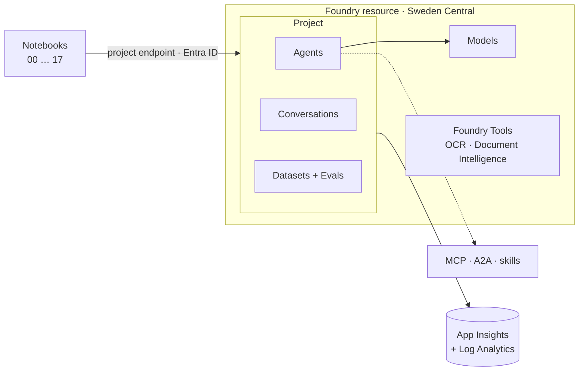

# 🦾 STARK – Microsoft Foundry from 0 to hero

> 🛠️ *"I am Iron Man."* – and every Iron Man started in a garage with one clumsy robot.

> 🚧 **Version 0.2: a young tutorial that still needs improvement.** New since 0.1: chapter 15 on the Microsoft Copilot harness (tested on a live project), skills that run scripts, and a quality pass over every notebook (one experiment per cell, visible prompts, whole answers). Foundry and Microsoft Agent Framework change fast, and several features used here are preview. Every notebook ran against a deployed environment. Parts are marked 🧪 (preview) or ❓ (a detail that can vary or was not checked), and regions, models and preview features differ per subscription. Expect rough edges, and please open an issue or a pull request when something breaks or reads badly. What changed since: [CHANGELOG.md](CHANGELOG.md).

> 💡 **TL;DR:** A **hands-on, story-driven tutorial** for **Microsoft Foundry**. One `azd up` deploys a Foundry project with models, monitoring and role assignments. Numbered notebooks then walk you from a first model call to a team of agents, one concept per chapter, told as the evolution of Tony Stark's AI: **Dummy → J.A.R.V.I.S. → F.R.I.D.A.Y. → Ultron (the warning) → Vision**. **It is a learning repo, not a production template.**

> 📖 **Prefer a story?** Read [The Story of STARK](story.md) first: all 18 chapters as one build log, from Dummy to Vision, with a link to the matching doc in each act.

What you learn, chapter by chapter:

- **Models and conversations**: Responses API, streaming, structured output, stored responses and conversations
- **Monitoring**: OpenTelemetry traces, KQL, the Foundry portal
- **Agents**: from code, from YAML, hosted agents, with built-in tools
- **MCP, A2A and skills** attached to agents. Skills four ways: injected into the instructions by your code, loaded on demand with `SkillsProvider`, served by a toolbox, or referenced by a prompt agent on the harness
- **The Microsoft Copilot harness** 🧪: prompt agents with skills that run their own scripts in a sandbox, a workspace per conversation and a managed loop, deployed with `azd`
- **Datasets and evaluations**: batch, conversation-level and on live traces
- **Beyond LLMs**: OCR, Document Intelligence and Content Understanding through the Foundry resource
- **Workflows** and multi-agent patterns
- **Guardrails and red teaming**

Infrastructure is **Bicep + azd**, custom code is **Python only**.

| This repo is | This repo is not |
|---|---|
| A working end-to-end tutorial you deploy in one command | A hardened landing zone or production template |
| A set of notebooks that each teach one Foundry concept | Cost-optimised: models and Application Insights bill while deployed |
| Honest about preview features (marked 🧪) | A promise that preview APIs stay the same |

**Docs, in reading order.** Start at 1 and read each doc next to its chapter:

| # | Doc | Read it | Chapters |
|---|---|---|---|
| 1 | [Foundry in plain words](docs/concepts.md) | before anything else | all |
| 2 | [Getting started](docs/getting-started.md) | deploy, run chapter 00 | 00 |
| 3 | [How you call a model](docs/models.md) | with chapter 01 | 01 |
| 4 | [How conversations work](docs/conversations.md) | with chapter 02 | 02 |
| 5 | [How Foundry traces and monitors](docs/observability.md) | with chapter 03 | 03 |
| 6 | [What an agent is, and prompt agents](docs/agents.md) | with chapter 04 | 04 |
| 7 | [How agents use tools](docs/tools.md) | with chapter 05 | 05, 06 |
| 8 | [MCP servers and skills](docs/mcp-skills.md) | with chapters 06, 07 | 06, 07 |
| 9 | [Agents as files](docs/agents-yaml.md) | with chapter 08 | 08 |
| 10 | [Hosted agents](docs/hosted-agents.md) | with chapter 09 | 09, 16 |
| 11 | [🧪 Datasets and evaluations](docs/datasets-evals.md) | with chapters 10, 11 | 10, 11 |
| 12 | [Foundry Tools](docs/foundry-tools.md) | with chapters 12, 13 | 12, 13 |
| 13 | [Guardrails, Prompt Shields and red teaming](docs/guardrails.md) | with chapter 14 | 14 |
| 14 | [🧪 Prompt agents on the Microsoft Copilot harness](docs/copilot-harness.md) | with chapter 15 | 07, 15 |
| 15 | [Workflows](docs/workflows.md) | with chapter 16 | 16 |
| 16 | [Agents calling agents: the A2A capstone](docs/capstone.md) | with chapter 17 | 17 |
| – | [Glossary](docs/glossary.md) | when a word is new | any |
| – | [Troubleshooting](docs/troubleshooting.md) | when something fails | any |
| – | [Portal tour](docs/portal-tour.md) | to find your work in the portal | any |
| – | [story.md](story.md) | the chapters as a story | all |

---

## 🗺️ The big picture



---

## 🚀 Deploy with azd

**Prerequisites:** an Azure subscription with quota for the models in [infra/config/stark.json](infra/config/stark.json), [Azure Developer CLI](https://learn.microsoft.com/azure/developer/azure-developer-cli/install-azd), [Azure CLI](https://learn.microsoft.com/cli/azure/install-azure-cli), Python 3.11+.

```bash
python scripts/check_models.py swedencentral   # are my models available? edit stark.json if not
azd auth login && az login
azd extension install microsoft.foundry         # first: azure.yaml uses its azure.ai.* hosts (+ `azd ai agent`); already installed? `azd extension upgrade microsoft.foundry`
azd up                                         # provisions Foundry + monitoring, writes .env
python -m venv .venv && . .venv/bin/activate   # Windows: .venv\Scripts\activate
pip install -r requirements.txt
jupyter lab                                    # or open notebooks in VS Code, start with 00
```

`azd up` also deploys every service in [azure.yaml](azure.yaml): the MCP function `stark-mcp` and the hosted agents `jarvis-hosted`, `jarvis-skills`, `invoice-workflow`, `morning-briefing`. The root `azure.yaml` needs `azure.ai.agents` 1.0.0-beta.22 or later.

**azd commands in the chapters.** Run them from the repo root unless the table says otherwise. "Notebook" means a cell runs it for you with `sh(...)`.

| Chapter | Command | What it does | Who runs it |
|---|---|---|---|
| 08 | `azd ai agent init jarvis-azd --kind prompt --agent-name jarvis-azd --project-id <project resource id> --model gpt-5-6-terra --instructions "You are J.A.R.V.I.S."` | scaffolds a prompt agent the azd way, in an **empty scratch folder** (optional) | you |
| 08 | `azd deploy`, `azd ai agent show`, `azd ai agent invoke` | deploys, inspects and calls that scaffolded agent (same scratch folder) | you |
| 09 | `azd ai agent run` | runs `jarvis-hosted` locally and opens the agent inspector (in `src/jarvis-hosted`, optional) | you |
| 09 | `azd ai agent invoke --local "Status of the arc reactor?"` | calls the local agent | you |
| 09 | `azd deploy jarvis-hosted --no-prompt` | a new version of the hosted agent, skills copied in by the `predeploy` hook | notebook |
| 09 | `azd deploy jarvis-skills --no-prompt` | the same for the agent that loads skills on demand | notebook |
| 09 | `azd ai agent monitor --follow`, `azd ai agent show` | container logs, versions, endpoint | you |
| 13 | `azd env set STARK_ENABLE_CU true && azd provision` | deploys the Content Understanding models (optional, section 3) | you |
| 15 | `azd extension upgrade microsoft.foundry` | `azure.ai.agents` 1.0.0-beta.22 or later for the Copilot harness | you |
| 15 | `python scripts/harness_env.py` | creates the azd environment `stark-harness` in `src/jarvis-harness`, filled from `.env` | notebook |
| 15 | `azd deploy --all --no-prompt` | publishes both skills, then the harness agent. In `src/jarvis-harness`, with `AZD_ALPHA_ENABLE_AGENTS_MANAGED_HARNESS=true` | notebook |
| 15 | `azd ai agent invoke --new-conversation --no-prompt "A suit just started smoking in the hangar. What do I do?"` | calls the deployed harness agent (in `src/jarvis-harness`) | you |
| 16 | `azd deploy invoice-workflow`, `azd deploy morning-briefing` | new versions of the two workflow agents | you |

| When done | Command |
|---|---|
| Remove everything | `azd down --purge` (or `python scripts/teardown.py`). Chapter 17 ends with it |
| Remove the harness agent of chapter 15 only | `azd ai agent delete --force --no-prompt` in `src/jarvis-harness` (the notebook's clean-up deletes it with the SDK) |

> ⚠️ Foundry model names, versions and regions change often. `check_models.py` tells you what your subscription can deploy.

---

## 📓 The chapters

> 📖 Each chapter is also told as part of a story in [story.md](story.md).

| # | Chapter | Status |
|---|---|---|
| 00 | [Setup the workshop](notebooks/00_setup_workshop.ipynb) | ✅ |
| 01 | [Dummy's first call](notebooks/01_dummy_first_call.ipynb) | ✅ |
| 02 | [Conversations](notebooks/02_conversations.ipynb) | ✅ |
| 03 | [Tracing and monitoring](notebooks/03_tracing_and_monitoring.ipynb) | ✅ |
| 04 | [J.A.R.V.I.S., the first agent](notebooks/04_jarvis_prompt_agent.ipynb) | ✅ |
| 05 | [Tools: function, code interpreter, file search, web](notebooks/05_tools_function_and_builtin.ipynb) | ✅ |
| 06 | [MCP tools (public + our own server)](notebooks/06_mcp_tools.ipynb) | ✅ |
| 07 | [Skills 🧪](notebooks/07_agent_skills.ipynb) | ✅ |
| 08 | [Agents from YAML](notebooks/08_agents_from_yaml.ipynb) | ✅ |
| 09 | [Hosted agent: skills in the instructions (`jarvis-hosted`) and on demand (`jarvis-skills`)](notebooks/09_hosted_agent.ipynb) | ✅ |
| 10 | [Datasets and evaluations](notebooks/10_datasets_and_evals.ipynb) | ✅ |
| 11 | [Conversation and trace evaluations 🧪](notebooks/11_conversation_and_trace_evals.ipynb) | ✅ |
| 12 | [OCR and Read (Vision, Document Intelligence)](notebooks/12_senses_ocr_read.ipynb) | ✅ |
| 13 | [Invoices, receipts and Content Understanding](notebooks/13_senses_document_intelligence.ipynb) | ✅ |
| 14 | [Ultron: guardrails and red teaming 🧪](notebooks/14_ultron_guardrails_redteam.ipynb) | ✅ |
| 15 | [The Microsoft Copilot harness: skills with scripts 🧪](notebooks/15_copilot_harness.ipynb) | ✅ |
| 16 | [Workflows (sequential, group chat, handoff, YAML)](notebooks/16_workflows.ipynb) | ✅ |
| 17 | [Vision: A2A capstone 🧪](notebooks/17_vision_a2a_capstone.ipynb) | ✅ |

> ✅ **Run on a live project:** every notebook, 00 to 17, ran in order against an environment deployed with `azd up`, including the hosted agents (`azd deploy`) and the Copilot harness project of chapter 15. The code follows the Microsoft Learn documentation as of 2026-11.
>
> ⚠️ **What can still differ for you:** preview features (skills, toolboxes, trace evaluation, guardrail APIs, the Copilot harness) can change without notice, and regions and models differ per subscription. Model answers and judge scores vary between runs, so an **Expected:** marked ❓ is a likely outcome, not a promise. Open an issue if an SDK call has drifted.
