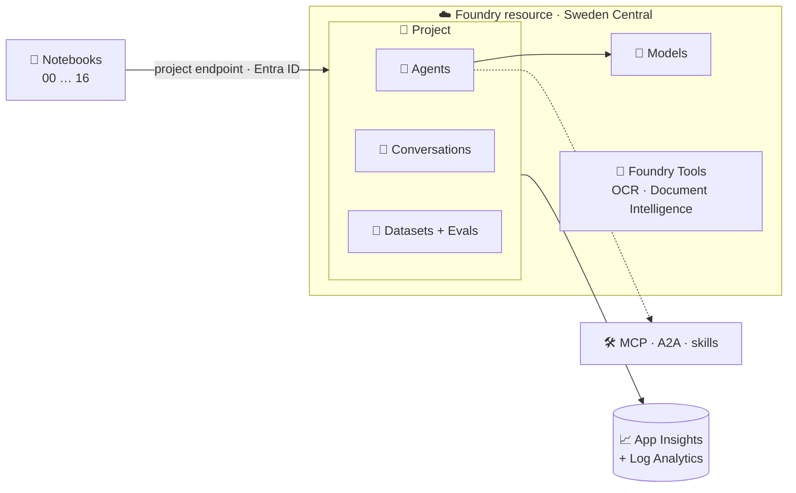

# 🦾 STARK – Microsoft Foundry from 0 to hero

> 🛠️ *"I am Iron Man."* – and every Iron Man started in a garage with one clumsy robot.

> 🚧 **Version 0.1: a first release that still needs improvement.** Foundry and Microsoft Agent Framework change fast, and several features used here are preview. Parts are marked 🧪 (preview) or ❓ (not checked), and some paths were not verified on every subscription (for example the GitHub Copilot harness and web search). Expect rough edges, and please open an issue or a pull request when something breaks or reads badly.

> 💡 **TL;DR:** A **hands-on, story-driven tutorial** for **Microsoft Foundry**. One `azd up` deploys a Foundry project with models, monitoring and role assignments. Numbered notebooks then walk you from a first model call to a team of agents, one concept per chapter, told as the evolution of Tony Stark's AI: **Dummy → J.A.R.V.I.S. → F.R.I.D.A.Y. → Ultron (the warning) → Vision**. **It is a learning repo, not a production template.**

> 📖 **Prefer a story?** Read [The Story of STARK](story.md) first: all 17 chapters as one build log, from Dummy to Vision, with a link to the matching doc in each act.

What you learn, chapter by chapter:

- 💬 **Models and conversations**: Responses API, streaming, structured output, stored responses and conversations
- 📈 **Monitoring**: OpenTelemetry traces, KQL, the Foundry portal
- 🤖 **Agents**: from code, from YAML, hosted agents, with built-in tools
- 🔌 **MCP, A2A and skills** attached to agents
- 🧪 **Datasets and evaluations**: batch, conversation-level and on live traces
- 🔬 **Beyond LLMs**: OCR, Document Intelligence and Content Understanding through the Foundry resource
- 🔀 **Workflows** and multi-agent patterns
- 🛡️ **Guardrails and red teaming**

Infrastructure is **Bicep + azd** 🦾, custom code is **Python only** 🐍.

| 🧪 This repo is | 🚫 This repo is not |
|---|---|
| A working end-to-end tutorial you deploy in one command | A hardened landing zone or production template |
| A set of notebooks that each teach one Foundry concept | Cost-optimised: models and Application Insights bill while deployed |
| Honest about preview features (marked 🧪) | A promise that preview APIs stay the same |

📚 **Docs, in reading order.** Start at 1 and read each doc next to its chapter:

| # | 📖 Doc | 🎯 Read it | 📓 Chapters |
|---|---|---|---|
| 1 | [🧭 Foundry in plain words](docs/concepts.md) | before anything else | all |
| 2 | [🚀 Deploy and make your first call](docs/getting-started.md) | deploy, run chapter 00 | 00 |
| 3 | [🏗️ How Foundry is put together](docs/architecture.md) | after the first call | 00-01 |
| 4 | [💬 How conversations work](docs/conversations.md) | with chapter 02 | 02 |
| 5 | [📈 Tracing and monitoring](docs/observability.md) | with chapter 03 | 03 |
| 6 | [🤖 Prompt agents and hosted agents](docs/agents.md) | with chapter 04 | 04, 09 |
| 7 | [🛠️ How agents use tools](docs/tools.md) | with chapter 05 | 05 |
| 8 | [🔌 MCP, skills and A2A](docs/mcp-a2a-skills.md) | with chapters 06, 07, 16 | 06, 07, 16 |
| 9 | [📄 Agents as files](docs/agents-yaml.md) | with chapter 08 | 08 |
| 10 | [🚢 How a hosted agent gets deployed](docs/hosted-agents.md) | with chapter 09 | 09 |
| 11 | [🧪 Datasets and evaluations](docs/datasets-evals.md) | with chapters 10, 11 | 10, 11 |
| 12 | [🔬 OCR and Document Intelligence](docs/foundry-tools.md) | with chapters 12, 13 | 12, 13 |
| 13 | [🛡️ Guardrails and red teaming](docs/guardrails.md) | with chapter 14 | 14 |
| 14 | [🔀 Workflows](docs/workflows.md) | with chapter 15 | 15 |
| – | [🩺 Troubleshooting](docs/troubleshooting.md) | when something fails | any |
| – | [👀 Portal tour](docs/portal-tour.md) | to find your work in the portal | any |
| – | [📖 story.md](story.md) | the chapters as a story | all |

---

## 🗺️ The big picture



---

## 🚀 Deploy with azd

**Prerequisites:** an Azure subscription with quota for the models in [infra/config/stark.json](infra/config/stark.json), [Azure Developer CLI](https://learn.microsoft.com/azure/developer/azure-developer-cli/install-azd), [Azure CLI](https://learn.microsoft.com/cli/azure/install-azure-cli), Python 3.11+.

```bash
python scripts/check_models.py swedencentral   # are my models available? edit stark.json if not
azd auth login && az login
azd extension install microsoft.foundry         # first: azure.yaml uses its azure.ai.* hosts (+ `azd ai agent`, chapters 08-09)
azd up                                         # provisions Foundry + monitoring, writes .env
python -m venv .venv && . .venv/bin/activate   # Windows: .venv\Scripts\activate
pip install -r requirements.txt
jupyter lab                                    # or open notebooks in VS Code, start with 00
```

| 🧹 When done | 💻 Command |
|---|---|
| Remove everything | `azd down --purge` (or `python scripts/teardown.py`) |

> ⚠️ Foundry model names, versions and regions change often. `check_models.py` tells you what your subscription can deploy.

---

## 📓 The chapters

> 📖 Each chapter is also told as part of a story in [story.md](story.md).

| # | 🎬 Chapter | Status |
|---|---|---|
| 00 | [Setup the workshop](notebooks/00_setup_workshop.ipynb) | ✅ |
| 01 | [Dummy's first call](notebooks/01_dummy_first_call.ipynb) | ✅ |
| 02 | [Conversations](notebooks/02_conversations.ipynb) | ✅ |
| 03 | [Tracing and monitoring](notebooks/03_tracing_and_monitoring.ipynb) | ✅ |
| 04 | [J.A.R.V.I.S., the first agent](notebooks/04_jarvis_prompt_agent.ipynb) | ✅ |
| 05 | [Tools: function, code interpreter, file search, web](notebooks/05_tools_function_and_builtin.ipynb) | ✅ |
| 06 | [MCP tools (public + our own server)](notebooks/06_mcp_tools.ipynb) | ✅ |
| 07 | [Skills 🧪](notebooks/07_agent_skills.ipynb) | ✅ |
| 08 | [Agents from YAML](notebooks/08_agents_from_yaml.ipynb) | ✅ |
| 09 | [Hosted agent](notebooks/09_hosted_agent.ipynb) | ✅ |
| 10 | [Datasets and evaluations](notebooks/10_datasets_and_evals.ipynb) | ✅ |
| 11 | [Conversation and trace evaluations 🧪](notebooks/11_conversation_and_trace_evals.ipynb) | ✅ |
| 12 | [OCR and Read (Vision, Document Intelligence)](notebooks/12_senses_ocr_read.ipynb) | ✅ |
| 13 | [Invoices, receipts and Content Understanding](notebooks/13_senses_document_intelligence.ipynb) | ✅ |
| 14 | [Ultron: guardrails and red teaming 🧪](notebooks/14_ultron_guardrails_redteam.ipynb) | ✅ |
| 15 | [Workflows (sequential, group chat, handoff, YAML)](notebooks/15_workflows.ipynb) | ✅ |
| 16 | [Vision: A2A capstone 🧪](notebooks/16_vision_a2a_capstone.ipynb) | ✅ |

> ⚠️ **Not verified against a live subscription:** hosted agents (`azure.yaml` `azure.ai.*` services) and preview features (skills, toolboxes) are the least certain parts.
>
> ⚠️ **General:** the notebooks and Bicep were written against the current Microsoft Learn documentation and validated statically (Bicep build, notebook syntax). Run them in order and open an issue if an SDK call has drifted.
