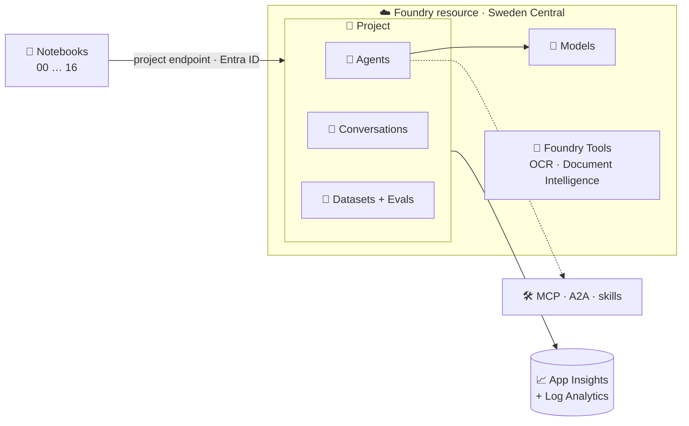

# 🦾 STARK – Microsoft Foundry from 0 to hero

> 🛠️ *"I am Iron Man."* – and every Iron Man started in a garage with one clumsy robot.

> 💡 **TL;DR:** A **hands-on, story-driven tutorial** for **Microsoft Foundry**. One `azd up` deploys a Foundry project with models, monitoring and role assignments. Numbered notebooks then walk you from a first model call to a team of agents, one concept per chapter, told as the evolution of Tony Stark's AI: **Dummy → J.A.R.V.I.S. → F.R.I.D.A.Y. → Ultron (the warning) → Vision**. **It is a learning repo, not a production template.**

What you learn, chapter by chapter:

- 💬 **Models and conversations**: Responses API, streaming, structured output, stored responses and conversations
- 📈 **Monitoring**: OpenTelemetry traces, KQL, the Foundry portal
- 🤖 **Agents**: from code, from YAML, hosted agents, with built-in tools
- 🔌 **MCP, A2A and skills** attached to agents
- 🧪 **Datasets and evaluations**: batch, conversation-level and on live traces
- 🔬 **Beyond LLMs**: OCR, Document Intelligence and Content Understanding through the Foundry resource
- 🔀 **Workflows** and multi-agent patterns
- 🛡️ **Guardrails and red teaming**

Infrastructure is **Bicep + azd** 🦾, custom code is **Python only** 🐍.

| 🧪 This repo is | 🚫 This repo is not |
|---|---|
| A working end-to-end tutorial you deploy in one command | A hardened landing zone or production template |
| A set of notebooks that each teach one Foundry concept | Cost-optimised: models and Application Insights bill while deployed |
| Honest about preview features (marked 🧪) | A promise that preview APIs stay the same |

📚 **Docs:** 🧭 **New here? Start with** [🧭 docs/concepts.md](docs/concepts.md) – Foundry in plain words · [🚀 docs/getting-started.md](docs/getting-started.md) – deploy and first call · [🩺 docs/troubleshooting.md](docs/troubleshooting.md) – common errors · [📖 story.md](story.md) – the chapters as a story · [🏗️ docs/architecture.md](docs/architecture.md) – how Foundry is put together · [💬 docs/conversations.md](docs/conversations.md) – how conversations work · [📈 docs/observability.md](docs/observability.md) – tracing and monitoring · [🤖 docs/agents.md](docs/agents.md) – prompt vs hosted agents and tools · [📄 docs/agents-yaml.md](docs/agents-yaml.md) – agents as files · [🔌 docs/mcp-a2a-skills.md](docs/mcp-a2a-skills.md) – MCP, skills, A2A · [🧪 docs/datasets-evals.md](docs/datasets-evals.md) – datasets and evaluations · [🛡️ docs/guardrails.md](docs/guardrails.md) – guardrails and red teaming · [🔬 docs/foundry-tools.md](docs/foundry-tools.md) – OCR, Document Intelligence, Content Understanding · [🔀 docs/workflows.md](docs/workflows.md) – workflows · [🛠️ docs/tools.md](docs/tools.md) – how agents use tools · [👀 docs/portal-tour.md](docs/portal-tour.md) – what shows up in the Foundry portal

---

## 🗺️ The big picture



---

## 🚀 Deploy with azd

**Prerequisites:** an Azure subscription with quota for the models in [infra/config/stark.json](infra/config/stark.json), [Azure Developer CLI](https://learn.microsoft.com/azure/developer/azure-developer-cli/install-azd), [Azure CLI](https://learn.microsoft.com/cli/azure/install-azure-cli), Python 3.11+.

```bash
python scripts/check_models.py swedencentral   # are my models available? edit stark.json if not
azd auth login && az login
azd up                                         # provisions Foundry + monitoring, writes .env
azd extension install microsoft.foundry         # azure.ai.* hosts + `azd ai agent` (chapters 08-09)
python -m venv .venv && . .venv/bin/activate   # Windows: .venv\Scripts\activate
pip install -r requirements.txt
jupyter lab                                    # or open notebooks in VS Code, start with 00
```

| 🧹 When done | 💻 Command |
|---|---|
| Remove everything | `azd down --purge` (or `python scripts/teardown.py`) |

> ⚠️ Foundry model names, versions and regions change often. `check_models.py` tells you what your subscription can deploy.

---

## 📓 The chapters

| # | 🎬 Chapter | Status |
|---|---|---|
| 00 | [Setup the workshop](notebooks/00_setup_workshop.ipynb) | ✅ |
| 01 | [Dummy's first call](notebooks/01_dummy_first_call.ipynb) | ✅ |
| 02 | [Conversations](notebooks/02_conversations.ipynb) | ✅ |
| 03 | [Tracing and monitoring](notebooks/03_tracing_and_monitoring.ipynb) | ✅ |
| 04 | [J.A.R.V.I.S., the first agent](notebooks/04_jarvis_prompt_agent.ipynb) | ✅ |
| 05 | [Tools: function, code interpreter, file search, web](notebooks/05_tools_function_and_builtin.ipynb) | ✅ |
| 06 | [MCP tools (public + our own server)](notebooks/06_mcp_tools.ipynb) | ✅ |
| 07 | [Skills 🧪](notebooks/07_agent_skills.ipynb) | ✅ |
| 08 | [Agents from YAML](notebooks/08_agents_from_yaml.ipynb) | ✅ |
| 09 | [Hosted agent](notebooks/09_hosted_agent.ipynb) | ✅ |
| 10 | [Datasets and evaluations](notebooks/10_datasets_and_evals.ipynb) | ✅ |
| 11 | [Conversation and trace evaluations 🧪](notebooks/11_conversation_and_trace_evals.ipynb) | ✅ |
| 12 | [OCR and Read (Vision, Document Intelligence)](notebooks/12_senses_ocr_read.ipynb) | ✅ |
| 13 | [Invoices, receipts and Content Understanding](notebooks/13_senses_document_intelligence.ipynb) | ✅ |
| 14 | [Ultron: guardrails and red teaming 🧪](notebooks/14_ultron_guardrails_redteam.ipynb) | ✅ |
| 15 | [Workflows (sequential, group chat, handoff, YAML)](notebooks/15_workflows.ipynb) | ✅ |
| 16 | [Vision: A2A capstone 🧪](notebooks/16_vision_a2a_capstone.ipynb) | ✅ |

> ⚠️ **Not verified against a live subscription:** hosted agents (`azure.yaml` `azure.ai.*` services) and preview features (skills, toolboxes) are the least certain parts.
>
> ⚠️ **General:** the notebooks and Bicep were written against the current Microsoft Learn documentation and validated statically (Bicep build, notebook syntax). Run them in order and open an issue if an SDK call has drifted.
