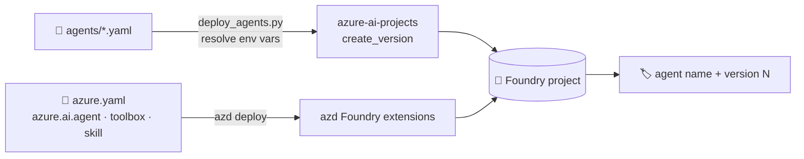

# 📄 Agents as files: YAML, azd and CI

> 💡 **TL;DR:** Keep agent definitions in git. This repo supports two routes: [agents/*.yaml](../agents/jarvis.yaml) deployed by [deploy_agents.py](../scripts/deploy_agents.py) (prompt agents, plain SDK), and azd `azure.yaml` services (`azure.ai.agent`, `azure.ai.toolbox`, `azure.ai.skill`, `azure.ai.connection`). Re-deploying creates a **new version**.

| 📄 Route | 🧰 Command | 🤖 Agent kinds | ✅ Verified here |
|---|---|---|---|
| `agents/*.yaml` | `python scripts/deploy_agents.py` | prompt | YAML parsing, `${VAR}` resolution (dry run) |
| `azure.yaml` services | `azd deploy` | prompt, hosted, voice | ❌ not run against Azure |

Hands-on: [notebooks/08_agents_from_yaml.ipynb](../notebooks/08_agents_from_yaml.ipynb).

---

## 🗺️ The big picture

---

## 1️⃣ Our YAML

| Field | Meaning |
|---|---|
| `name` | agent name; reuse = new version |
| `kind` | `prompt` (only kind this script deploys) |
| `model` | deployment name, e.g. `${STARK_CHAT_MODEL}` |
| `instructions` / `instructions_file` | inline text or a file next to the YAML |
| `tools[]` | `code_interpreter`, `web_search`, `file_search`, `mcp`, `a2a`, `function` |

`${VAR}` comes from `.env`; an unset variable stops the script (so a missing MCP URL never ships silently). `--dry-run` prints the resolved definitions for a pull-request check.

## 2️⃣ azd `azure.yaml`

Each Foundry resource is a **service** with a `host`: `azure.ai.project`, `azure.ai.agent`, `azure.ai.connection`, `azure.ai.toolbox`, `azure.ai.skill`. `uses:` orders them. Connections are applied by `azd provision`; agents, toolboxes and skills by `azd deploy`. Secrets stay in the azd environment (`${VAR}`), never in the file.

The old `agent.yaml` / `agent.manifest.yaml` files are deprecated. See the [azure.yaml reference](https://learn.microsoft.com/azure/foundry/agents/concepts/azure-yaml-reference).

## 3️⃣ In CI

A minimal pipeline: `deploy_agents.py --dry-run` on pull requests, `deploy_agents.py` on merge, then run an evaluation (chapter 10) against the new version before routing traffic to it.
