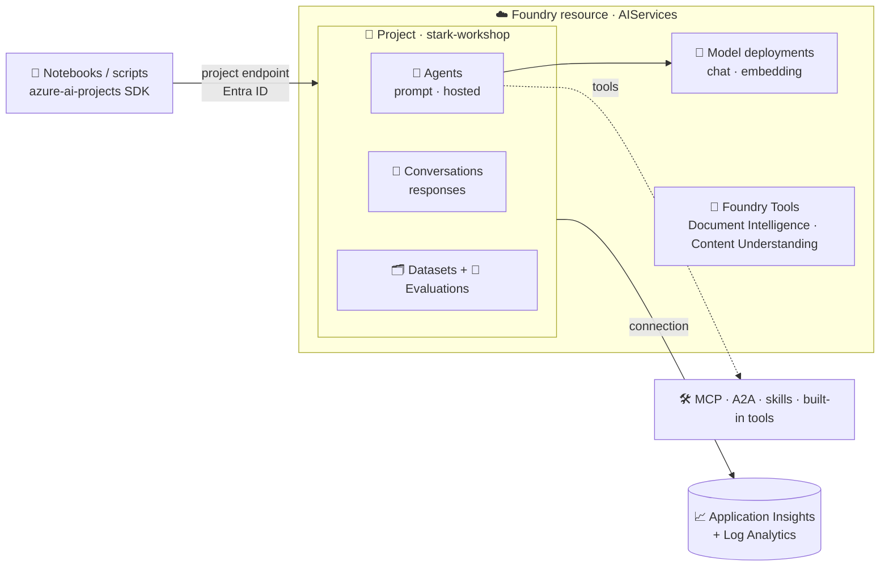

# 🏗️ How Microsoft Foundry is put together

> 💡 **TL;DR:** One **Foundry resource** holds your models and the Foundry Tools. Inside it, a **project** holds your agents, conversations, datasets and evaluations. The SDK needs one thing: the **project endpoint**. Everything else (models, agents, tools) is reached through it with your Entra identity, no keys.

| 🧱 Layer | 🔎 What it holds | 🔑 How you reach it |
|---|---|---|
| ☁️ Foundry resource (`AIServices`) | model deployments, Foundry Tools (Document Intelligence, Content Understanding, Vision) | `STARK_ACCOUNT_ENDPOINT` |
| 📁 Foundry project | agents, conversations, datasets, evaluations, connections | `STARK_PROJECT_ENDPOINT` |
| 🤖 Agent (versioned) | model + instructions + tools, or your own container | `agent_reference` in a response |
| 📈 Application Insights | traces and agent metrics | connection on the project |

> 🧭 New to these terms? [concepts.md](concepts.md) explains them in plain words.

---

## 🗺️ The big picture

---

## 1️⃣ What `azd up` creates

[infra/main.bicep](../infra/main.bicep) deploys these into the resource group `rg-stark-<env>`:

| 🧩 Resource | 📄 Defined in | 🎯 Purpose |
|---|---|---|
| Foundry account + project + deployments | [foundry.bicep](../infra/modules/foundry.bicep) | models and the project |
| Log Analytics + Application Insights | [monitoring.bicep](../infra/modules/monitoring.bicep) | traces, KQL |
| Role assignments for you | [rbac.bicep](../infra/modules/rbac.bicep) | `Azure AI User`, `Cognitive Services User`, `Log Analytics Reader` |

The model list is data, not code: [infra/config/stark.json](../infra/config/stark.json). Model names and versions change often, so run `python scripts/check_models.py <region>` before you deploy.

> ⚠️ **Demo-grade:** public endpoints, one project, no private networking, no customer-managed keys. This is a learning setup, not a landing zone.

---

## 2️⃣ How the notebooks connect

[notebooks/stark_helpers.py](../notebooks/stark_helpers.py) wraps three things:

- `project()` is the `AIProjectClient` (agents, datasets, connections, telemetry).
- `openai_client()` is an OpenAI client bound to the project (responses, conversations, evals, vector stores).
- `kql()` queries Log Analytics.

Authentication is `DefaultAzureCredential`: your `az login` session. The Foundry resource has local (key) auth disabled in [foundry.bicep](../infra/modules/foundry.bicep).

---

## 3️⃣ Where the data lives

Foundry Agent Service is **stateful**. Conversations, responses, files and vector stores persist until you delete them. This tutorial uses the **basic setup**: data sits in a Microsoft-managed store. The **standard setup** keeps it in your own Storage, Cosmos DB and AI Search; it is *not* deployed here.

---

## 🧹 Cleaning up

`azd down --purge` (or `python scripts/teardown.py`) removes everything. Foundry accounts are soft-deleted, so `--purge` frees the name and quota.
