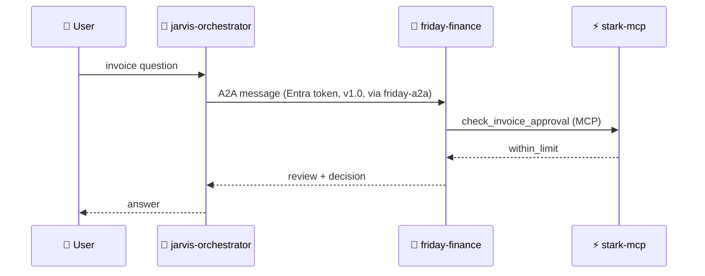
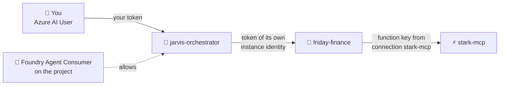

# 🦾 15 · Agents calling agents: the A2A capstone

> 💡 **TL;DR:** **A2A** (*Agent2Agent*) is an open protocol for agents to discover and call each other. In chapter 16 a specialist agent, `friday-finance`, is exposed over A2A. An orchestrator, `jarvis-orchestrator`, calls it with an `A2ATool` through a project connection and its own identity. The system then has to pass an evaluation before you trust it.

| 🧱 Piece | 🔎 What it is | 🏷️ Name here |
|---|---|---|
| 🤖 Specialist | a prompt agent with the invoice-review skill and one MCP tool | `friday-finance` |
| 🪪 Agent card | the A2A discovery document: description and skills | `agentCard/v1.0` |
| 🔑 A2A connection | a project connection that points at the specialist | `friday-a2a` |
| 🛂 Role | lets the caller's identity call the target | *Foundry Agent Consumer* |
| 🧭 Orchestrator | a prompt agent with an `A2ATool` and an `MCPTool` | `jarvis-orchestrator` |
| 🧪 Quality gate | an evaluation of the orchestrator | `capstone` |

Hands-on: [notebooks/16_vision_a2a_capstone.ipynb](../notebooks/16_vision_a2a_capstone.ipynb).

> 🧪 **Preview-adjacent.** Foundry supports A2A **v1.0** (GA) and **v0.3** (preview). The Python surface (`update_details`, `A2ATool`) needs `azure-ai-projects>=2.5.0`, and the connection is created through a preview ARM API version (`2025-04-01-preview`). Not verified against a live subscription.

---

## 🗺️ The big picture



The orchestrator also calls `stark-mcp` directly for suit and workshop facts. Two agents, two identities, one conversation.

---

## 1️⃣ The specialist

`friday-finance` is a normal prompt agent ([agents.md](agents.md)). Its instructions embed the invoice-review checklist with `skill_body("invoice-review")` (direct skill injection, [mcp-skills.md](mcp-skills.md)). Its only tool is `check_invoice_approval` on `stark-mcp`, through the `stark-mcp` connection.

---

## 2️⃣ Expose it over A2A

One call turns on the A2A protocol next to Responses and sets the agent card:

```python
project().agents.update_details(
    agent_name="friday-finance",
    agent_endpoint=AgentEndpointConfig(protocol_configuration=ProtocolConfiguration(
        responses=ResponsesProtocolConfiguration(), a2a=A2AProtocolConfiguration())),
    agent_card=AgentCard(version="1.0", description="...", skills=[AgentCardSkill(...)]),
)
```

The A2A base URL is `<STARK_PROJECT_ENDPOINT>/agents/friday-finance/endpoint/protocols/a2a`.

| ⚡ Limit | 🔎 |
|---|---|
| content | text only |
| transport | JSON-RPC, no streaming |
| target | must speak the Responses protocol (prompt agents do) |

---

## 3️⃣ Authentication and authorization

A2A in Foundry has **no keys** on the incoming side: every call to an agent's A2A endpoint needs an **Entra token** (audience `https://ai.azure.com`), and the identity behind it needs a role that allows calling agents.



Each hop signs in **as someone else**. Your rights do not travel down the chain.

### 🪪 Incoming: who may call an A2A endpoint

| 🧩 | 🔎 Rule |
|---|---|
| Authentication | Entra ID only. Key-based and anonymous access are not supported |
| Authorization | the *Foundry Agent Consumer* role (least privilege: call, not change) on the target **project** (every agent in it) or the target **agent** (only that one) |
| Which identity | the one in the token: the caller agent's `instance_identity`, a service principal, a managed identity, or a user (on-behalf-of). Use its **object (principal) ID** in the role assignment |

### 🔑 Outgoing: how the A2A tool signs in

The `A2ATool` uses a project connection (`category: RemoteA2A`). Its auth type decides whose identity the target sees:

| 🔑 Auth type (azd `--auth-type`) | 👤 Target sees | 🏗️ In this repo |
|---|---|---|
| `agentic-identity` (`AgenticIdentityToken`) | the calling agent | ✅ `friday-a2a`, the recommended choice for a Foundry target |
| `project-managed-identity` | the project's shared identity | ❌ |
| `user-entra-token` | the user who talks to the orchestrator | ❌ |
| `oauth2` | each user, after a one-time consent (OAuth identity passthrough) | ❌ |
| `custom-keys`, `none` | a shared key, or nobody (non-Foundry targets only) | ❌ |

### 🗺️ The three calls in chapter 16

| 📞 Call | 🪪 Signs in as | 🛂 Allowed by |
|---|---|---|
| notebook section 3: `a2a-sdk` | **you** (your `az login` token) | your *Azure AI User* role ([rbac.bicep](../infra/modules/rbac.bicep)) |
| notebook sections 4–5: orchestrator → `friday-finance` | the orchestrator's **instance identity** | *Foundry Agent Consumer*, assigned in the notebook |
| `friday-finance` → `stark-mcp` | the **function key** in connection `stark-mcp` | the key alone ([mcp-skills.md](mcp-skills.md)) |

> ⚠️ A new role assignment can take **up to 10 minutes** to work. A `403` right after the assignment usually means: wait and retry.

Details: [A2A authentication](https://learn.microsoft.com/azure/foundry/agents/concepts/agent-to-agent-authentication) and [Enable incoming A2A](https://learn.microsoft.com/azure/foundry/agents/how-to/enable-agent-to-agent-endpoint).

---

## 4️⃣ Discover and call it from any client

Any A2A client can use the agent, not only Foundry agents:

1. **Discover.** `GET <base>/agentCard/v1.0` with your Entra token for `https://ai.azure.com/.default`.
2. **Call.** The open-source `a2a-sdk` (`A2ACardResolver`, `create_client`) reads `protocolVersion` from the card and sends a message.

> ⚠️ A request that does not name a version gets preview **v0.3**. Use the v1.0 card or the `A2A-Version: 1.0` header.

---

## 5️⃣ Let a Foundry agent call it

| 🧱 Step | 🔧 How |
|---|---|
| Connection | `arm("PUT", .../connections/friday-a2a, ...)` with `category: RemoteA2A`, `authType: AgenticIdentityToken`, `target: <A2A base URL>` |
| Tool | `A2ATool(a2a_version=A2AProtocolVersion.V1_0, project_connection_id=conn.id)` on the orchestrator |
| Role | *Foundry Agent Consumer* for the orchestrator's **instance identity** on the project (section 3) |

The connection holds no secret: the orchestrator signs in as itself. The notebook assigns the role with a fixed role-assignment name (`uuid5`), so a re-run does not create a duplicate.

[`arm()`](../notebooks/stark_helpers.py) calls Azure Resource Manager with your token, for the parts the project SDK does not cover.

---

## 6️⃣ Prove it

The capstone ends like a release: an evaluation of the orchestrator on [capstone-queries.jsonl](../data/capstone-queries.jsonl), with `task_adherence` and a gate of 0.6 ([datasets-evals.md](datasets-evals.md)). Then open **Traces**: the orchestrator's A2A call and Friday's own run show up as separate agent runs ([observability.md](observability.md)).

---

## 🧹 Clean up

The notebook deletes the conversation, the evaluation, both agents, the `friday-a2a` connection and the `stark-capstone` dataset. `azd down --purge` removes the whole workshop.

---

## 🙈 Common mistakes

| 🚨 Mistake | 💥 What happens | ✅ Do this |
|---|---|---|
| calling A2A without version 1.0 | falls back to preview v0.3 | use the v1.0 card or `A2A-Version: 1.0` |
| forgetting the role on the target | `403` | assign *Foundry Agent Consumer* to the caller's identity, wait a minute |
| granting the role to yourself instead of the agent | your test call works, the agent's fails | the **orchestrator's** identity calls the target |
| streaming or files over A2A | not supported | text only, no streaming |
