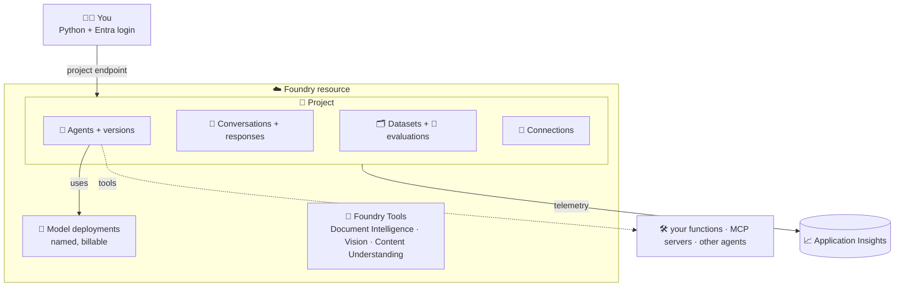
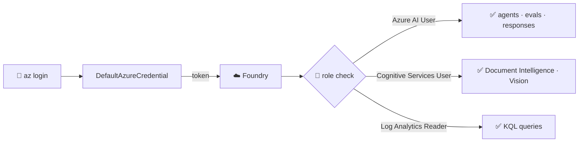

# 🧭 1 · Foundry in plain words: the concepts you need first

> 💡 **TL;DR:** Foundry is **one Azure resource** that hosts **models**, with a **project** inside it that stores your **agents, conversations, datasets and evaluations**. You call it with **one URL** (the project endpoint) and your **Entra identity**. A **model** answers one request and forgets. An **agent** is a saved, versioned setup (model + instructions + tools) that Foundry runs for you. Read this page once, then the notebooks use no word you have not seen.

| ❓ Question | ✅ Short answer |
|---|---|
| What do I deploy? | One Foundry resource, one project, a few model deployments (`azd up`) |
| What do I call from code? | The **project endpoint** (`STARK_PROJECT_ENDPOINT`) |
| How do I log in? | `az login` / `azd auth login`. No API keys exist in this repo |
| Which API do I use? | The **Responses API** (`responses.create`) |
| What is the difference between a model and an agent? | A model is a deployment you call. An agent is a saved definition that *uses* a deployment |
| Where can I see my work? | <https://ai.azure.com> and Application Insights ([portal-tour.md](portal-tour.md)) |

---

## 🗺️ The big picture

---

## 1️⃣ The building blocks

Think of it as a company building. The resource is the building, the project is one office, the deployment is the machine you call.

| 🧱 Block | 🏢 Analogy | 🔎 What it is | 🏷️ Name here |
|---|---|---|---|
| **Foundry resource** | the building | Azure resource `Microsoft.CognitiveServices/accounts`, kind `AIServices`. Owns billing, networking, model deployments, Foundry Tools | `STARK_FOUNDRY_ACCOUNT` |
| **Project** | one office | a workspace inside the resource. Agents, conversations, datasets, evaluations and connections live here | `STARK_FOUNDRY_PROJECT` |
| **Project endpoint** | the office address | `https://<resource>.services.ai.azure.com/api/projects/<project>`. The one URL the SDK needs | `STARK_PROJECT_ENDPOINT` |
| **Account endpoint** | the building's loading dock | `https://<resource>.cognitiveservices.azure.com`. For Foundry Tools (OCR, Document Intelligence) | `STARK_ACCOUNT_ENDPOINT` |
| **Model** | a machine design | `gpt-5.6-terra`, `text-embedding-3-small`, ... | `model` in [stark.json](../infra/config/stark.json) |
| **Deployment** | a machine you switched on | a named, billable instance of a model. **You call the deployment name, not the model name** | `STARK_CHAT_MODEL`, `STARK_JUDGE_MODEL`, ... |
| **Connection** | a key in the safe | a project-level place for credentials of an external service (MCP server, remote agent) | `stark-mcp` (chapter 06) |
| **Application Insights** | the security camera | stores traces and metrics | `STARK_APPINSIGHTS` |

> 💡 **Resource vs project:** the model deployments belong to the **resource**, so every project in it can use them. Agents, conversations and datasets belong to a **project** and are not shared with the other projects.

---

## 2️⃣ Model, response, agent

This is the part most newcomers mix up.

| 🧩 | 🧠 Model call | 🤖 Agent call |
|---|---|---|
| You send | `model="<deployment>"` + `input` | `agent_reference` + `input` |
| Instructions come from | your request (`instructions=...`) | the **agent version** |
| Tools come from | your request | the **agent version** |
| History | you carry it, or use a conversation | a **conversation** (usual) |
| Changes without touching the caller | no | yes: publish a new version |
| Chapters | [01](../notebooks/01_dummy_first_call.ipynb) · [02](../notebooks/02_conversations.ipynb) | [04](../notebooks/04_jarvis_prompt_agent.ipynb) on |

A model **forgets everything** after each call. History is something you add: either you send it again, or Foundry stores it for you ([conversations.md](conversations.md)). An agent is **not a running process** for a prompt agent: it is a stored definition. Foundry loads the definition when a request arrives ([agents.md](agents.md)).

### The words around a request

| 🏷️ Word | 🔎 Meaning |
|---|---|
| **Response** | what one `responses.create` call returns: `output_text`, a list of **output items**, and `usage` (token counts) |
| **Output item** | one piece of the answer: a `message`, a `function_call`, an `mcp_approval_request`, `reasoning`, ... |
| **Conversation** | a durable, ordered list of items that Foundry stores for you |
| **Token** | the unit a model reads and writes (about ¾ of a word in English). Cost is counted in tokens |
| **Instructions** | the system prompt: how the model should behave |
| **Tool** | a capability the model may ask for (function, code interpreter, MCP, ...). See [tools.md](tools.md) |
| **Version** | an immutable snapshot of an agent definition. Re-creating an agent name adds a new version |

---

## 3️⃣ Which API?

Foundry speaks several shapes of OpenAI-style APIs. This repo uses the newest one.

| 🔌 API | 🎯 Use it for | 🧑‍💻 In this repo |
|---|---|---|
| **Responses** | new work: stateful, tools, agents | everywhere (`responses.create`) |
| **Chat Completions** | existing code that sends a `messages` list | shown once in [chapter 01](../notebooks/01_dummy_first_call.ipynb) |
| **Embeddings** | turn text into vectors for search | [chapter 01](../notebooks/01_dummy_first_call.ipynb), via [`embeddings_client()`](../notebooks/stark_helpers.py) (the project route has no `/embeddings`) |

---

## 4️⃣ Identity, roles and secrets

There are **no API keys** in this repo. The resource is created with `disableLocalAuth: true` ([foundry.bicep](../infra/modules/foundry.bicep)), so only Entra ID works.

| 🛂 Role | 🎯 Lets you | 📄 Assigned in |
|---|---|---|
| Azure AI User | use projects, agents, evaluations | [rbac.bicep](../infra/modules/rbac.bicep) |
| Cognitive Services User | call Foundry Tools | [rbac.bicep](../infra/modules/rbac.bicep) |
| Log Analytics Reader | run KQL on the workspace | [rbac.bicep](../infra/modules/rbac.bicep) |

> ⚠️ A role assignment can take a minute or more to work. A `403` right after `azd up` is often just that. See [troubleshooting.md](troubleshooting.md).

Secrets for **other** systems (an MCP key, a remote agent) go into a **project connection**, never into an agent definition or a notebook ([mcp-a2a-skills.md](mcp-a2a-skills.md)).

---

## 5️⃣ The Python packages

| 📦 Package | 🎯 Gives you |
|---|---|
| `azure-ai-projects` | `AIProjectClient`: agents, datasets, connections, telemetry |
| `openai` | the client you get from `project.get_openai_client()`: responses, conversations, evals, vector stores |
| `azure-identity` | `DefaultAzureCredential` |
| `azure-monitor-opentelemetry`, `azure-monitor-query` | send traces, query logs |
| `azure-ai-documentintelligence`, `azure-ai-vision-imageanalysis`, `azure-ai-contentunderstanding` | the Foundry Tools |
| `agent-framework*` | workflows and hosted agents (chapters 09, 15) |
| `mcp`, `a2a-sdk` | talk to MCP servers and A2A agents |

The full list is [requirements.txt](../requirements.txt). The notebooks reach everything through [stark_helpers.py](../notebooks/stark_helpers.py): `project()`, `openai_client()`, `model()`.

---

## 6️⃣ Preview, GA and why the official docs feel confusing

Foundry changes fast, so the official pages mix several generations. Four things help:

| 🧭 You see | 💡 What it means |
|---|---|
| "New Foundry" toggle in the portal | the current experience. This repo uses it. The older "classic" pages describe other APIs |
| "Assistants" / `threads` / `runs` | the **old** agent API. This repo uses Responses + conversations instead |
| "preview" or 🧪 | may change or break. The notebooks mark it |
| the same name in several SDKs | check the package: `azure-ai-projects` (v2) is the one used here |

> 💡 **Rule of thumb:** if a Learn page and the SDK disagree, trust the installed SDK (`pip show azure-ai-projects`) and open an issue here.

---

## 📚 Where to go next

| 🎯 You want to | 📖 Read |
|---|---|
| deploy and run the first notebook | [getting-started.md](getting-started.md) |
| fix an error | [troubleshooting.md](troubleshooting.md) |
| see how the pieces fit | [architecture.md](architecture.md) |
| find things in the portal | [portal-tour.md](portal-tour.md) |
