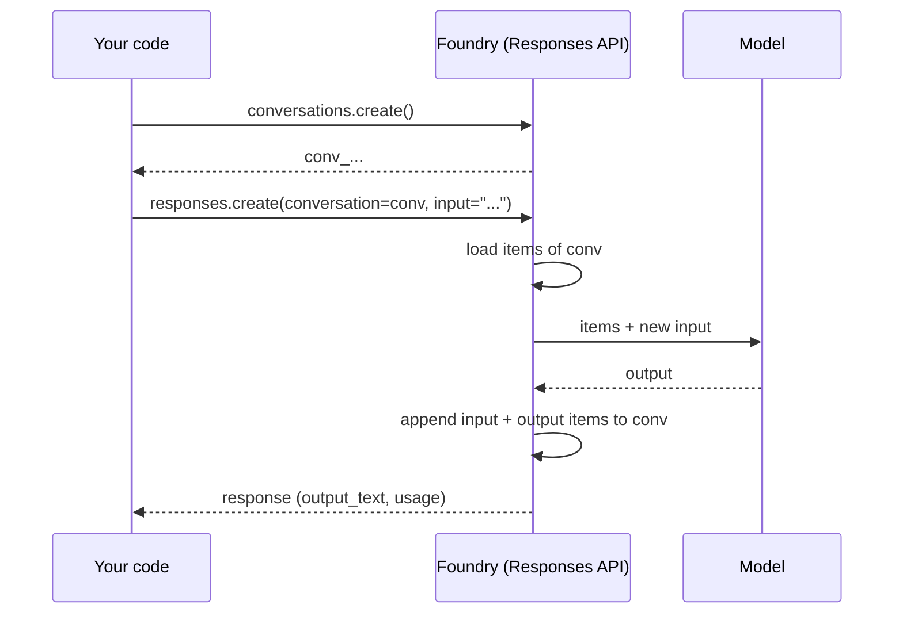

# 💬 4 · How conversations work in Foundry

> 💡 **TL;DR:** Models are **stateless**. Foundry keeps history for you in **stored responses** and **conversations**. Pass `previous_response_id` to chain responses, or `conversation=<id>` to use a durable list of items. Agents always use conversations. Data stays until you delete it.

| Option | You pass | History kept by | Forkable | Use for |
|---|---|---|---|---|
| Manual | message list | your code | n/a | zero retention |
| Response chain | `previous_response_id` | Foundry | ✅ | scripts, quick follow-ups |
| Conversation | `conversation` | Foundry | ❌ (append only) | chat, agents, long sessions |

Hands-on: [notebooks/02_conversations.ipynb](../notebooks/02_conversations.ipynb).

---

## 🗺️ The big picture



---

## 1 · Items

A conversation is an ordered list of **items**: `message`, tool calls, tool results, reasoning. `conversations.items.list(conv_id)` shows them, and so does the portal. You can add items yourself (`conversations.items.create`) to seed context without calling the model.

---

## 2 · Responses

Every `responses.create` stores a **response** (`store=True` by default). Its `usage` field has the token counts. `store=False` makes the call one-shot: not stored, not retrievable, and you carry context yourself.

---

## 3 · Agents and conversations

An agent is referenced per call with `extra_body={"agent_reference": {"name": ..., "type": "agent_reference"}}`, or by binding the client with `get_openai_client(agent_name=...)`. A bound client uses the agent's own endpoint and its own conversations, so create the conversation with the bound client too. The conversation holds the history; the agent version supplies model, instructions and tools. Chapter 04 shows this.

> ℹ️ Hosted agents also have **sessions** (sandbox + files). A session is not a conversation: see [Manage hosted agent sessions](https://learn.microsoft.com/azure/foundry/agents/how-to/manage-hosted-sessions).

---

## 4 · Retention and deletion

Conversations and responses persist until deleted (`conversations.delete`, `responses.delete`). Deleting a conversation removes its items. Where the data lives depends on the setup type: see [concepts.md](concepts.md).

---

## 5 · Finding conversations in monitoring

Each conversation id also appears on traces (`gen_ai.conversation.id`). See [observability.md](observability.md).

---

## 🪜 Walkthrough: give a model a memory

Code from [chapter 02](../notebooks/02_conversations.ipynb). `oai = openai_client()` and `MODEL = model("chat")` come from [stark_helpers.py](../notebooks/stark_helpers.py).

**Step 1. See the problem.** Two separate calls share nothing:

```python
a = oai.responses.create(model=MODEL, input="My suit is the Mark 7. Remember that.")
b = oai.responses.create(model=MODEL, input="Which suit did I just mention?")   # the model has no idea
```

**Step 2. Chain the calls.** Point the second call at the first response:

```python
b = oai.responses.create(model=MODEL, input="Which suit did I just mention?", previous_response_id=a.id)
```

Use the **same** `a.id` twice and you get a fork: two answers that both start from `a`.

**Step 3. Use a conversation for anything longer.** Create it once, pass its id every time:

```python
conv = oai.conversations.create(items=[{"type": "message", "role": "user", "content": "I am Tony Stark."}])
r = oai.responses.create(model=MODEL, conversation=conv.id, input="Which suit is best underwater?")
```

**Step 4. Look inside.** `oai.conversations.items.list(conv.id)` prints every item. Add your own with `oai.conversations.items.create(conv.id, items=[...])`.

**Step 5. Clean up.** `oai.responses.delete(id)` and `oai.conversations.delete(id)`. The chapter keeps a `created` dict so the last cell can delete everything.

> 💡 **Which one do I pick?** Two or three quick follow-ups in a script: `previous_response_id`. A chat, an agent or anything you want to look at later in the portal: a conversation. Nothing stored at all: `store=False`.

---

## 🙈 Common mistakes

| Mistake | What happens | Do this |
|---|---|---|
| expecting the model to remember the last call | it answers "I don't know" | pass `previous_response_id` or `conversation` |
| passing **both** `previous_response_id` and `conversation` | one history wins or the call is rejected 🔎 | choose one |
| using `store=False` and then calling `responses.retrieve` | it fails: nothing was stored | expected. Keep `store=True` when you need to look it up |
| trying to fork a conversation | a conversation is append only | fork with response chains instead |
| forgetting to delete | conversations and responses stay in the project | keep ids and delete them in a clean-up cell |
| mixing a bound client with a plain client | the bound client has its **own** conversations | create the conversation with the client you will use ([chapter 04](../notebooks/04_jarvis_prompt_agent.ipynb)) |
