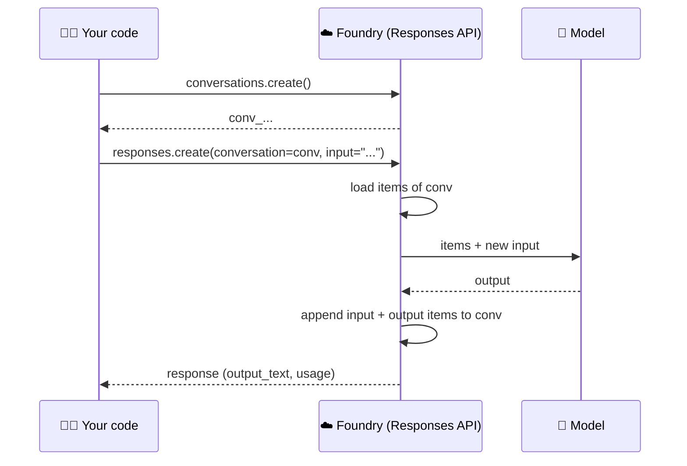

# 💬 How conversations work in Foundry

> 💡 **TL;DR:** Models are **stateless**. Foundry keeps history for you in **stored responses** and **conversations**. Pass `previous_response_id` to chain responses, or `conversation=<id>` to use a durable list of items. Agents always use conversations. Data stays until you delete it.

| 🧠 Option | 🔑 You pass | 🗄️ History kept by | 🌿 Forkable | 🎯 Use for |
|---|---|---|---|---|
| Manual | message list | your code | n/a | zero retention |
| Response chain | `previous_response_id` | Foundry | ✅ | scripts, quick follow-ups |
| Conversation | `conversation` | Foundry | ❌ (append only) | chat, agents, long sessions |

Hands-on: [notebooks/02_conversations.ipynb](../notebooks/02_conversations.ipynb).

---

## 🗺️ The big picture

---

## 1️⃣ Items

A conversation is an ordered list of **items**: `message`, tool calls, tool results, reasoning. `conversations.items.list(conv_id)` shows them, and so does the portal. You can add items yourself (`conversations.items.create`) to seed context without calling the model.

## 2️⃣ Responses

Every `responses.create` stores a **response** (`store=True` by default). Its `usage` field has the token counts. `store=False` makes the call one-shot: not stored, not retrievable, and you carry context yourself.

## 3️⃣ Agents and conversations

An agent is referenced per call with `extra_body={"agent_reference": {"name": ..., "type": "agent_reference"}}`, or by binding the client with `get_openai_client(agent_name=...)`. A bound client uses the agent's own endpoint and its own conversations, so create the conversation with the bound client too. The conversation holds the history; the agent version supplies model, instructions and tools. Chapter 04 shows this.

> ℹ️ Hosted agents also have **sessions** (sandbox + files). A session is not a conversation: see [Manage hosted agent sessions](https://learn.microsoft.com/azure/foundry/agents/how-to/manage-hosted-sessions).

## 4️⃣ Retention and deletion

Conversations and responses persist until deleted (`conversations.delete`, `responses.delete`). Deleting a conversation removes its items. Where the data lives depends on the setup type: see [architecture.md](architecture.md).

## 5️⃣ Finding conversations in monitoring

Each conversation id also appears on traces (`gen_ai.conversation.id`). See [observability.md](observability.md).
