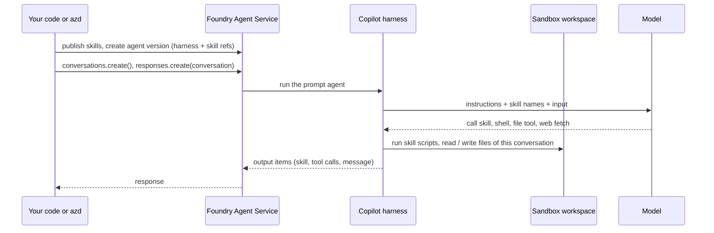

# 🧰 14 · Prompt agents on the Microsoft Copilot harness

> 💡 **TL;DR:** The **Microsoft Copilot harness** 🧪 is a managed runtime for **prompt agents**. Foundry runs the agent loop and a sandbox with a workspace per conversation. You only write configuration: model, instructions, tools and **skills**. Skills attached to a prompt agent only take effect on the harness, and a skill can ship **scripts** that the harness runs with its shell tool. You choose the harness when you create the agent, and every request needs a conversation.

| | Default prompt agent | Prompt agent + harness 🧪 | Hosted agent |
|---|---|---|---|
| You own | the definition | the definition | the code and the loop |
| Skills via `skills=[...]` | ❌ accepted, no effect | ✅ | your code loads them |
| Skill scripts | ❌ | ✅ run with the shell tool | your code runs them |
| Built-in tools | none | file read, file write, shell, web fetch, subagents | what you code |
| Connected tools | Foundry tools, MCP, functions | function tools, `web_search`, toolbox tools (MCP, OpenAPI, ...) | what you code |
| Files between turns | ❌ | ✅ workspace per conversation | sessions |
| Chapter | 04 | 15 | 09 |

Hands-on: [notebooks/15_copilot_harness.ipynb](../notebooks/15_copilot_harness.ipynb). Announcement: [Microsoft Copilot harness in Foundry](https://devblogs.microsoft.com/foundry/microsoft-copilot-harness-in-foundry/).

---

## 🗺️ The big picture



---

## 1 · What you provide

A prompt agent definition with three extra pieces. In Python ([azure-ai-projects](https://pypi.org/project/azure-ai-projects/) 2.9.0 or later, `allow_preview=True`):

| Field | Value | Note |
|---|---|---|
| `harness` | `MicrosoftCopilotHarness()` | type `microsoft_copilot_preview`. Fixed for the life of the agent |
| `skills` | `[SkillReference(name=..., version=...)]` | up to 50. Each agent version pins an immutable skill version |
| `tools` | at most one `MicrosoftCopilotToolsetPreview`, plus connected tools | the toolset switches built-in tools on or off (`filesystem_read`, `filesystem_write`, `shell`, `web`, `subagents`). All on by default. Connected tools keep their own auth, connection and approval settings |

The harness manages its own settings. Leave out `temperature`, `top_p`, `tool_choice`, `text.format` and `text.verbosity`. Unsupported fields return an error instead of being ignored.

The announcement names four building blocks. This is where each one shows up here:

| Building block | What it is | In this repo |
|---|---|---|
| Reusable skills | instructions, scripts and resources in one versioned package | ✅ `stark-escalation`, `invoice-review` with five scripts (section 3) |
| Connected tools | Foundry and MCP tools with explicit auth and approvals | ❌ not used in chapter 15 (see What if) |
| Execution and delegation | files and code in the sandbox, bounded tasks for built-in subagents | ✅ shell and workspace. Subagents switched off |
| Source-controlled definitions | the agent and its skills as files next to your code | ✅ [src/jarvis-harness/azure.yaml](../src/jarvis-harness/azure.yaml) (section 5) |

You can author the same agent in the Foundry portal (**Use the Microsoft Copilot harness** when you create the agent), with `azd`, with the SDK, in Foundry Toolkit for VS Code, or with the Microsoft Foundry plugin in the GitHub Copilot app. This repo uses the SDK (chapter 15) and `azd`.

Chapter 15 zips the repo skill folders [stark-escalation](../skills/stark-escalation/SKILL.md) and [invoice-review](../skills/invoice-review/SKILL.md) and uploads them with `beta.skills.create_from_files` (`SKILL.md` at the root of the zip, scripts and assets included). Then it creates `jarvis-nb15` with both pinned, keeps `shell` on for the scripts and switches off `subagents`.

---

## 2 · How you call it

| Rule | Why |
|---|---|
| every request has a `conversation` | the workspace belongs to the conversation |
| no `previous_response_id`, no `store=False` | not supported on the harness |
| an agent-bound client: `get_openai_client(agent_name=...)` | the pattern of the Microsoft Learn sample |
| no `max_output_tokens`, `parallel_tool_calls`, `truncation`, `service_tier` | the harness manages them |
| delete the conversation, not single responses | `responses.delete` is not supported. Deleting the conversation also ends its harness session |

Text, image and file input over HTTP work. Audio input and WebSocket do not.

---

## 3 · Skills that run scripts

When a request matches a skill, the output contains a `skill` item, then the answer. Chapter 15 checks this with markers, as chapter 07 does: `Severity:` first for `stark-escalation`, a final `APPROVE` / `REJECT` / `NEEDS HUMAN REVIEW` for `invoice-review`.

A skill is a folder, not only text. [invoice-review](../skills/invoice-review/SKILL.md) ships prewritten commands for the checks a model gets wrong. The agent runs them with the **shell** tool in the sandbox and only fills in the arguments:

| Script | Checks | Data |
|---|---|---|
| [check_invoice.py](../skills/invoice-review/scripts/check_invoice.py) | required fields, line sum, subtotal + tax = total, date not in the future | the invoice JSON |
| [vendor_check.py](../skills/invoice-review/scripts/vendor_check.py) | vendor approved, not blocked or unknown | [vendors.csv](../skills/invoice-review/assets/vendors.csv) |
| [iban_check.py](../skills/invoice-review/scripts/iban_check.py) | mod-97 checksum, same IBAN as on file | [vendors.csv](../skills/invoice-review/assets/vendors.csv) |
| [ledger.py](../skills/invoice-review/scripts/ledger.py) | vendor and invoice number not reviewed before | `ledger.csv` in the workspace |
| [approval_limit.py](../skills/invoice-review/scripts/approval_limit.py) | total within the approver's limit | [approval-limits.csv](../skills/invoice-review/assets/approval-limits.csv) |

Every script prints one JSON line and exits with `0` (pass) or `1` (fail). They use only the Python standard library, so nothing is installed in the sandbox. Chapter 15 sends four invoices, each built to trip a different script, and lists which `scripts/*.py` names appear in the output items.

Who does what: the notebook extracts the PDFs with Document Intelligence (`extract_invoice`, your identity) and sends the fields as JSON. The scripts only check. They need no credentials.

> ⚠️ **Not documented: a script using the agent identity.** Foundry uses the agent identity for tools (toolbox, OpenAPI, returned files). Microsoft Learn shows no way for a sandbox script to get a token, so chapter 15 doesn't call Azure services from a script. Never put keys into a skill instead.

The same `SKILL.md` is injected as plain instructions in chapters 16 and 17 and by `jarvis-hosted`. Without shell, it tells the agent to do the arithmetic itself and to say that the vendor, IBAN and duplicate checks were not run.

---

## 4 · The workspace

The **workspace** holds files for one conversation, in a sandbox that Foundry manages. It survives idle and resume, but a new conversation starts empty. It is session state, not storage. Chapter 15 shows it with `ledger.csv`: invoice 4471 is a duplicate in the conversation that reviewed it before, and passes again in a new one.

| You want | Do |
|---|---|
| give the agent a file | add an `input_file` item to the request. The harness stages it in the workspace |
| get a file back | the harness uploads it to Foundry Files with the **agent identity**. Give `instance_identity.principal_id` the **Foundry User** role on the project first. Not done in this repo |
| keep a result | store it in Foundry Files or your own storage |

---

## 5 · Deploy with azd

[src/jarvis-harness/azure.yaml](../src/jarvis-harness/azure.yaml) is the same agent as a file. It reuses the STARK project and provisions nothing.

| Service | Host | Does |
|---|---|---|
| `ai-project` | `azure.ai.project` | points at `STARK_PROJECT_ENDPOINT` |
| `stark-escalation`, `invoice-review` | `azure.ai.skill` | `archive: ./skills/<name>` publishes the folder (scripts and assets included) as a new skill version |
| `jarvis-harness` | `azure.ai.agent`, `kind: prompt` | `harness.type: microsoft_copilot_preview`, `skills:`, `microsoft_copilot_toolset_preview` (shell on, subagents off) |

`skills:` attaches a skill. `uses:` only sets the deploy order (project, then skills, then agent). The `predeploy` hook runs [sync_skills.py](../scripts/sync_skills.py), which copies `skills/` into the folder so `archive` finds each `SKILL.md`.

```bash
azd extension upgrade microsoft.foundry               # azure.ai.agents >= 1.0.0-beta.22
python scripts/harness_env.py                         # azd env `stark-harness`, filled from .env
cd src/jarvis-harness
export AZD_ALPHA_ENABLE_AGENTS_MANAGED_HARNESS=true   # opt-in, per shell
azd deploy --all --no-prompt
azd ai agent show --output json
azd ai agent invoke --new-conversation --no-prompt "A suit just started smoking in the hangar. What do I do?"
```

It is a **separate azd project** with its own azd environment, so the harness opt-in and its deploy stay apart from the root project. Both need `azure.ai.agents` 1.0.0-beta.22 or later: the root [azure.yaml](../azure.yaml) requires `>=1.0.0-beta.22` too, so one extension version serves both. [harness_env.py](../scripts/harness_env.py) copies the project values from `.env` into the new azd environment.

> ❓ The hosted agents of chapters 08, 09 and 16 were deployed with beta.20. They were not redeployed with beta.22 yet.

---

## 6 · Security and limits

- **Shell is the broadest tool.** It can read, write and reach the network by itself, so switching off `filesystem_*` or `web` while shell stays on is not a boundary. Chapter 15 needs shell for the skill scripts and switches off `subagents`. Treat skill scripts as code: review them and pin the skill version. A separately declared shell or `code_interpreter` tool doesn't follow the toolset settings.
- `require_approval` applies to your MCP tools, not to harness tools. The service sets their approval policy during the preview.
- **Network egress controls** 🧪: attach an RAI policy with **Network** rules (`rai_config` in the SDK, `policies:` in `azure.yaml`) to limit where the sandbox may connect. With shell on, this is the real boundary. The invoice-review scripts need no network, so a deny-all policy would fit. Not used in this repo.
- Regions: Australia East, Canada Central, Central US, Germany West Central, Japan East, Sweden Central, UK South, West Europe, West US. Models must support reasoning and tool calling. No bring-your-own model, no Foundry Memory.
- The harness is chosen at creation and can't be switched on an existing agent during the preview. Foundry manages the sandbox's CPU, memory and idle settings.
- Cost: the harness runtime is free until 2026-12-01. From then on, the sandbox costs USD 0.0994 per vCPU-hour and USD 0.0118 per GiB-hour (prices may vary by region and agreement). Model tokens and separately billed tools are charged as before.

Current list: [Copilot harness limits](https://learn.microsoft.com/azure/foundry/agents/concepts/limits-quotas-regions#microsoft-copilot-harness-preview).

> 🧪 **Status in this repo:** the notebook and the `azd` project follow the Microsoft Learn docs as of 2026-11. Chapter 15 was tested on a live project (2026-11-03). It showed that `gpt-5-6-terra` works as a harness model, that shell commands come back as `shell_call` items and the file tools as `function_call` items (for example `view`), and that the workspace is `/home/session/workspace`. ❓ Where the harness places a skill's own files in the sandbox is still not checked.

---

## 🔭 What if (not implemented)

- **Web search and Code Interpreter.** The announcement's example agent declares `- type: web_search` (live results with citations) and `- type: code_interpreter` with `container: { type: auto }` in `tools`. Web search is separate from the harness `web` tool, which only fetches a given URL. Code Interpreter runs behind its own service boundary, not in the harness sandbox.
- **Document Intelligence with the agent identity.** Add an OpenAPI tool for the Document Intelligence REST API (`prebuilt-invoice`: analyze, then get the result) to a toolbox, with managed-identity auth, and give the agent identity **Cognitive Services User** on the account. Then the agent reads the PDF itself and the scripts check it. ❓ Agent-identity auth for OpenAPI tools on the harness was not checked.
- **Toolboxes.** A harness agent can also find skills through a toolbox (`toolboxes:` in `azure.yaml`). The agent identity then needs the **Foundry User** role.
- **Returned files.** Grant the agent identity **Foundry User** and ask for a report file. See the [CSV Chart Analyst sample](https://github.com/microsoft-foundry/foundry-samples/tree/main/samples/cli/prompt-agents/microsoft-copilot-harness/csv-chart-analyst).

Sources: [Use the Microsoft Copilot harness with prompt agents](https://learn.microsoft.com/azure/foundry/agents/how-to/use-tools-skills-copilot-harness), [Introducing the Microsoft Copilot harness in Foundry Agent Service](https://devblogs.microsoft.com/foundry/microsoft-copilot-harness-in-foundry/) (2026-10-28).
