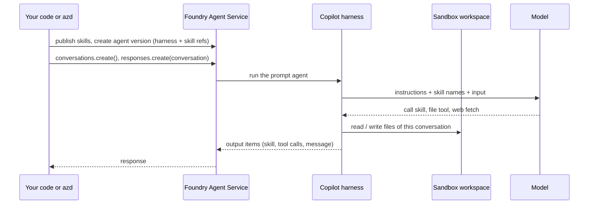

# 🧰 16 · Prompt agents on the Microsoft Copilot harness

> 💡 **TL;DR:** The **Microsoft Copilot harness** 🧪 is a managed runtime for **prompt agents**. Foundry runs the agent loop and a sandbox with a workspace per conversation. You only write configuration: model, instructions, tools and **skills**. Skills attached to a prompt agent only take effect on the harness. You choose the harness when you create the agent, and every request needs a conversation.

| | Default prompt agent | Prompt agent + harness 🧪 | Hosted agent |
|---|---|---|---|
| You own | the definition | the definition | the code and the loop |
| Skills via `skills=[...]` | ❌ accepted, no effect | ✅ | your code loads them |
| Built-in tools | none | file read, file write, shell, web fetch, subagents | what you code |
| Files between turns | ❌ | ✅ workspace per conversation | sessions |
| Chapter | 04 | 07 (section 7), 17 | 09 |

Hands-on: [notebooks/17_copilot_harness.ipynb](../notebooks/17_copilot_harness.ipynb). Announcement: [Microsoft Copilot harness in Foundry](https://devblogs.microsoft.com/foundry/microsoft-copilot-harness-in-foundry/).

---

## 🗺️ The big picture



---

## 1 · What you provide

A prompt agent definition with three extra pieces. In Python ([azure-ai-projects](https://pypi.org/project/azure-ai-projects/) 2.9.0 or later, `allow_preview=True`):

| Field | Value | Note |
|---|---|---|
| `harness` | `MicrosoftCopilotHarness()` | type `microsoft_copilot_preview`. Fixed for the life of the agent |
| `skills` | `[SkillReference(name=..., version=...)]` | up to 50. Each agent version pins an immutable skill version |
| `tools` | at most one `MicrosoftCopilotToolsetPreview` | switches built-in tools on or off (`filesystem_read`, `filesystem_write`, `shell`, `web`, `subagents`). All on by default |

The harness manages its own settings. Leave out `temperature`, `top_p`, `tool_choice`, `text.format` and `text.verbosity`. Unsupported fields return an error instead of being ignored.

> ⚠️ **Renamed.** Earlier SDKs called it the *GitHub Copilot harness* (`GitHubCopilotHarness`, `github_copilot_preview`). Those names are legacy. Use the `MicrosoftCopilot*` classes.

Chapter 17 publishes the repo skills [stark-escalation](../skills/stark-escalation/SKILL.md) and [invoice-review](../skills/invoice-review/SKILL.md) first, then creates `jarvis-nb17` with both pinned, and switches off `shell` and `subagents`.

---

## 2 · How you call it

| Rule | Why |
|---|---|
| every request has a `conversation` | the workspace belongs to the conversation |
| no `previous_response_id`, no `store=False` | not supported on the harness |
| an agent-bound client: `get_openai_client(agent_name=...)` | the pattern of the Microsoft Learn sample |
| no `max_output_tokens`, `parallel_tool_calls`, `truncation`, `service_tier` | the harness manages them |
| delete the conversation, not single responses | `responses.delete` is not supported. Deleting the conversation also ends its harness session |

Text, image and file input over HTTP work. Audio input and WebSocket do not.

---

## 3 · Skills and the workspace

When a request matches a skill, the output contains a `skill` item, then the answer. Chapter 17 checks this with markers, as chapter 07 does: `Severity:` first for `stark-escalation`, a final `APPROVE` / `REJECT` / `NEEDS HUMAN REVIEW` for `invoice-review`.

The **workspace** holds files for one conversation, in a sandbox that Foundry manages. It survives idle and resume, but a new conversation starts empty. It is session state, not storage.

| You want | Do |
|---|---|
| give the agent a file | add an `input_file` item to the request. The harness stages it in the workspace |
| get a file back | the harness uploads it to Foundry Files with the **agent identity**. Give `instance_identity.principal_id` the **Foundry User** role on the project first. Not done in this repo |
| keep a result | store it in Foundry Files or your own storage |

---

## 4 · Deploy with azd

[src/jarvis-harness/azure.yaml](../src/jarvis-harness/azure.yaml) is the same agent as a file. It reuses the STARK project and provisions nothing.

| Service | Host | Does |
|---|---|---|
| `ai-project` | `azure.ai.project` | points at `STARK_PROJECT_ENDPOINT` |
| `stark-escalation`, `invoice-review` | `azure.ai.skill` | `archive: ./skills/<name>` publishes a new skill version |
| `jarvis-harness` | `azure.ai.agent`, `kind: prompt` | `harness.type: microsoft_copilot_preview`, `skills:`, `microsoft_copilot_toolset_preview` |

`skills:` attaches a skill. `uses:` only sets the deploy order (project, then skills, then agent). The `predeploy` hook runs [sync_skills.py](../scripts/sync_skills.py), which copies `skills/` into the folder so `archive` finds each `SKILL.md`.

```bash
azd extension upgrade microsoft.foundry               # azure.ai.agents >= 1.0.0-beta.22
python scripts/harness_env.py                         # azd env `stark-harness`, filled from .env
cd src/jarvis-harness
export AZD_ALPHA_ENABLE_AGENTS_MANAGED_HARNESS=true   # opt-in, per shell
azd deploy --all --no-prompt
azd ai agent show --output json
azd ai agent invoke --new-conversation --no-prompt "A suit just started smoking in the hangar. What do I do?"
```

It is a **separate azd project** for one reason: the harness needs `azd` 1.37.0+ and newer Foundry extensions, while the root [azure.yaml](../azure.yaml) pins `azure.ai.agents` `=1.0.0-beta.20` for the hosted agents. [harness_env.py](../scripts/harness_env.py) copies the project values from `.env` into the new azd environment.

> ⚠️ After the upgrade, the root project may refuse the newer extension. Go back with `azd extension install azure.ai.agents --version 1.0.0-beta.20 --force` before chapters 08, 09 and 15.

---

## 5 · Security and limits

- **Shell is the broadest tool.** It can read, write and reach the network by itself, so switching off `filesystem_*` or `web` while shell stays on is not a boundary. Chapter 17 turns shell off.
- `require_approval` applies to your MCP tools, not to harness tools. The service sets their approval policy during the preview.
- **Network egress controls** 🧪: attach an RAI policy with **Network** rules (`rai_config` in the SDK, `policies:` in `azure.yaml`) to limit where the sandbox may connect. Not used in this repo.
- Regions: Australia East, Canada Central, Central US, Germany West Central, Japan East, Sweden Central, UK South, West Europe, West US. Models must support reasoning and tool calling. No bring-your-own model, no Foundry Memory.
- Cost: the harness runtime is free until 2026-12-01. After that the sandbox is billed per vCPU-hour and GiB-hour, on top of model tokens.

Current list: [Copilot harness limits](https://learn.microsoft.com/azure/foundry/agents/concepts/limits-quotas-regions#microsoft-copilot-harness-preview).

> 🧪 **Status in this repo:** the notebook and the `azd` project follow the Microsoft Learn docs as of 2026-11. ❓ Neither was run on a live project yet, including whether `gpt-5-6-terra` is accepted as a harness model.

---

## 🔭 What if (not implemented)

- **Web search.** Add `- type: web_search` to the agent's `tools` in `azure.yaml` for live web results with citations. It is separate from the harness `web` tool, which only fetches a given URL.
- **Toolboxes.** A harness agent can also find skills through a toolbox (`toolboxes:` in `azure.yaml`). The agent identity then needs the **Foundry User** role.
- **Returned files.** Grant the agent identity **Foundry User** and ask for a report file. See the [CSV Chart Analyst sample](https://github.com/microsoft-foundry/foundry-samples/tree/main/samples/cli/prompt-agents/microsoft-copilot-harness/csv-chart-analyst).

Source: [Use the Microsoft Copilot harness with prompt agents](https://learn.microsoft.com/azure/foundry/agents/how-to/use-tools-skills-copilot-harness).
