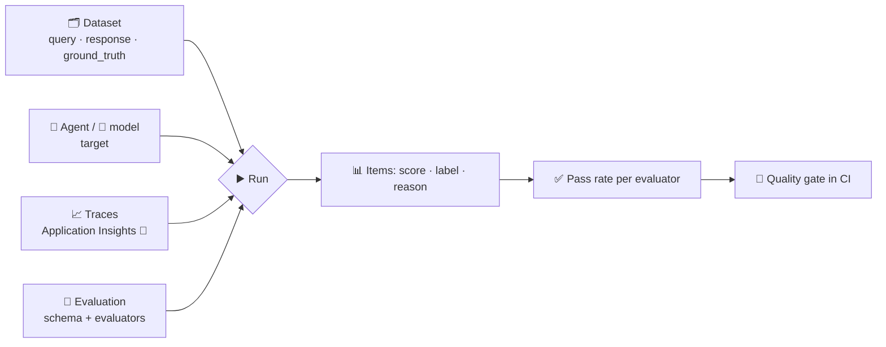

# 🧪 How datasets and evaluations work in Foundry

> 💡 **TL;DR:** A **dataset** is a versioned file of test inputs. An **evaluation** defines *what to score* (data schema + evaluators). A **run** executes it against a **target** (model or agent), saved responses, or live **traces**, and returns per-item scores with reasons plus a pass rate per evaluator. Use the pass rate as a **quality gate** before you ship a new agent version.

| 🧱 Concept | 🔎 What it is | 🧰 SDK |
|---|---|---|
| Dataset | versioned JSONL/CSV in the project | `project.datasets.upload_file(name, version, file_path)` |
| Evaluation | schema + evaluators (`testing_criteria`) | `openai.evals.create(...)` |
| Run | one execution | `openai.evals.runs.create(eval_id, data_source=...)` |
| Output items | scores, labels, reasons | `openai.evals.runs.output_items.list(...)` |

Hands-on: [10 · datasets and evals](../notebooks/10_datasets_and_evals.ipynb) · [11 · conversation and trace evals](../notebooks/11_conversation_and_trace_evals.ipynb).

---

## 🗺️ The big picture

---

## 1️⃣ Data sources

| 📥 Source (`data_source.type`) | You provide | Foundry does |
|---|---|---|
| `azure_ai_target_completions` + `azure_ai_agent` / `azure_ai_model` target | queries | calls the target for every row, then scores the answer |
| `jsonl` | queries **and** responses | scores what you already have |
| `azure_ai_trace_data_source_preview` 🧪 | conversation ids or an agent filter | reads spans from Application Insights, scores conversations |

## 2️⃣ Evaluators

| 🏷️ Family | Examples (`builtin.*`) | Needs a judge model |
|---|---|---|
| Quality | `coherence`, `fluency` | ✅ |
| Agent | `task_adherence`, `intent_resolution`, `tool_call_accuracy`, `task_completion` | ✅ |
| Conversation level | `customer_satisfaction`, `output_quality`, `tool_use_quality` | ✅ |
| Safety | `violence`, `hate_unfairness`, `sexual`, `self_harm` | ❌ (service model) |
| Classic metrics | `f1_score`, `bleu_score`, `rouge_score` | ❌ |

Each result has a **score**, a pass/fail **label** (score vs. threshold) and, for LLM judges, a **reason**. `data_mapping` connects evaluator inputs to dataset fields (`{{item.query}}`) or to the target's output (`{{sample.output_text}}`, `{{sample.output_items}}`).

## 3️⃣ Conversation level

Turn-level scores miss repeated failures and unresolved problems. With `extra_body={"evaluation_level": "conversation"}` the judge reads the whole `messages` array. Dataset example: [data/conversations.jsonl](../data/conversations.jsonl).

## 4️⃣ Quality gates and continuous evaluation

[assert_pass_rate()](../notebooks/stark_helpers.py) raises when a pass rate falls below a threshold: run it in CI after deploying an agent version. For live traffic, schedule a trace run (agent filter) or use the agent's **Monitor** tab to track pass rates over time.

> ⚠️ **Judge cost and bias:** every AI-judged score is a model call. Use a stable judge deployment (`STARK_JUDGE_MODEL`) so scores stay comparable between runs, and read the `reason` field instead of trusting the number blindly.

> ⚠️ **Preview / unverified:** trace evaluation is preview and needs a recent `azure-ai-projects`. The code follows the Microsoft Learn samples; it has not been run against a live subscription.
