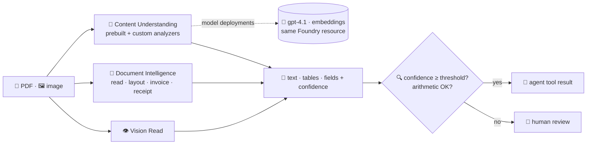

# 🔬 Foundry Tools: OCR, Document Intelligence and Content Understanding

> 💡 **TL;DR:** The Foundry **resource** that hosts your models also hosts **Foundry Tools**: services that are not LLM chat. For text in images use **Vision Read**; for documents use **Document Intelligence** (read, layout, prebuilt models like invoice and receipt); for your **own schema** or messy documents use **Content Understanding** (LLM-powered, needs model deployments). All share one endpoint and Entra ID auth. Wrap them as **agent tools** so a model decides *when* to read a document.

| 🔧 Service | 📦 SDK | 🎯 Output | 🧠 Needs models |
|---|---|---|---|
| Vision Read | `azure-ai-vision-imageanalysis` | lines, words, polygons | ❌ |
| Document Intelligence `prebuilt-read` | `azure-ai-documentintelligence` | text, pages, languages, handwriting | ❌ |
| `prebuilt-layout` | same | text + tables + Markdown | ❌ |
| `prebuilt-invoice`, `prebuilt-receipt`, ... | same | typed fields + confidence | ❌ |
| Content Understanding | `azure-ai-contentunderstanding` | your schema, summaries, Markdown | ✅ (`gpt-4.1`, `gpt-4.1-mini`, `text-embedding-3-large`) |

Hands-on: [12 · OCR and Read](../notebooks/12_senses_ocr_read.ipynb) · [13 · invoices and Content Understanding](../notebooks/13_senses_document_intelligence.ipynb). Helpers: [stark_docs.py](../notebooks/stark_docs.py).

---

## 🗺️ The big picture

---

## 1️⃣ One resource, one endpoint

`STARK_ACCOUNT_ENDPOINT` (`https://<account>.cognitiveservices.azure.com`) serves the Foundry Tools. Auth is Entra ID; the *Cognitive Services User* role is assigned in [rbac.bicep](../infra/modules/rbac.bicep). No keys are created (local auth is disabled in [foundry.bicep](../infra/modules/foundry.bicep)).

## 2️⃣ Which one?

| 📄 Your document | ✅ Start with |
|---|---|
| photo, whiteboard, sign | Vision Read |
| scan or PDF, only text | `prebuilt-read` |
| tables, forms, reading order | `prebuilt-layout` (Markdown for LLMs) |
| invoice, receipt, ID, tax form | the matching prebuilt model |
| varied layouts, inferred or generated fields, summaries, classification, audio/video | Content Understanding |
| complete control of prompts and models | your own LLM call (you own OCR, chunking, grounding) |

## 3️⃣ Confidence and checks

Every extracted field has a `confidence`. Route low values to a human and check arithmetic **in code** (line items vs subtotal): [notebook 13](../notebooks/13_senses_document_intelligence.ipynb) shows both.

## 4️⃣ Content Understanding setup

Analyzers call **your** model deployments. Deploy them with `azd env set STARK_ENABLE_CU true && azd provision` (extra quota needed; off by default) and register them once with `update_defaults`. A **custom analyzer** declares fields with a method: `extract` (literal text), `generate` (model-written) or `classify` (pick from a list).

## 5️⃣ As an agent tool

The agent never sees the PDF bytes; it calls `extract_invoice(path)` and gets typed JSON ([stark_docs.extract_invoice](../notebooks/stark_docs.py)). The same function is used by the workflow in [chapter 15](../notebooks/15_workflows.ipynb).

> ⚠️ **Not verified live:** SDK calls follow the Microsoft Learn samples; the Content Understanding calls (`update_defaults`, `begin_analyze_binary`, analyzer models) are the least certain. Sample documents are fictional and generated by [make_sample_docs.py](../scripts/make_sample_docs.py).
