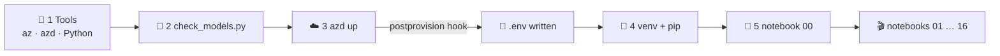
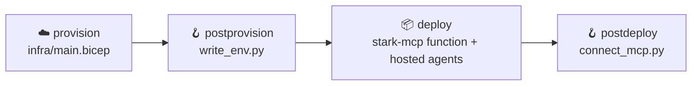

# 🚀 2 · Getting started: from zero to your first Foundry call

> 💡 **TL;DR:** Check your tools, check that your region has the models, run `azd up` (about 10 minutes), install the Python packages, then open notebook `00`. If the smoke test in `00` prints `Workshop online`, your endpoint, identity and model all work. Everything after that is one concept per notebook.

| ⏱️ Step | 💻 What you do | 🎯 What it proves |
|---|---|---|
| 1 | install the tools | your machine is ready |
| 2 | `python scripts/check_models.py` | the models exist in your region |
| 3 | `azd up` | Foundry, monitoring and roles are deployed |
| 4 | `pip install -r requirements.txt` | the notebooks can run |
| 5 | notebook `00` | endpoint + identity + model work |

---

## 🗺️ The big picture



---

## 1️⃣ Prerequisites

| 🧰 You need | 🔎 Why | ✅ Check |
|---|---|---|
| Azure subscription | hosts everything. You need **Owner** (or Contributor + User Access Administrator) because [rbac.bicep](../infra/modules/rbac.bicep) creates role assignments | `az account show` |
| quota for the models | the models in [stark.json](../infra/config/stark.json) are deployed as `GlobalStandard` | step 2 |
| [Azure CLI](https://learn.microsoft.com/cli/azure/install-azure-cli) | login, model listing | `az --version` |
| [Azure Developer CLI](https://learn.microsoft.com/azure/developer/azure-developer-cli/install-azd) `>= 1.36.0` | runs the deployment ([azure.yaml](../azure.yaml) pins this) | `azd version` |
| Python 3.11+ | notebooks and scripts | `python --version` |
| Jupyter or VS Code | opens the notebooks | `jupyter lab` |

> 💡 **What is azd?** `azd` reads [azure.yaml](../azure.yaml), deploys the Bicep in [infra/](../infra/main.bicep), then runs **hooks** (small scripts). Here one hook writes your `.env` file.

---

## 2️⃣ Check the models

Model names, versions and regions change often. Ask Azure before you deploy:

```bash
az login
python scripts/check_models.py swedencentral
```

| 🖨️ Output | 🔧 What to do |
|---|---|
| `OK (version ...)` | nothing |
| `VERSION MISMATCH` | change `version` in [stark.json](../infra/config/stark.json) to one that is listed |
| `NOT FOUND in this region/subscription` | pick another model or region. The `STARK_*_MODEL` names in `.env` come from `stark.json`, so keep `chatModel` and the others in sync |

---

## 3️⃣ Deploy with `azd up`

```bash
azd auth login
azd extension install microsoft.foundry       # first: azure.yaml uses its azure.ai.* hosts (and chapters 08-09 use `azd ai agent`)
azd up                                        # asks for an environment name and region
```

`azd up` does three things in order:



| 🧩 Created | 📄 Defined in | 🎯 Used from chapter |
|---|---|---|
| Foundry resource, project, model deployments | [foundry.bicep](../infra/modules/foundry.bicep) | 00 |
| Log Analytics + Application Insights | [monitoring.bicep](../infra/modules/monitoring.bicep) | 03 |
| Roles for you | [rbac.bicep](../infra/modules/rbac.bicep) | all |
| MCP server (Azure Function) | [mcp-function.bicep](../infra/modules/mcp-function.bicep), [src/stark-mcp](../src/stark-mcp/function_app.py) | 06, 16 |
| `.env` file | [write_env.py](../scripts/write_env.py), template [.env.example](../.env.example) | all |
| Project connection `stark-mcp` | [connect_mcp.py](../scripts/connect_mcp.py) | 06 |

Everything lands in the resource group `rg-stark-<env>`.

> ⚠️ **Hosted agents are the least tested part.** If `azd up` fails in the *deploy* phase on `azure.ai.agent` services, the infrastructure and `.env` are already done. Chapters 00 to 08 still work. See [troubleshooting.md](troubleshooting.md).

### 💰 What it costs

| 💸 Item | 🔎 Billed by |
|---|---|
| Model calls | tokens in and out (`usage` in every response) |
| Application Insights | GB of data ingested |
| Azure Function (MCP) | executions (Flex Consumption) |
| Content Understanding models | only if you set `STARK_ENABLE_CU=true` ([foundry-tools.md](foundry-tools.md)) |

No price list is kept here because prices change. **Remove everything when you are done:** `azd down --purge`.

---

## 4️⃣ Python environment

```bash
python -m venv .venv
. .venv/bin/activate          # Windows: .venv\Scripts\activate
pip install -r requirements.txt
```

Select this `.venv` as the **kernel** in Jupyter or VS Code. A wrong kernel is the most common reason for `ModuleNotFoundError`.

---

## 5️⃣ Run notebook `00`

Open [00_setup_workshop.ipynb](../notebooks/00_setup_workshop.ipynb) and run all cells.

| 🧪 Cell | ✅ Good result |
|---|---|
| `check_env()` | prints your endpoint and model names |
| `az account show` | your user and subscription |
| `deployments.list()` | the three models from `stark.json` |
| smoke test | `Workshop online` |

If a cell fails, look up the message in [troubleshooting.md](troubleshooting.md).

---

## 6️⃣ Pick a path

| 🧑‍💻 You are | 🛤️ Take this path |
|---|---|
| brand new to Foundry | `00` → `01` → `02` → `04` → `05`, then the rest in order |
| here for agents | `04` → `05` → `06` → `08` → `09`. Read [agents.md](agents.md) first |
| here for quality | `04` → `10` → `11`. Read [datasets-evals.md](datasets-evals.md) |
| here for documents | `12` → `13`. Read [foundry-tools.md](foundry-tools.md). No agent needed |
| here for safety | `04` → `05` → `14`. Read [guardrails.md](guardrails.md) |

> 💡 Chapters build on each other only a little, but the agent chapters (04 on) reuse the helpers and settings from 00. Each notebook deletes what it created (agent versions, conversations, datasets) unless the next chapter needs it.

---

## 🧹 When you are done

```bash
azd down --purge
```

Foundry accounts are **soft-deleted**. Without `--purge` the name and the model quota stay reserved for a while.
