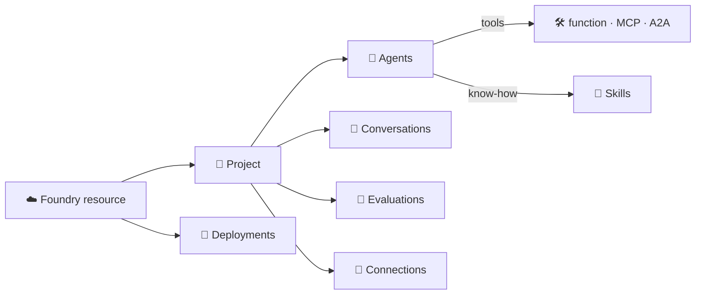

# 📖 Glossary: the words this tutorial uses

> 💡 **TL;DR:** One line per term, A to Z, with the doc that explains it in depth. Each term is used in the notebooks or docs. The first group is the Foundry core, the second is everything around it.

| 🔤 Group | 🎯 Read it when |
|---|---|
| 🧱 Foundry core | a notebook or doc uses a Foundry word you do not know |
| 🧰 Around Foundry | a protocol, a standard or an Azure term comes up |

---

## 🗺️ The big picture

---

## 1️⃣ Foundry core

| 🏷️ Term | 🔎 Meaning | 📖 More |
|---|---|---|
| **Account endpoint** | `https://<resource>.cognitiveservices.azure.com`. For Foundry Tools and embeddings (`STARK_ACCOUNT_ENDPOINT`) | [concepts.md](concepts.md) |
| **Agent** | a named, versioned definition (model + instructions + tools) that Foundry runs, or your code that Foundry hosts | [agents.md](agents.md) |
| **Agent identity / instance identity** | the Entra identities a hosted or prompt agent uses to call other services. Unpublished agents use the shared **project agent identity**, published ones their own **instance identity**. Your roles never carry over | [hosted-agents.md](hosted-agents.md) |
| **`agent_reference`** | the field in a Responses call that says which agent answers. [`agent_ref()`](../notebooks/stark_helpers.py) builds it | [agents.md](agents.md) |
| **Basic vs standard setup** | where Foundry stores agent data. **Basic** (used here): Microsoft-managed storage. **Standard**: your own Storage, Cosmos DB and AI Search. Not deployed here | [concepts.md](concepts.md) |
| **Connection** | a project-level place for the credentials or address of an external service (`stark-mcp`, `friday-a2a`) | [concepts.md](concepts.md) |
| **Conversation** | a durable, ordered list of items that Foundry stores for you | [conversations.md](conversations.md) |
| **Data mapping** | tells an evaluator where its inputs come from: `{{item.query}}`, `{{sample.output_text}}` | [datasets-evals.md](datasets-evals.md) |
| **Dataset** | a named, versioned file of test rows (JSONL) in the project | [datasets-evals.md](datasets-evals.md) |
| **Deployment** | a named, billable instance of a model. You call the deployment name | [concepts.md](concepts.md) |
| **Evaluator** | a scorer: AI-judged (`builtin.coherence`), safety (`builtin.violence`) or a classic metric (`builtin.f1_score`) | [datasets-evals.md](datasets-evals.md) |
| **Foundry resource** | the Azure resource (`Microsoft.CognitiveServices/accounts`, kind `AIServices`) that holds models and Foundry Tools | [concepts.md](concepts.md) |
| **Foundry Tools** | prebuilt services on the same resource: Vision, Document Intelligence, Content Understanding | [foundry-tools.md](foundry-tools.md) |
| **Guardrail (RAI policy)** | a set of content filters and Prompt Shields that Foundry applies to the input and output of a model or agent. RAI = Responsible AI | [guardrails.md](guardrails.md) |
| **Harness (GitHub Copilot harness)** 🧪 | an optional managed runtime for prompt agents. It makes skill references work and brings its own tools. Gated preview | [mcp-skills.md](mcp-skills.md) |
| **Hosted agent** 🧪 | your own code that Foundry runs in a managed container, called like any agent | [hosted-agents.md](hosted-agents.md) |
| **Project** | a workspace inside the resource: agents, conversations, datasets, evaluations, connections | [concepts.md](concepts.md) |
| **Project endpoint** | `https://<resource>.services.ai.azure.com/api/projects/<project>`. The one URL the SDK needs (`STARK_PROJECT_ENDPOINT`) | [concepts.md](concepts.md) |
| **Prompt agent** | an agent that is only configuration: model, instructions, tools | [agents.md](agents.md) |
| **Response** | what one `responses.create` call returns: `output_text`, `output` items, `usage` | [models.md](models.md) |
| **Skill** 🧪 | a versioned `SKILL.md` with a procedure an agent should follow | [mcp-skills.md](mcp-skills.md) |
| **Structured inputs** | `{{placeholders}}` in an agent's instructions, filled per request | [agents.md](agents.md) |
| **Toolbox** 🧪 | a named, versioned bundle of tools and skills behind one MCP endpoint | [mcp-skills.md](mcp-skills.md) |
| **Vector store** | an index of your files that file search reads from. It outlives the agent | [tools.md](tools.md) |
| **Version** | an immutable snapshot of an agent (or skill) definition | [agents.md](agents.md) |

---

## 2️⃣ Around Foundry

| 🏷️ Term | 🔎 Meaning | 📖 More |
|---|---|---|
| **A2A (Agent2Agent)** | an open protocol for agents to discover (agent card) and call each other | [capstone.md](capstone.md) |
| **azd** | the Azure Developer CLI. Reads `azure.yaml`, deploys the Bicep, runs hooks, deploys services | [getting-started.md](getting-started.md) |
| **Entra ID** | Microsoft's identity service. Every call here signs in with it; there are no API keys | [concepts.md](concepts.md) |
| **Flex Consumption** | the Azure Functions hosting plan of `stark-mcp`: scales to zero, billed per execution | [mcp-skills.md](mcp-skills.md) |
| **GenAI semantic conventions** | the OpenTelemetry names for AI spans: `gen_ai.operation.name`, `gen_ai.usage.input_tokens`, ... | [observability.md](observability.md) |
| **GlobalStandard** | the deployment type in [stark.json](../infra/config/stark.json): Azure routes requests to any region with capacity, billed per token | [getting-started.md](getting-started.md) |
| **KQL** | Kusto Query Language, used to query Log Analytics (`kql()` in the helpers) | [observability.md](observability.md) |
| **MCP (Model Context Protocol)** | an open standard for servers that offer tools, resources and prompts to AI clients | [mcp-skills.md](mcp-skills.md) |
| **Microsoft Agent Framework** | Microsoft's open-source Python/.NET library for agents and workflows (`agent-framework*` packages). Used for hosted agents and workflows | [workflows.md](workflows.md) |
| **OpenTelemetry (OTel)** | the open standard for traces and metrics. Foundry and the SDK emit OTel spans | [observability.md](observability.md) |
| **OTLP** | the OpenTelemetry wire protocol. An optional local exporter can use it instead of Application Insights | [observability.md](observability.md) |
| **PowerFx** | the expression language inside declarative YAML workflows (`=System.ConversationId`). Runs on .NET, so chapter 15 section 5 needs a .NET runtime | [workflows.md](workflows.md) |
| **Prompt injection** | text that tries to give the model new instructions. *Indirect* when it hides in a document or tool output | [guardrails.md](guardrails.md) |
| **Token** | the unit a model reads and writes, about ¾ of an English word. You pay per token | [concepts.md](concepts.md) |
