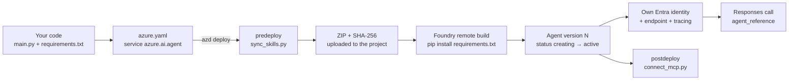
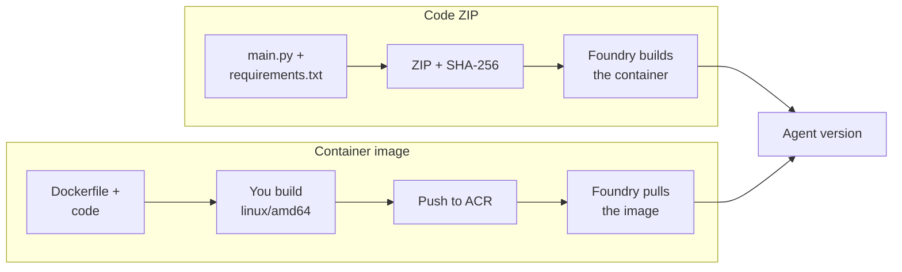

# 🚢 10 · Hosted agents: your code, run by Foundry

> 💡 **TL;DR:** A hosted agent is **your code** that Foundry runs for you. You describe it once in `azure.yaml`, run `azd deploy`, and Foundry packages, builds and starts it as a new **agent version**. The deploy only needs your code and the right roles. There are five ways to ship the same agent; this repo uses the first one. 🧪 Hosted agents are a newer feature.

| Way | What you ship | Docker? | Best for | In this repo |
|---|---|---|---|---|
| 1. `azd` + **code** mode | a ZIP of your source | no | most cases, fastest loop | yes (chapter 09, 15) |
| 2. `azd` + **container** mode | a container image in ACR | yes | own Dockerfile, system packages | no |
| 3. **SDK** or **REST** | ZIP or image, sent by your own code | optional | deploy from an app or custom tooling | no |
| 4. **CI/CD** (`azd pipeline config`) | the same as 1 or 2, run by a pipeline | no | repeatable releases | no |
| 5. **Terraform** (agent as IaC) or **VS Code** | container image digest via AzAPI, or the editor | image: yes | IaC-managed agent definitions | no |

| | Prompt agent ([agents.md](agents.md)) | Hosted agent (this doc) |
|---|---|---|
| You provide | `PromptAgentDefinition` | code + an `azure.yaml` service |
| Created with | `agents.create_version` / [deploy_agents.py](../scripts/deploy_agents.py) | `azd deploy` |
| Logic | the model + tools | anything your code does (Agent Framework, LangGraph, your own) |
| Runs | inside Foundry's agent runtime | in a managed container with its own Entra identity |
| Called with | `agent_reference` in a Responses call | the same |
| Chapter | [04](../notebooks/04_jarvis_prompt_agent.ipynb)–[08](../notebooks/08_agents_from_yaml.ipynb) | [09](../notebooks/09_hosted_agent.ipynb), [15](../notebooks/15_workflows.ipynb) section 6 |

> ✅ **Deployed live:** `invoice-workflow` and `morning-briefing` were deployed with `azd deploy` and called on a live project, with the `azure.ai.agent` services in [azure.yaml](../azure.yaml) as they are. `jarvis-hosted` and `jarvis-skills` use the same format; `jarvis-skills` was not deployed yet. If a newer `azd` rejects a field, run `azd ai agent init --deploy-mode code` in a scratch folder and compare.

---

## 🗺️ The big picture



---

## 1 · What you provide

Three things per agent. Take `jarvis-hosted` as the example.

| Piece | File | Job |
|---|---|---|
| Code | [main.py](../src/jarvis-hosted/main.py) | builds an `Agent` and starts `ResponsesHostServer(agent).run()` |
| Dependencies | [requirements.txt](../src/jarvis-hosted/requirements.txt) | what the remote build installs |
| Service entry | [azure.yaml](../azure.yaml) | tells `azd` how to deploy it |

[jarvis-skills](../src/jarvis-skills/main.py) is the same agent with the skills loaded on demand by Agent Framework's `SkillsProvider` instead of pasted into the instructions ([mcp-skills.md](mcp-skills.md) section 4, chapter 09 section 4).

`ResponsesHostServer` is what makes the container a Foundry agent. It speaks the Responses protocol on port `8088`, so conversations, streaming and tracing work like for prompt agents.

The service entry in [azure.yaml](../azure.yaml), field by field:

| Field | Meaning |
|---|---|
| `host: azure.ai.agent` | use the Foundry agents extension of `azd` |
| `project: src/jarvis-hosted` | the folder that gets zipped |
| `uses: [ai-project]` | deploy into the existing project (`${STARK_PROJECT_ENDPOINT}`), do not create a new one |
| `kind: hosted` | your code, not a prompt definition |
| `protocols: responses 2.0.0` | what the container speaks |
| `codeConfiguration.runtime` | `python_3_13`; the platform base image |
| `codeConfiguration.entryPoint` | the file that starts the host |
| `codeConfiguration.dependencyResolution` | `remote_build` (Foundry installs) or `bundled` (you ship the packages) |
| `env` | your own variables, filled from the `azd` environment |
| `container.resources` | CPU and memory of the sandbox |

> ⚠️ **Check before you rely on it:** the Microsoft Learn example writes `entryPoint` as a list (`[python, main.py]`). This repo writes it as a string (`main.py`), and that deployed fine for `invoice-workflow` and `morning-briefing`. If a newer `azd` rejects it, compare with the output of `azd ai agent init --deploy-mode code`.

---

## 2 · What `azd deploy` does, step by step

1. **`predeploy` hook.** [sync_skills.py](../scripts/sync_skills.py) copies `skills/` into `src/jarvis-hosted`, `src/jarvis-skills` and `src/invoice-workflow`, and the sample invoices into `src/invoice-workflow/data/docs`. The ZIP only contains the service folder, so everything the agent reads at runtime must be inside it first.
2. **Package and upload.** The `azure.ai.agents` extension zips the folder, computes the SHA-256 and uploads it. The ZIP limit is 250 MB.
3. **Remote build.** Foundry reads `requirements.txt`, installs it on the platform runtime image and builds the container. No Docker on your machine.
4. **New agent version.** The version moves `creating` → `active`. `azd` waits for `active`. A new version is only created when the ZIP or the definition changed.
5. **Identity and endpoint.** The platform creates an Entra identity for the agent, and a dedicated endpoint. It injects `FOUNDRY_PROJECT_ENDPOINT`, `FOUNDRY_AGENT_NAME`, `FOUNDRY_AGENT_VERSION` and `APPLICATIONINSIGHTS_CONNECTION_STRING`.
6. **`postdeploy` hook.** [connect_mcp.py](../scripts/connect_mcp.py) creates the project connection `stark-mcp`.

> 💡 **The hooks are not the deployment.** Steps 2 to 5 are done by the `azd` Foundry extension from `azure.yaml` alone. The two hooks (steps 1 and 6) are optional helpers this repo adds. A minimal agent needs only its code and the `azure.yaml` service entry.

> 🚫 Don't redeclare the `FOUNDRY_*` variables in `env`. The prefix is reserved. Only add your own, such as `MODEL_DEPLOYMENT_NAME`.

---

## 3 · Roles: who may deploy, who runs

Two different identities, two different problems.

| Identity | Needs | How it is granted here |
|---|---|---|
| **You**, to deploy | *Foundry Project Manager* on the project | [grant_hosted_role.py](../scripts/grant_hosted_role.py) |
| **The agent**, to call other Azure resources | e.g. *Cognitive Services User* on the Foundry resource | [grant_agent_role.py](../scripts/grant_agent_role.py) |

The deployed agent does **not** run as you. Your own roles do not carry over, so a call to Document Intelligence fails with `PermissionDenied` until you grant the role. `grant_agent_role.py` grants it to two identities:

- the **shared project agent identity**, used while the agent is unpublished
- the agent's **instance identity**, used once it is published

Run it after the first deploy, then wait a minute or two:

```bash
python scripts/grant_agent_role.py invoice-workflow
```

---

## 4 · Run, deploy, call, watch

| Step | ⌨Command |
|---|---|
| Run locally (inspector opens) | `azd ai agent run` |
| Call the local run | `azd ai agent invoke --local "hello"` |
| Deploy one agent | `azd deploy jarvis-hosted` |
| Deploy everything | `azd deploy` (or `azd up`) |
| Call the deployed agent | `azd ai agent invoke "hello"` |
| Inspect versions and endpoint | `azd ai agent show` |
| Follow container logs | `azd ai agent monitor --follow` |

From code, a deployed hosted agent is called like any agent: `agent_reference` in a Responses call. See [09_hosted_agent.ipynb](../notebooks/09_hosted_agent.ipynb).

---

## 5 · Code ZIP or container image?

Foundry accepts your agent in two forms. The agent behaves the same once it runs. What differs is **who builds the container**.



| | Code ZIP | Container image |
|---|---|---|
| Who builds the container | Foundry | you |
| What you upload | a ZIP of the source (max 250 MB) | an image in Azure Container Registry |
| Docker on your machine | not needed | needed to build (and for `azd ai agent run` in container mode) |
| Container registry | not needed | needed; the project identity must be able to pull from it |
| Languages | Python (`python_3_13`, `python_3_14`) and .NET (`dotnet_10`) | anything that fits the runtime contract |
| Base image and system packages | the platform runtime image, no changes | whatever your Dockerfile says |
| Dependencies | `remote_build`: Foundry installs `requirements.txt`; `bundled`: you ship prebuilt Linux packages | baked into the image |
| Definition field | `code_configuration` (`codeConfiguration` in `azure.yaml`) | `container_configuration.image` |
| Versioning | new version when the ZIP hash or definition changes | new version when you point at a new image; use unique tags or a digest, not `:latest` |
| Verify what runs | download the deployed ZIP and compare the SHA-256 | inspect the image in the registry |
| Roles on top of Foundry Project Manager | none | push to ACR (*Container Registry Repository Writer* or *AcrPush*) and pull for the project identity (*Container Registry Repository Reader*) |
| SDK / REST | `create_version_from_code`, multipart upload (`azure-ai-projects` 2.2.0 or later) | `container_configuration.image` (2.3.0 or later) |
| Terraform | not supported | supported (AzAPI) |
| `azd` mode | `--deploy-mode code`, the default for Python and .NET | `--deploy-mode container` |
| Typical failure | wrong ZIP layout, `ModuleNotFoundError`, a failed `pip` | wrong platform (not `linux/amd64`), registry pull permissions |

**What stays the same:** the agent version and its `creating` → `active` states, the Entra identity, the endpoint, the injected `FOUNDRY_*` variables, the Responses protocol, tracing, and how you call it.

> ⚠️ **Mutually exclusive:** one version uses `code_configuration` *or* `container_configuration`, never both. Code-only operations such as downloading the ZIP return `409 AgentNotCodeBased` for an image-based agent.

**ZIP rules that bite:**
- The ZIP must be **flat**: `main.py` at the root, no wrapper folder.
- `bundled` needs extracted modules in `packages/`, not `.whl` files, and Linux binaries only. Build them with `pip install --target packages --platform manylinux2014_x86_64 --only-binary=:all:`.
- With a private virtual network, allow outbound access to `mcr.microsoft.com` and `*.login.microsoft.com`.

**Image rules that bite:**
- Build for `linux/amd64`, also on Apple Silicon and Arm Windows (cross-platform emulation).
- Permission to push does not give Foundry permission to pull. Grant both.
- The container must meet the hosted-agent runtime contract and container protocol 2.0.0.
- A private registry outside the project's own works through a project connection (`--registry-connection`).

| If you... | Use |
|---|---|
| write plain Python or .NET and want the fastest loop | ZIP (this repo) |
| need system packages, a custom base image or another language | image |
| deploy with Terraform | image |
| want no registry to manage | ZIP |

---

## 6 · Other ways to deploy (reference only)

Everything below ends the same way: an agent version that goes `creating` → `active`. These ways are **documented by Microsoft but not used or tested in this repo**.

### `azd` with container mode

You bring a Dockerfile. `azd` builds the image, pushes it to Azure Container Registry and registers it as a version.

```bash
azd ai agent init -t <path-or-url-to-azure.yaml> --src . --deploy-mode container
```

Use it when you need system packages or full control of the runtime image. Docker must run locally. `azure.yaml` then uses `container` settings instead of `codeConfiguration`. The two are mutually exclusive on one version. You can also point at a prebuilt image in a private registry (`--image`, `--registry-connection`).

### Python SDK, .NET SDK, JavaScript SDK or REST

For deploying from your own app, a script or a CD system. Code mode needs `azure-ai-projects` 2.2.0 or later.

```python
created = project.agents.create_version_from_code(
    agent_name="my-code-agent",
    definition=HostedAgentDefinition(
        cpu="1", memory="2Gi",
        code_configuration=CodeConfiguration(
            runtime="python_3_13",
            entry_point=["python", "main.py"],
            dependency_resolution="remote_build",
        ),
        protocol_versions=[ProtocolVersionRecord(protocol="responses", version="2.0.0")],
    ),
    code=(zip_path.name, zip_bytes, "application/zip"),
    code_zip_sha256=sha256_hex,
)
```

Then poll `get_version` until `status == "active"`. A `failed` version has an `error` object with the pip or NuGet message. With REST you send a multipart request (`metadata` + `code`) with the header `x-ms-code-zip-sha256`. For a container image the SDK takes `container_configuration.image` (2.3.0 or later) and the project identity needs *Container Registry Repository Reader* on the registry.

### CI/CD with GitHub Actions or Azure DevOps

```bash
azd pipeline config
```

This creates a service principal with federated credentials, sets the repository variables and writes a workflow that runs `azd provision --no-prompt` and `azd deploy --no-prompt` on every push to `main`. The runner must install the extension (`azd ext install microsoft.foundry`). Use `--no-prompt` in every `azd ai` step. For gated releases, validate the new version before you promote it, because the endpoint follows the latest version by default.

### Foundry Toolkit for VS Code

The same choice (code ZIP or container) from the editor. It packages, uploads and polls for you, like `azd`.

> 🏗️ Terraform and Bicep are covered in the next section: only Terraform can deploy the agent itself.

---

## 7 · Infrastructure as code (reference only)

| Tool | Can it deploy the hosted agent? |
|---|---|
| **Terraform** (AzAPI) | ✅ yes, but only a **container image** |
| **Bicep** | ❌ no. A hosted agent is not an Azure Resource Manager resource; it lives on the Foundry project data plane. Bicep can only create the platform (account, project, models). Use `azd deploy` or the Python SDK for the agent (sections 2 and 6). |

### Terraform

Terraform can deploy the hosted agent into an existing Foundry project, with the AzAPI provider. It works only for a **container image** (pinned by digest), not for a code ZIP. This is the resource, from Microsoft Learn:

```terraform
resource "azapi_data_plane_resource" "hosted_agent" {
  type      = "Microsoft.Foundry/agents@v1"
  name      = var.agent_name
  parent_id = trimprefix(trimsuffix(var.project_endpoint, "/"), "https://")

  body = {
    name = var.agent_name
    definition = {
      kind = "hosted"
      container_configuration = { image = var.image_uri }   # <registry>/<repo>@sha256:<digest>
      cpu    = "0.5"
      memory = "1Gi"
      protocol_versions = [{ protocol = "responses", version = "2.0.0" }]
      environment_variables = {
        AZURE_AI_MODEL_DEPLOYMENT_NAME = var.model_deployment_name
      }
      rai_config = { rai_policy_name = var.rai_policy_id }  # full ARM ID of a guardrail policy
    }
  }

  response_export_values = ["versions.latest.version"]
}
```

Things that surprise people:

- `parent_id` is the **project endpoint** without `https://`, not the project's ARM ID.
- `rai_policy_name` takes the **full ARM resource ID** of an existing guardrail (RAI) policy, despite its name.
- This is the Foundry REST schema, not the `azure.yaml` schema.
- Terraform manages the **named agent**, not each version. A changed definition creates a new version.
- A finished `apply` does not prove the version is `active`. Check the version status separately.
- Needs Terraform 1.4+ and AzAPI 2.9.0+.

> ⚠️ **Reference only:** this repo does not use it. The resource comes from [Deploy a hosted agent with Terraform](https://learn.microsoft.com/azure/foundry/agents/how-to/deploy-hosted-agent-terraform), which also has the providers, variables, readiness check and CI setup.

---

## 8 · Pick one

| Situation | Choose |
|---|---|
| Python or .NET agent, no special system needs | `azd` + code mode (this repo) |
| Own Dockerfile, native libraries | `azd` + container mode |
| A platform app deploys agents for users | SDK or REST |
| Releases should be automatic and reviewed | CI/CD on top of either `azd` mode |
| Agent definition must live in IaC | Terraform + container image |

> 💡 **Dependencies:** start with `remote_build`. Switch to `bundled` (prebuilt Linux packages in `packages/`) if a version stays in `creating` for more than ten minutes, or if a dependency is private. Wrong layouts are the usual failure: the ZIP must be flat (no wrapper folder), with extracted modules and Linux binaries only.

---

## 📚 Sources

Microsoft Learn, checked in October 2026. Foundry moves fast, so recheck before you rely on a flag.

- [Deploy a hosted agent from source code](https://learn.microsoft.com/azure/foundry/agents/how-to/deploy-hosted-agent-code)
- [Deploy a hosted agent (container, SDK, REST)](https://learn.microsoft.com/azure/foundry/agents/how-to/deploy-hosted-agent)
- [Set up CI/CD for hosted agents with azd](https://learn.microsoft.com/azure/foundry/agents/how-to/set-up-ci-cd-cli)
- [Deploy a hosted agent with Terraform](https://learn.microsoft.com/azure/foundry/agents/how-to/deploy-hosted-agent-terraform)
- [Hosted agent infrastructure with azd (Bicep, Terraform)](https://learn.microsoft.com/azure/foundry/agents/concepts/cli-infrastructure)
- [Quickstart: deploy your first hosted agent](https://learn.microsoft.com/azure/foundry/agents/quickstarts/quickstart-hosted-agent)
