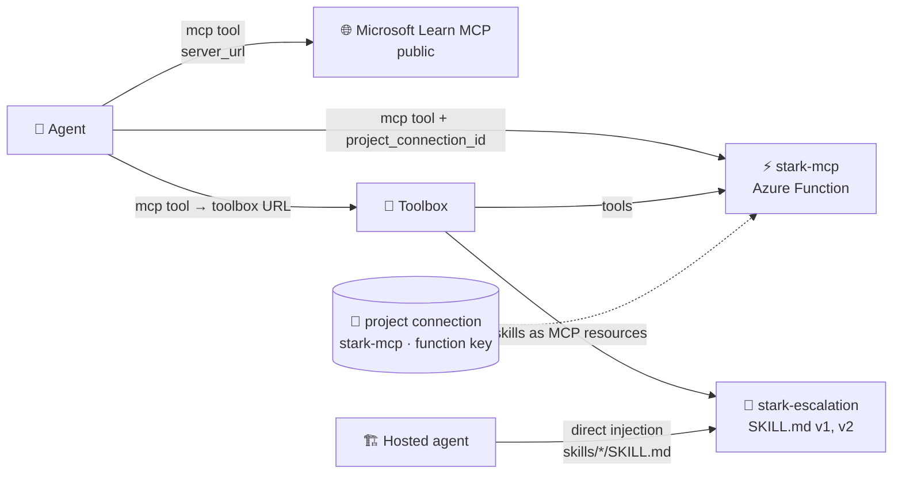
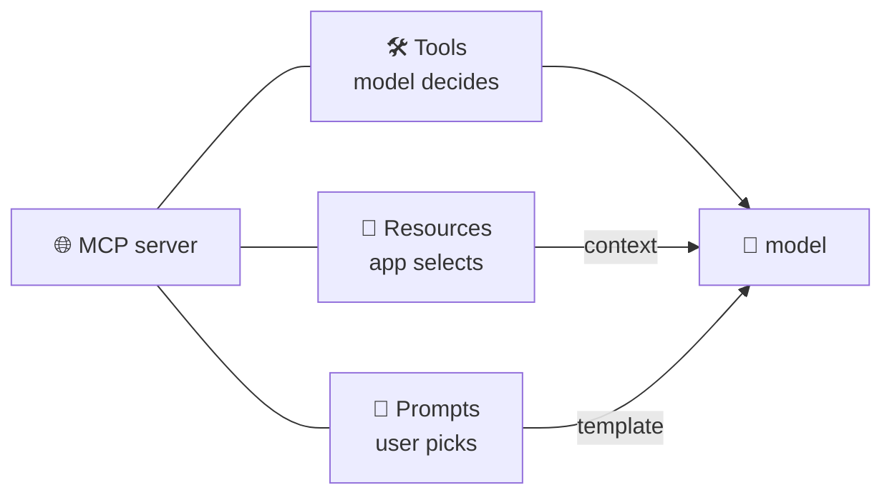
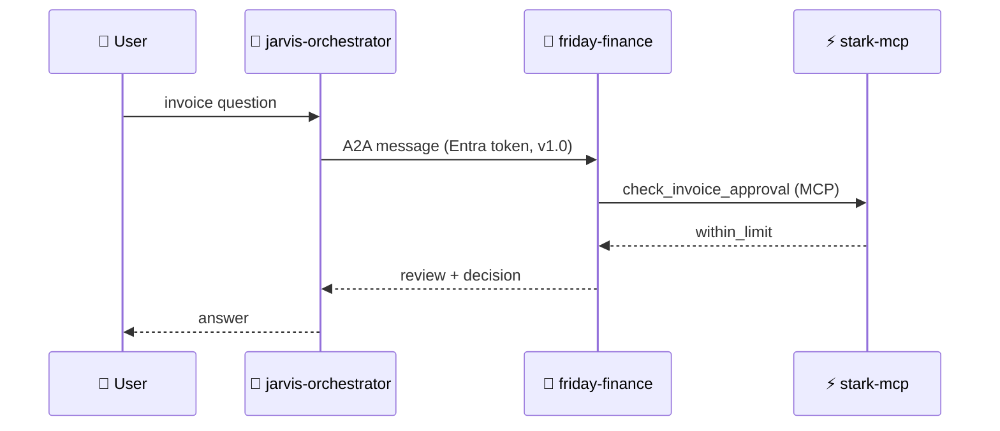

# 🔌 8 · MCP, skills and A2A on Foundry agents

> 💡 **TL;DR:** **MCP** is a protocol where a server offers three kinds of things: *tools*, *resources* and *prompts*. A Foundry agent uses an MCP server for its *tools*. **Skills** give an agent *procedures* from a versioned `SKILL.md`. **A2A** lets an agent call *another agent* (chapter 16). Secrets live in **project connections**, never in the agent definition.

| 🔌 | 🎯 Gives the agent | 📦 Lives in | 🧪 Status |
|---|---|---|---|
| MCP | tools (functions with schemas) | remote MCP server + optional project connection | GA tool; toolboxes preview |
| Skills | instructions / know-how | Foundry Skills API (versioned) | 🧪 preview |
| Toolbox | one MCP endpoint for tools **and** skills | Foundry toolbox (versioned) | 🧪 preview |
| A2A | another agent as a tool | project connection to the remote agent | A2A v1.0 GA; SDK surface newer |

Hands-on: [06 MCP](../notebooks/06_mcp_tools.ipynb) · [07 skills](../notebooks/07_agent_skills.ipynb) · [16 A2A](../notebooks/16_vision_a2a_capstone.ipynb).

---

## 🗺️ The big picture

---

## 1️⃣ The three MCP primitives

An MCP server can offer three kinds of building blocks. Each has a different **controller**, which decides who triggers it:

| 🧩 Primitive | 🎯 What it is | 🎮 Controlled by | 📡 Methods | 🔎 Here |
|---|---|---|---|---|
| **Tools** | functions the model can call, with a JSON schema | the **model** (you approve) | `tools/list`, `tools/call` | [chapter 06](../notebooks/06_mcp_tools.ipynb): Microsoft Learn and `stark-mcp` |
| **Resources** | read-only data with a URI: files, schemas, documents | the **application** | `resources/list`, `resources/templates/list`, `resources/read` | [chapter 07](../notebooks/07_agent_skills.ipynb): a toolbox serves skills as resources |
| **Prompts** | reusable instruction templates with arguments, like slash commands | the **user** | `prompts/list`, `prompts/get` | ❌ not used in this tutorial |

A server says which primitives it supports when a client connects (its **capabilities**), and the client lists each one before using it.

### What a Foundry agent does with them

| 🔌 Primitive | 📋 Status here |
|---|---|
| Tools | ✅ `MCPTool` on a prompt agent: the model calls them, with `allowed_tools` and approvals ([tools.md](tools.md)) |
| Resources | ✅ for **MCP clients** of a toolbox: skills appear in `resources/list` (section 4, Skills). ❓ Whether an agent's `MCPTool` exposes a server's resources to the model is **not documented** in the MCP tool article and was **not tested** |
| Prompts | ❓ same: not documented for agents, not tested, and the Learn MCP server and `stark-mcp` offer none |

> ℹ️ The Microsoft Learn MCP server **declares** the resources and prompts capabilities, but its lists were empty when checked (0 resources, 0 prompts). Declaring a capability does not mean the server fills it.

---

## 2️⃣ MCP in an agent

`MCPTool(server_label, server_url, allowed_tools, require_approval, project_connection_id)`. The model sees the server's tool list (filtered by `allowed_tools`) and decides when to call. See [agents.md](agents.md) for the approval loop.

| 🛡️ Practice | Why |
|---|---|
| `allowed_tools` allow-list | smaller attack surface, fewer wrong tool picks |
| `require_approval="always"` for writes | a human sees tool and arguments first |
| connection for credentials | the agent definition (and its traces) carry no secrets |
| treat results as untrusted | indirect prompt injection (chapter 14) |

## 3️⃣ Our MCP server

[src/stark-mcp/function_app.py](../src/stark-mcp/function_app.py) is an Azure Function (Flex Consumption, Python) using the Functions MCP extension. Endpoint: `https://<app>.azurewebsites.net/runtime/webhooks/mcp`, authenticated with the `mcp_extension` system key. The postdeploy hook [connect_mcp.py](../scripts/connect_mcp.py) stores that key in the project connection `stark-mcp`.

> ⚠️ **Demo-grade:** public endpoint with a shared system key. Production: private networking or Entra-based auth, per-user identity.

## 4️⃣ Skills

A skill is a folder with `SKILL.md` (front matter `name`, `description`, then Markdown). In Foundry it is **versioned**: every upload is an immutable version, and `default_version` decides what unpinned consumers get. Three ways to deliver it:

| 🚚 Mode | How |
|---|---|
| Direct injection | download into the agent project; agent code adds it to instructions ([main.py](../src/jarvis-hosted/main.py) `load_skills`) |
| Toolbox | attach with `ToolboxSkillReference`; MCP clients read `resources/list` and `resources/read` |
| Copilot harness 🧪 | `skills=[SkillReference(...)]` plus `harness=GitHubCopilotHarness()` on a prompt agent ([chapter 07](../notebooks/07_agent_skills.ipynb) section 6), or `skills:` and `harness.type: github_copilot_preview` in `azure.yaml` |

> ⚠️ **Skills need the harness.** On a default prompt agent, `skills=[...]` is accepted but had no effect in a test: the agent did not follow the skill. The Copilot harness is a gated preview, so creating it can fail with `not enabled for this subscription`. That was the result on this project, so **the harness path itself was not run successfully here**.

## 5️⃣ A2A

The **Agent2Agent** protocol lets agents discover and call each other. Foundry supports **v1.0 (GA)** and v0.3 (preview). Limits: **text only**, **JSON-RPC** transport, **no streaming**, and the target must use the **Responses protocol** (prompt agents do).

| 🧱 Step | 🔧 How (chapter 16) |
|---|---|
| Expose | `project.agents.update_details(agent_endpoint=... a2a, agent_card=...)` |
| Discover | `GET .../agents/<name>/endpoint/protocols/a2a/agentCard/v1.0` with an Entra token |
| Call from any client | `a2a-sdk` (`A2ACardResolver`, `create_client`) |
| Call from a Foundry agent | project connection (`RemoteA2A`) + `A2ATool(a2a_version=V1_0, project_connection_id=...)` |
| Authorize | role **Foundry Agent Consumer** for the caller's identity on the target project or agent |

> ⚠️ Unrequested version selection defaults to preview v0.3: always use the v1.0 card or the `A2A-Version: 1.0` header. Role assignments need a minute to propagate. Not verified against a live subscription.

---

## 🪜 Walkthrough: connect an MCP server safely

Code in [chapter 06](../notebooks/06_mcp_tools.ipynb).

**Step 1. List before you restrict.** Connect with the `mcp` package and call `session.list_tools()`, or read `mcp_list_tools` from a first response.

**Step 2. Allow only what you need.** Put the names in `allowed_tools`.

**Step 3. Keep approvals on.** Leave `require_approval="always"` until you know the tool only reads.

**Step 4. Store credentials in a connection.** For `stark-mcp`, `azd deploy` runs [connect_mcp.py](../scripts/connect_mcp.py). The agent references `project_connection_id`.

**Step 5. Run with a policy.** `ask_agent(agent, question, approve=lambda item: item.server_label == "learn")`.

**Step 6. Read the result as untrusted text** ([guardrails.md](guardrails.md)).

---

## 🙈 Common mistakes

| 🚨 Mistake | 💥 What happens | ✅ Do this |
|---|---|---|
| exposing every tool of a server | more wrong picks, more attack surface | `allowed_tools` |
| `require_approval="never"` by default | no human sees writes | only for read-only tools you trust |
| key in the agent definition | it shows up in versions and traces | project connection |
| expecting skills to work on a default prompt agent | no effect | use direct injection or a toolbox |
| calling A2A without version 1.0 | falls back to preview v0.3 | use the v1.0 card or `A2A-Version: 1.0` |
| forgetting the role on the target | `403` | assign *Foundry Agent Consumer*, wait a minute |

---

## 📚 Learn more

| 🏷️ Source | 📖 What you get |
|---|---|
| [MCP architecture overview](https://modelcontextprotocol.io/docs/learn/architecture) | participants, layers, the primitives and discovery |
| [Understanding MCP servers](https://modelcontextprotocol.io/docs/learn/server-concepts) | tools, resources and prompts with who controls each, plus a worked example |
| [MCP specification](https://modelcontextprotocol.io/specification/latest) | the exact messages and rules |
| [MCP Inspector](https://github.com/modelcontextprotocol/inspector) | a tool to connect to a server and browse its tools, resources and prompts |
| [Reference MCP servers](https://github.com/modelcontextprotocol/servers) | sample servers to read and run |
| [Anthropic: Introducing the Model Context Protocol](https://www.anthropic.com/news/model-context-protocol) | why MCP exists (announcement, November 2024) |
| [Connect agents to MCP server endpoints (Microsoft Learn)](https://learn.microsoft.com/azure/foundry/agents/how-to/tools/model-context-protocol) | the Foundry MCP tool: connections, approvals, best practices |
| [What is Toolbox in Foundry? (Microsoft Learn)](https://learn.microsoft.com/azure/foundry/agents/concepts/toolbox-overview) | one MCP endpoint for tools and skills |
| [Secure MCP servers (Microsoft Learn)](https://learn.microsoft.com/azure/api-management/secure-mcp-servers) | protecting an MCP server with API Management |

> ⚠️ The MCP specification is versioned and still changing. The architecture page reflects spec version `2026-07-28` and marks some older client features (sampling, logging) as deprecated. Check the version before you copy a message format.
