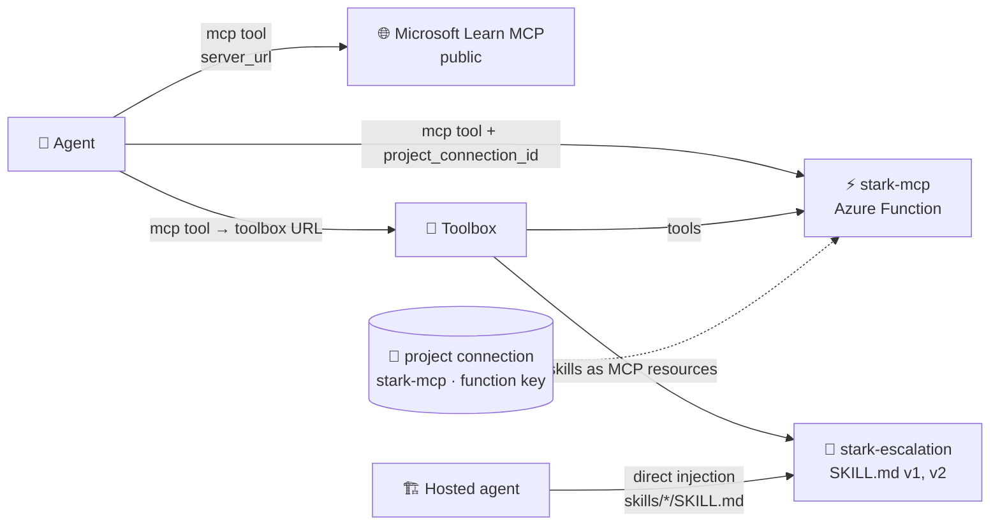

# 🔌 MCP, skills and (soon) A2A on Foundry agents

> 💡 **TL;DR:** **MCP** gives an agent *tools* from a remote server. **Skills** give an agent *procedures* from a versioned `SKILL.md`. **A2A** lets an agent call *another agent* (chapter 16, planned). Secrets live in **project connections**, never in the agent definition.

| 🔌 | 🎯 Gives the agent | 📦 Lives in | 🧪 Status |
|---|---|---|---|
| MCP | tools (functions with schemas) | remote MCP server + optional project connection | GA tool; toolboxes preview |
| Skills | instructions / know-how | Foundry Skills API (versioned) | 🧪 preview |
| Toolbox | one MCP endpoint for tools **and** skills | Foundry toolbox (versioned) | 🧪 preview |
| A2A | another agent as a tool | project connection to the remote agent | planned (chapter 16) |

Hands-on: [06 MCP](../notebooks/06_mcp_tools.ipynb) · [07 skills](../notebooks/07_agent_skills.ipynb).

---

## 🗺️ The big picture

---

## 1️⃣ MCP in an agent

`MCPTool(server_label, server_url, allowed_tools, require_approval, project_connection_id)`. The model sees the server's tool list (filtered by `allowed_tools`) and decides when to call. See [agents.md](agents.md) for the approval loop.

| 🛡️ Practice | Why |
|---|---|
| `allowed_tools` allow-list | smaller attack surface, fewer wrong tool picks |
| `require_approval="always"` for writes | a human sees tool and arguments first |
| connection for credentials | the agent definition (and its traces) carry no secrets |
| treat results as untrusted | indirect prompt injection (chapter 14) |

## 2️⃣ Our MCP server

[src/stark-mcp/function_app.py](../src/stark-mcp/function_app.py) is an Azure Function (Flex Consumption, Python) using the Functions MCP extension. Endpoint: `https://<app>.azurewebsites.net/runtime/webhooks/mcp`, authenticated with the `mcp_extension` system key. The postdeploy hook [connect_mcp.py](../scripts/connect_mcp.py) stores that key in the project connection `stark-mcp`.

> ⚠️ **Demo-grade:** public endpoint with a shared system key. Production: private networking or Entra-based auth, per-user identity.

## 3️⃣ Skills

A skill is a folder with `SKILL.md` (front matter `name`, `description`, then Markdown). In Foundry it is **versioned**: every upload is an immutable version, and `default_version` decides what unpinned consumers get. Three ways to deliver it:

| 🚚 Mode | How |
|---|---|
| Direct injection | download into the agent project; agent code adds it to instructions ([main.py](../src/jarvis-hosted/main.py) `load_skills`) |
| Toolbox | attach with `ToolboxSkillReference`; MCP clients read `resources/list` and `resources/read` |
| Copilot harness | `skills:` on a prompt agent with `harness.type: github_copilot_preview` |

## 4️⃣ A2A

Planned for [chapter 16](../story.md): expose an agent over the A2A protocol (v1.0, JSON-RPC, text only) and call it from another agent with the `a2a` tool.
