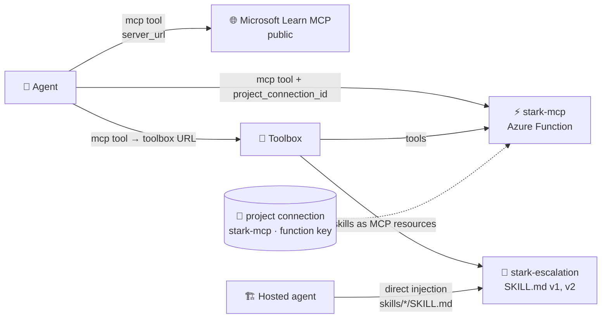
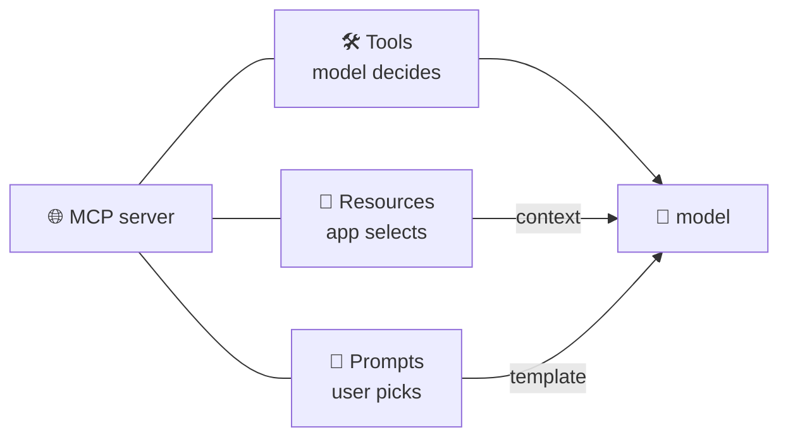

# 🔌 8 · MCP servers and skills

> 💡 **TL;DR:** **MCP** is a protocol where a server offers three kinds of things: *tools*, *resources* and *prompts*. A Foundry agent uses an MCP server for its *tools*; this repo runs its own server, `stark-mcp`. **Skills** give an agent *procedures* from a versioned `SKILL.md`, delivered by your code, a toolbox or the Copilot harness. Secrets live in **project connections**, never in the agent definition.

| 🔌 | 🎯 Gives the agent | 📦 Lives in | 🧪 Status |
|---|---|---|---|
| MCP | tools (functions with schemas) | remote MCP server + optional project connection | GA tool |
| Skills | instructions / know-how | Foundry Skills API (versioned) | 🧪 preview |
| Toolbox | one MCP endpoint for tools **and** skills | Foundry toolbox (versioned) | 🧪 preview |

Hands-on: [06 MCP](../notebooks/06_mcp_tools.ipynb) · [07 skills](../notebooks/07_agent_skills.ipynb). How an agent *calls* an MCP tool (allow-lists, approvals): [tools.md](tools.md). Agents calling agents (A2A): [capstone.md](capstone.md).

---

## 🗺️ The big picture

---

## 1️⃣ The three MCP primitives

An MCP server can offer three kinds of building blocks. Each has a different **controller**, which decides who triggers it:

| 🧩 Primitive | 🎯 What it is | 🎮 Controlled by | 📡 Methods | 🔎 Here |
|---|---|---|---|---|
| **Tools** | functions the model can call, with a JSON schema | the **model** (you approve) | `tools/list`, `tools/call` | [chapter 06](../notebooks/06_mcp_tools.ipynb): Microsoft Learn and `stark-mcp` |
| **Resources** | read-only data with a URI: files, schemas, documents | the **application** | `resources/list`, `resources/templates/list`, `resources/read` | [chapter 07](../notebooks/07_agent_skills.ipynb): a toolbox serves skills as resources |
| **Prompts** | reusable instruction templates with arguments, like slash commands | the **user** | `prompts/list`, `prompts/get` | ❌ not used in this tutorial |

A server says which primitives it supports when a client connects (its **capabilities**), and the client lists each one before using it.

### 🤖 What a Foundry agent does with them

| 🔌 Primitive | 📋 Status here |
|---|---|
| Tools | ✅ `MCPTool` on a prompt agent: the model calls them, with `allowed_tools` and approvals ([tools.md](tools.md)) |
| Resources | ✅ for **MCP clients** of a toolbox: skills appear in `resources/list` (section 3, Skills). ❓ Whether an agent's `MCPTool` exposes a server's resources to the model is **not documented** in the MCP tool article and was **not tested** |
| Prompts | ❓ same: not documented for agents, not tested, and the Learn MCP server and `stark-mcp` offer none |

> ℹ️ The Microsoft Learn MCP server **declares** the resources and prompts capabilities, but its lists were empty when checked (0 resources, 0 prompts). Declaring a capability does not mean the server fills it.

---

## 2️⃣ Our MCP server

[src/stark-mcp/function_app.py](../src/stark-mcp/function_app.py) is an Azure Function (Flex Consumption, Python) using the Functions MCP extension. Endpoint: `https://<app>.azurewebsites.net/runtime/webhooks/mcp`, authenticated with the `mcp_extension` system key. The postdeploy hook [connect_mcp.py](../scripts/connect_mcp.py) stores that key in the project connection `stark-mcp`.

> ⚠️ **Demo-grade:** public endpoint with a shared system key. Production: private networking or Entra-based auth, per-user identity.

---

## 3️⃣ Skills

A skill is a folder with `SKILL.md` (front matter `name`, `description`, then Markdown). In Foundry it is **versioned**: every upload is an immutable version, and `default_version` decides what unpinned consumers get. Three ways to deliver it:

| 🚚 Mode | How |
|---|---|
| Direct injection | your code adds the `SKILL.md` text to the instructions: `load_skills` in [main.py](../src/jarvis-hosted/main.py), [`skill_body()`](../notebooks/stark_helpers.py) in chapters 15 and 16 |
| Toolbox | attach with `ToolboxSkillReference`; MCP clients read `resources/list` and `resources/read` |
| Copilot harness 🧪 | `skills=[SkillReference(...)]` plus `harness=GitHubCopilotHarness()` on a prompt agent ([chapter 07](../notebooks/07_agent_skills.ipynb) section 6), or `skills:` and `harness.type: github_copilot_preview` in `azure.yaml` |

> ⚠️ **Skills need the harness.** On a default prompt agent, `skills=[...]` is accepted but had no effect in a test: the agent did not follow the skill. The Copilot harness is a gated preview, so creating it can fail with `not enabled for this subscription`. That was the result on this project, so **the harness path itself was not run successfully here**.

---

## 🪜 Walkthrough: ship a new version of a skill

Code in [chapter 07](../notebooks/07_agent_skills.ipynb) 🧪.

**Step 1. Upload version 1.** `skills.create(name=..., inline_content=SkillInlineContent(description=..., instructions=...))` creates the skill and its first version.

**Step 2. Change the procedure.** Edit the text and call `skills.create` again with the same name: that is **version 2**. Version 1 is untouched.

**Step 3. Test, then promote.** `skills.update(name, default_version=v2.version)`. Consumers that follow the default pick it up **without a code change**; pinned consumers stay on their version.

**Step 4. Deliver it.** Attach it to a toolbox (`ToolboxSkillReference`, MCP clients read it with `resources/read`), or download it into an agent project for direct injection.

**Step 5. Check it took effect.** The `stark-escalation` skill makes an answer start with `Severity:`. Chapter 07 section 6 tests exactly that.

---

## 🙈 Common mistakes

| 🚨 Mistake | 💥 What happens | ✅ Do this |
|---|---|---|
| key in the agent definition | it shows up in versions and traces | project connection |
| expecting skills to work on a default prompt agent | no effect | use direct injection or a toolbox |

---

## 📚 Learn more

| 🏷️ Source | 📖 What you get |
|---|---|
| [MCP architecture overview](https://modelcontextprotocol.io/docs/learn/architecture) | participants, layers, the primitives and discovery |
| [Understanding MCP servers](https://modelcontextprotocol.io/docs/learn/server-concepts) | tools, resources and prompts with who controls each, plus a worked example |
| [MCP specification](https://modelcontextprotocol.io/specification/latest) | the exact messages and rules |
| [MCP Inspector](https://github.com/modelcontextprotocol/inspector) | a tool to connect to a server and browse its tools, resources and prompts |
| [Reference MCP servers](https://github.com/modelcontextprotocol/servers) | sample servers to read and run |
| [Anthropic: Introducing the Model Context Protocol](https://www.anthropic.com/news/model-context-protocol) | why MCP exists (announcement, November 2024) |
| [Connect agents to MCP server endpoints (Microsoft Learn)](https://learn.microsoft.com/azure/foundry/agents/how-to/tools/model-context-protocol) | the Foundry MCP tool: connections, approvals, best practices |
| [What is Toolbox in Foundry? (Microsoft Learn)](https://learn.microsoft.com/azure/foundry/agents/concepts/toolbox-overview) | one MCP endpoint for tools and skills |
| [Secure MCP servers (Microsoft Learn)](https://learn.microsoft.com/azure/api-management/secure-mcp-servers) | protecting an MCP server with API Management |

> ⚠️ The MCP specification is versioned and still changing. The architecture page reflects spec version `2026-07-28` and marks some older client features (sampling, logging) as deprecated. Check the version before you copy a message format.
