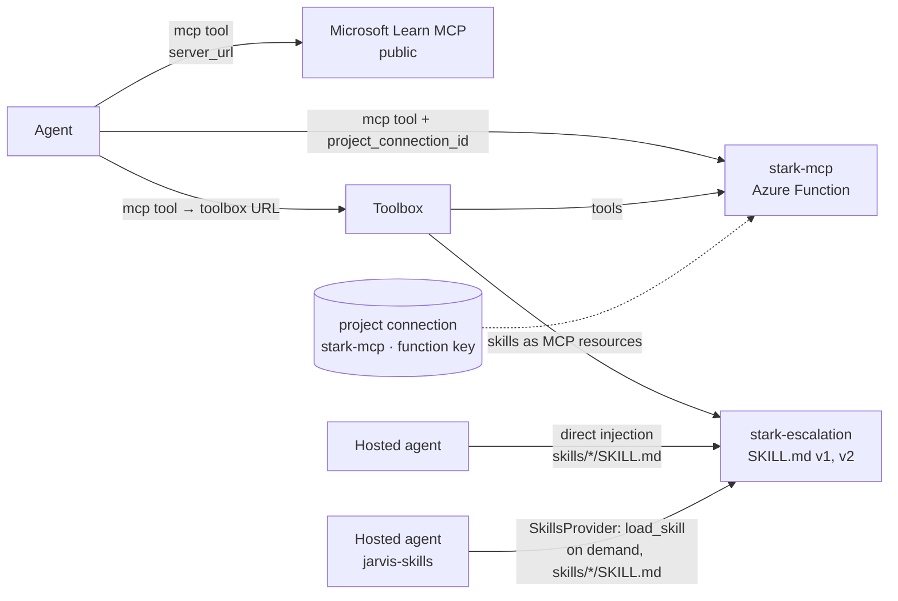
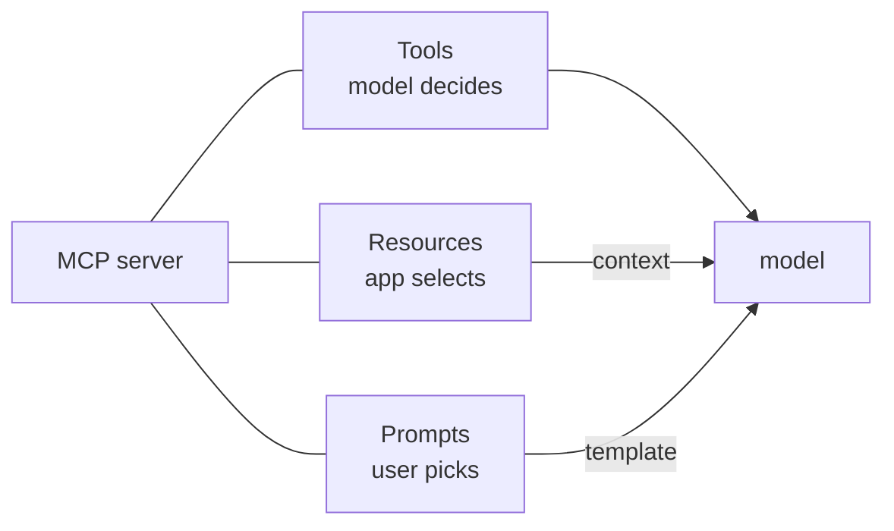
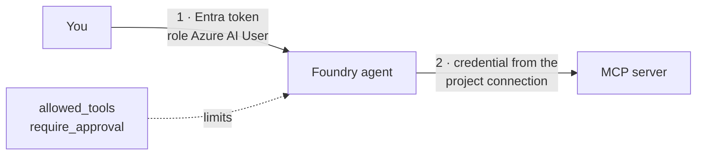

# 🔌 8 · MCP servers and skills

> 💡 **TL;DR:** **MCP** is a protocol where a server offers three kinds of things: *tools*, *resources* and *prompts*. A Foundry agent uses an MCP server for its *tools*; this repo runs its own server, `stark-mcp`, protected by a key that Foundry reads from a project connection. **Skills** give an agent *procedures* from a versioned `SKILL.md`, delivered by your code (pasted into the instructions, or loaded on demand by Agent Framework's `SkillsProvider`), a toolbox or the Copilot harness. Secrets live in **project connections**, never in the agent definition.

| | Gives the agent | Lives in | Status |
|---|---|---|---|
| MCP | tools (functions with schemas) | remote MCP server + optional project connection | GA tool |
| Skills | instructions / know-how | Foundry Skills API (versioned) | 🧪 preview |
| Toolbox | one MCP endpoint for tools **and** skills | Foundry toolbox (versioned) | 🧪 preview |

Hands-on: [06 MCP](../notebooks/06_mcp_tools.ipynb) · [07 skills](../notebooks/07_agent_skills.ipynb) · [09 hosted agents](../notebooks/09_hosted_agent.ipynb) section 4 (`jarvis-skills`). How an agent *calls* an MCP tool (allow-lists, approvals): [tools.md](tools.md). Agents calling agents (A2A): [capstone.md](capstone.md).

---

## 🗺️ The big picture



---

## 1 · The three MCP primitives

An MCP server can offer three kinds of building blocks. Each has a different **controller**, which decides who triggers it:

| Primitive | What it is | Controlled by | Methods | Here |
|---|---|---|---|---|
| **Tools** | functions the model can call, with a JSON schema | the **model** (you approve) | `tools/list`, `tools/call` | [chapter 06](../notebooks/06_mcp_tools.ipynb): Microsoft Learn and `stark-mcp` |
| **Resources** | read-only data with a URI: files, schemas, documents | the **application** | `resources/list`, `resources/templates/list`, `resources/read` | [chapter 07](../notebooks/07_agent_skills.ipynb): a toolbox serves skills as resources |
| **Prompts** | reusable instruction templates with arguments, like slash commands | the **user** | `prompts/list`, `prompts/get` | ❌ not used in this tutorial |

A server says which primitives it supports when a client connects (its **capabilities**), and the client lists each one before using it.



### What a Foundry agent does with them

| Primitive | Status here |
|---|---|
| Tools | ✅ `MCPTool` on a prompt agent: the model calls them, with `allowed_tools` and approvals ([tools.md](tools.md)) |
| Resources | ✅ for **MCP clients** of a toolbox: skills appear in `resources/list` (section 4, Skills), and [chapter 07](../notebooks/07_agent_skills.ipynb) section 6 reads one with `resources/read`. ❓ Whether an agent's `MCPTool` exposes a server's resources to the model is **not documented** in the MCP tool article and was **not tested** |
| Prompts | ❓ same: not documented for agents, not tested, and the Learn MCP server and `stark-mcp` offer none |

> ℹ️ The Microsoft Learn MCP server **declares** the resources and prompts capabilities, but its lists were empty when checked (0 resources, 0 prompts). Declaring a capability does not mean the server fills it.

---

## 2 · Our MCP server

[src/stark-mcp/function_app.py](../src/stark-mcp/function_app.py) is an Azure Function (Flex Consumption, Python) using the Functions MCP extension. Endpoint: `https://<app>.azurewebsites.net/runtime/webhooks/mcp`, authenticated with the `mcp_extension` system key. The postdeploy hook [connect_mcp.py](../scripts/connect_mcp.py) stores that key in the project connection `stark-mcp`.

> ⚠️ **Demo-grade:** public endpoint with a shared system key. Production: private networking or Entra-based auth, per-user identity.

---

## 3 · Authentication and authorization

Two different questions, often mixed up:

| | Question | Answered by |
|---|---|---|
| **Authentication** | *who* is calling? | a key or an Entra token that proves the caller |
| **Authorization** | *what* may the caller do? | roles, allow-lists, approvals, the server's own rules |

An MCP call from a Foundry agent has two hops, and each hop answers both questions on its own:



1. **You → Foundry.** You sign in with Entra ID (`DefaultAzureCredential`). The *Azure AI User* role from [rbac.bicep](../infra/modules/rbac.bicep) allows you to call the agent.
2. **Foundry → MCP server.** Foundry signs in to the server with what the **project connection** holds. Your own token never reaches the server.

### How Foundry signs in to an MCP server

| Method | How it works | Server sees each user? | In this repo |
|---|---|---|---|
| **Key-based** | a header (API key, PAT, `Bearer` token) stored in the connection | no, one shared secret | ✅ `stark-mcp`: header `x-functions-key`, connection `stark-mcp` ([connect_mcp.py](../scripts/connect_mcp.py)) |
| **Entra: agent identity** | Foundry gets a token for the agent's own identity (connection auth type `AgenticIdentityToken`) | no, the agent | ❌ |
| **Entra: project managed identity** | a token for the project's shared identity | no, the project | ❌ |
| **OAuth identity passthrough** | each user signs in once through a consent link; Foundry stores that user's tokens | ✅ yes | ❌ |
| **Unauthenticated** | no credential | no | ✅ the public Microsoft Learn server |

> ⚠️ Everyone with access to the project can read a key stored in a connection. Store only **shared** secrets there; for per-user access use OAuth identity passthrough.

### Who may do what

| Where | Control | Effect |
|---|---|---|
| agent definition | `allowed_tools` | the model never sees the other tools ([tools.md](tools.md)) |
| agent definition | `require_approval` | your code approves each call before it runs ([`ask_agent()`](../notebooks/stark_helpers.py)) |
| MCP server | its own checks | with a shared key the server cannot tell callers apart: every agent gets the same rights |
| downstream service | roles of the identity the server uses | Entra methods need role assignments on the service behind the server |

**Toolboxes** (chapter 07) move the credentials one step back: a client signs in to the toolbox with **Entra** (chapter 07 sends a bearer token for `https://ai.azure.com` plus the `Foundry-Features: Skills=V1Preview` header), and the toolbox injects the credentials of each tool.

> 💡 **Harden `stark-mcp` (not implemented):** turn on the Functions built-in MCP authentication, which switches off the key, and use an Entra method. Microsoft recommends Entra whenever the server supports it: no secret to rotate. See [MCP server authentication](https://learn.microsoft.com/azure/foundry/agents/how-to/mcp-authentication) and [MCP on Azure Functions with Foundry](https://learn.microsoft.com/azure/azure-functions/functions-mcp-foundry-tools).

---

## 4 · Skills

A skill is a folder in the open [Agent Skills format](https://agentskills.io/specification). `SKILL.md` is required; scripts, reference docs, data files and any other files are optional and travel with it when you upload the whole folder. In Foundry a skill is **versioned**: every upload is an immutable version, and `default_version` decides what unpinned consumers get.

### What a skill folder holds

[stark-escalation](../skills/stark-escalation/SKILL.md) is text only. [invoice-review](../skills/invoice-review/SKILL.md) uses two of the three optional folders the format names:

```
skills/invoice-review/
├── SKILL.md      front matter, the checklist, the exact command for each check, the verdict rule
├── scripts/      check_invoice.py, vendor_check.py, iban_check.py, ledger.py, approval_limit.py (+ _common.py)
└── assets/       vendors.csv, approval-limits.csv, invoice-example.json
```

| Part | Holds | Used by |
|---|---|---|
| `SKILL.md` | front matter (see below), then Markdown instructions. The whole body is loaded when the skill is used, so the format recommends under 500 lines | every delivery mode below |
| `scripts/` | prewritten commands for what a model gets wrong: arithmetic, checksums, lookups, duplicates. Each prints one JSON line and exits with `0` (pass) or `1` (fail), standard library only | the Copilot harness, with its shell tool. Direct injection and the toolbox pass on only the text. `SkillsProvider` offers `run_skill_script`, but `jarvis-skills` runs only the script of its code-defined skill, not scripts in a skill folder |
| `assets/` | data the scripts read (vendor master, approval limits) and an example of the input shape | the scripts, and the model through the harness file tools |
| `references/` | extra docs the agent reads only when it needs them (`REFERENCE.md`, form templates, domain notes), so `SKILL.md` stays short. Not used in this repo | agents that can read files: the harness file tools, `read_skill_resource` in `SkillsProvider` |
| any other file | the format allows more files and folders; link them from `SKILL.md` with a relative path, one level deep | the same as `references/` |

The front matter in `SKILL.md`:

| Field | Required | Rule |
|---|---|---|
| `name` | ✅ | 1–64 characters: lowercase letters, digits and hyphens, no hyphen at the start or end, no `--`. Must match the folder name |
| `description` | ✅ | up to 1,024 characters: what the skill does **and when to use it**. A model reads only this when it picks a skill |
| `license` | ❌ | a license name or a bundled license file |
| `compatibility` | ❌ | up to 500 characters of environment needs (product, packages, network) |
| `metadata` | ❌ | free string key-value pairs, for example `author` or `version` |
| `allowed-tools` | ❌ | 🧪 tools the skill may use without asking. Experimental in the format; ❓ not checked in Foundry |

Two ways to upload a version:

| Upload | Call | Carries |
|---|---|---|
| text | `skills.create(name=..., inline_content=SkillInlineContent(description=..., instructions=...))` ([chapter 07](../notebooks/07_agent_skills.ipynb)) | `SKILL.md` only |
| folder 🧪 | a zip with `SKILL.md` at the root, `beta.skills.create_from_files(name, content=CreateSkillVersionFromFilesBody(files=[...]))` ([chapter 15](../notebooks/15_copilot_harness.ipynb), `publish_skill()` in [stark_harness.py](../notebooks/stark_harness.py)), or an `azure.ai.skill` service with `archive:` in [src/jarvis-harness/azure.yaml](../src/jarvis-harness/azure.yaml) | the whole folder |

Writing a skill with scripts:

- **List the exact command per check in `SKILL.md`.** The model only fills in the arguments.
- **Put rules in the scripts, not in the model.** A live run read the Pym total at 0.44 confidence. `check_invoice.py` now treats an amount that the line items and tax add up to as checked (`confirmed_by_arithmetic`), so the skill no longer sends a clean invoice to a human.
- **Say what to do without shell.** The same `SKILL.md` is injected as plain text in chapters 16 and 17 and in `jarvis-hosted`. There it tells the agent to do the arithmetic itself and to report the vendor, IBAN and duplicate checks as not run.
- **Run the scripts on your machine first.** They are plain CLI tools, and chapter 15 section 4 calls them locally before the agent does.
- **Keep `__pycache__` out of the upload.** `publish_skill()` and [sync_skills.py](../scripts/sync_skills.py) skip it.

What each `invoice-review` script checks, and how the harness runs it: [copilot-harness.md](copilot-harness.md), section 3.

> ⚠️ **A skill holds no agents.** The Agent Skills format covers instructions, code and files only. The Copilot harness has a built-in **Subagents** tool that "delegates work to additional agents", but Microsoft Learn shows no way to define your own subagents for it ❓, and chapter 15 switches it off. To combine your own agents, use a workflow ([chapter 16](../notebooks/16_workflows.ipynb)), the A2A tool ([chapter 17](../notebooks/17_vision_a2a_capstone.ipynb)) or agents as files ([chapter 08](../notebooks/08_agents_from_yaml.ipynb)). Custom agent files such as `.agent.md` belong to GitHub Copilot, not to Foundry skills.

### How an agent gets the skill

Four ways to deliver it:

| Mode | How | Reads |
|---|---|---|
| Direct injection | your code adds the `SKILL.md` text to the instructions: `load_skills` in [main.py](../src/jarvis-hosted/main.py), [`skill_body()`](../notebooks/stark_helpers.py) in chapters 16 and 17 | local `skills/` files, or a version downloaded from Foundry |
| Agent Framework `SkillsProvider` | the model sees only each skill's name and description, and calls `load_skill`, `read_skill_resource` or `run_skill_script` when a skill fits. The hosted agent [jarvis-skills](../src/jarvis-skills/main.py) does this with the file skills from `skills/` plus one code-defined skill. ✅ Tested on a live project | local `skills/` files (copied into the ZIP on deploy) |
| Toolbox | attach with `ToolboxSkillReference`; MCP clients read `resources/list` and `resources/read`. The toolbox only **offers** the skill: it is used only when the client loads it and the model follows it | the Foundry version (default or pinned) |
| Microsoft Copilot harness 🧪 | `skills=[SkillReference(...)]` plus `harness=MicrosoftCopilotHarness()` on a prompt agent ([chapter 15](../notebooks/15_copilot_harness.ipynb)), or `skills:` and `harness.type: microsoft_copilot_preview` in [src/jarvis-harness/azure.yaml](../src/jarvis-harness/azure.yaml). The harness also runs the skill's scripts with its shell tool. See [copilot-harness.md](copilot-harness.md) | the Foundry version the agent version pins, uploaded as a folder (zip) |

> ⚠️ **Skills need the harness.** On a default prompt agent, `skills=[...]` is accepted but has no effect: the agent doesn't follow the skill. Only the **Microsoft Copilot harness**, a public preview in [supported regions](copilot-harness.md), uses it. Chapter 15 was tested on a live project.

Direct injection is the simplest, but every run pays for every skill. `SkillsProvider` loads a skill only when the model picks it, so it scales to many skills. It is also the fast loop for writing one: edit `skills/<name>/SKILL.md`, run `python samples/skills_provider.py "<question>"` (the `jarvis-skills` agent as a plain script, no deploy), and check that the right `load_skill` call shows up. Deployed, the same calls appear as `function_call` items in the response output. All three skill tools need approval by default; `jarvis-skills` turns approval off because the skills are this repo's own. It reads `skills/` from disk, so a new Foundry version reaches it only when you copy that version into `skills/`.

---

## 🪜 Walkthrough: ship a new version of a skill

Code in [chapter 07](../notebooks/07_agent_skills.ipynb) 🧪.

**Step 1. Upload version 1.** `skills.create(name=..., inline_content=SkillInlineContent(description=..., instructions=...))` creates the skill and its first version.

**Step 2. Change the procedure.** Edit the text and call `skills.create` again with the same name: that is **version 2**. Version 1 is untouched.

**Step 3. Test, then promote.** `skills.update(name, default_version=v2.version)`. Consumers that follow the default pick it up **without a code change**; pinned consumers stay on their version.

**Step 4. Deliver it.** Attach it to a toolbox (`ToolboxSkillReference`, MCP clients read it with `resources/read`), or download it into an agent project for direct injection or `SkillsProvider`.

**Step 5. Check it took effect.** Attaching a skill does not prove it is used, so test the behaviour. The `stark-escalation` skill makes an answer start with `Severity:`, and version 2 adds a floor for critical incidents. Chapter 07 section 6 reads the skill from the toolbox (step 1) and compares an answer without it (step 2) and with it (step 3). Chapter 15 runs the same check on a prompt agent on the Copilot harness.

---

## 🙈 Common mistakes

| Mistake | What happens | Do this |
|---|---|---|
| key in the agent definition | it shows up in versions and traces | project connection |
| a personal token in a shared connection | every project member can read it, every user acts as you | OAuth identity passthrough for per-user access |
| expecting skills to work on a default prompt agent | no effect | use direct injection, `SkillsProvider` or a toolbox |
| turning off approval for skills you did not write | `run_skill_script` runs their code, and their instructions go into the context | keep approval on for outside skills, at least for scripts |

---

## 📚 Learn more

| Source | What you get |
|---|---|
| [MCP architecture overview](https://modelcontextprotocol.io/docs/learn/architecture) | participants, layers, the primitives and discovery |
| [Understanding MCP servers](https://modelcontextprotocol.io/docs/learn/server-concepts) | tools, resources and prompts with who controls each, plus a worked example |
| [MCP specification](https://modelcontextprotocol.io/specification/latest) | the exact messages and rules |
| [MCP Inspector](https://github.com/modelcontextprotocol/inspector) | a tool to connect to a server and browse its tools, resources and prompts |
| [Reference MCP servers](https://github.com/modelcontextprotocol/servers) | sample servers to read and run |
| [Anthropic: Introducing the Model Context Protocol](https://www.anthropic.com/news/model-context-protocol) | why MCP exists (announcement, November 2024) |
| [Agent Skills in Agent Framework (Microsoft Learn)](https://learn.microsoft.com/agent-framework/agents/skills) | `SkillsProvider`, file, code-defined, class-based and MCP skill sources, approvals |
| [Connect agents to MCP server endpoints (Microsoft Learn)](https://learn.microsoft.com/azure/foundry/agents/how-to/tools/model-context-protocol) | the Foundry MCP tool: connections, approvals, best practices |
| [What is Toolbox in Foundry? (Microsoft Learn)](https://learn.microsoft.com/azure/foundry/agents/concepts/toolbox-overview) | one MCP endpoint for tools and skills |
| [Secure MCP servers (Microsoft Learn)](https://learn.microsoft.com/azure/api-management/secure-mcp-servers) | protecting an MCP server with API Management |

> ⚠️ The MCP specification is versioned and still changing. The architecture page reflects spec version `2026-07-28` and marks some older client features (sampling, logging) as deprecated. Check the version before you copy a message format.
