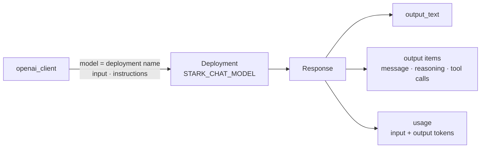

# 🧠 3 · How you call a model: the Responses API

> 💡 **TL;DR:** You call a **deployment** by name with `responses.create(model=..., input=...)`. The answer is a **response**: the text in `output_text`, the pieces in `output`, the token count in `usage`. Add `stream=True` to get the text as it is written, and a JSON schema to get output your code can parse. Embeddings are a separate call that turns text into vectors.

| You want | Call | Chapter 01 section |
|---|---|---|
| one answer | `responses.create(model=MODEL, input="...")` | 1 |
| fixed behaviour for this call | `instructions="..."`, `max_output_tokens=...` | 1 |
| existing chat code to keep working | `chat.completions.create(messages=[...])` | 2 |
| text while it is written | `stream=True` | 3 |
| JSON your code can parse | `text={"format": {"type": "json_schema", ...}}` | 4 |
| vectors for search | `embeddings_client().embeddings.create(...)` | 6 |

Hands-on: [notebooks/01_dummy_first_call.ipynb](../notebooks/01_dummy_first_call.ipynb). The words *response*, *output item* and *token* are explained in [concepts.md](concepts.md).

---

## 🗺️ The big picture



---

## 1 · One call, one answer

[`openai_client()`](../notebooks/stark_helpers.py) returns an OpenAI client that talks to your project with your Entra login. `model` is the **deployment name** from `.env`, read with `model("chat")`.

```python
oai = openai_client()
r = oai.responses.create(model=model("chat"), input="In one sentence: what is Dummy in Iron Man?")
print(r.output_text)
```

| Parameter | What it does |
|---|---|
| `input` | a string, or a list of messages |
| `instructions` | the system prompt, for this call only |
| `max_output_tokens` | caps the length of the answer, and so the cost |
| `store` | `True` by default: Foundry keeps the response ([conversations.md](conversations.md)) |

> ⚠️ A model **forgets** after each call. Memory is chapter 02.

---

## 2 · What a response contains

| Field | Holds |
|---|---|
| `id` | the response id, used for chaining and deleting |
| `status` | `completed`, or why it stopped |
| `output_text` | all text of the answer, joined |
| `output` | the list of **items**: `message`, `reasoning`, and later tool calls |
| `usage` | `input_tokens`, `output_tokens`, `total_tokens`: what you pay for |

Reasoning models add a `reasoning` item before the `message`. You can ignore it. From chapter 05 on, tool calls appear in `output` too ([tools.md](tools.md)).

---

## 3 · Streaming

With `stream=True` the call returns **events** instead of one response. Print the text pieces as they arrive:

```python
for event in oai.responses.create(model=MODEL, input="...", stream=True):
    if event.type == "response.output_text.delta":
        print(event.delta, end="")
    elif event.type == "response.completed":
        print(event.response.usage.total_tokens)
```

| Event | Meaning |
|---|---|
| `response.output_text.delta` | the next piece of text |
| `response.completed` | the end. `event.response` is the full response with `usage` |

Streaming does not make the model faster. It shows the first words sooner, which feels faster to a user.

---

## 4 · Structured output

Give the model a **JSON schema** and `strict: True`. The answer then matches the schema, so `json.loads(r.output_text)` works without guessing.

```python
text={"format": {"type": "json_schema", "name": "suit_card", "schema": schema, "strict": True}}
```

| Rule for a strict schema | Why |
|---|---|
| every property is listed in `required` | strict mode has no optional fields |
| `"additionalProperties": False` | no extra keys appear |

---

## 5 · Chat Completions: the older shape

The same deployment also answers `chat.completions.create(messages=[...])`. It returns `choices[0].message.content`.

| API | Use it for |
|---|---|
| **Responses** | new work. Agents, tools and conversations are built on it |
| **Chat Completions** | existing code that already sends a `messages` list |

This repo uses Responses everywhere after chapter 01.

---

## 6 · Embeddings

An embedding turns text into a list of numbers (a **vector**). Texts with a similar meaning get vectors that point in a similar direction, so you can search by meaning. Chapter 01 compares `arc reactor` with `repulsor` and `smoothie` using cosine similarity.

```python
e = embeddings_client().embeddings.create(model=model("embedding"), input=["arc reactor", "repulsor"])
```

> 💡 **Why a second client?** The project route has no `/embeddings`. [`embeddings_client()`](../notebooks/stark_helpers.py) calls the **account** endpoint (`STARK_ACCOUNT_ENDPOINT`) instead, still with your Entra login.

You rarely call embeddings yourself in Foundry: **file search** (chapter 05) embeds your documents for you.

---

## 🙈 Common mistakes

| Mistake | What happens | Do this |
|---|---|---|
| `model="gpt-…"` (the model name) | an error: no deployment has that name | use the deployment name: `model("chat")` |
| reading `r.output[0].content` | breaks when a `reasoning` item comes first | use `r.output_text` |
| strict schema with an optional field | the request is rejected | list every property in `required` |
| embeddings through `openai_client()` | the call fails: the project route has no `/embeddings` | use `embeddings_client()` |
| no `max_output_tokens` in a loop | long answers, high cost | cap it |
