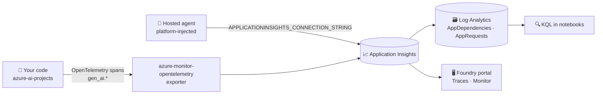

# 📈 5 · How Foundry traces and monitors your AI app

> 💡 **TL;DR:** Foundry writes **OpenTelemetry** traces to the **Application Insights** connected to your project. You see them in **Application Insights** (all calls) and on an **agent's** Traces and Monitor tabs in the Foundry portal, and you can query everything with **KQL**. **Agent calls are traced by Foundry itself** (server-side, chapter 04). **Your own code** (direct model calls, custom spans) sends traces only after `configure_azure_monitor` (chapter 03). Content recording can contain personal data.

| 👀 Where | 🔎 What you see | 🛠️ How |
|---|---|---|
| Application Insights → Transaction search | every traced call, also calls without an agent (chapter 03) | the same Application Insights, no setup |
| Foundry portal → agent → Traces (server-side, no code needed) | spans, durations, tokens, messages, conversation id | needs an agent (chapter 04) and Application Insights (Bicep connects it) |
| Portal → agent → Monitor | runs, success rate, latency, tokens, eval scores | needs an agent (chapter 04) |
| Log Analytics | everything, queryable | `kql()` in [stark_helpers.py](../notebooks/stark_helpers.py) |
| Local console | spans while developing | OTLP/console exporter (optional) |

Hands-on: [notebooks/03_tracing_and_monitoring.ipynb](../notebooks/03_tracing_and_monitoring.ipynb).

---

## 🗺️ The big picture



---

## 1️⃣ Switch it on

| 📡 Calls | 🔧 Who sends the traces |
|---|---|
| to an **agent** (`agent_reference`, chapter 04 on) | Foundry, server-side. Nothing to switch on |
| **your own code**: direct model calls, custom spans | your process, after `configure_azure_monitor` |

For your own code, in [notebook 03](../notebooks/03_tracing_and_monitoring.ipynb), before importing the SDK:

```python
os.environ["AZURE_EXPERIMENTAL_ENABLE_GENAI_TRACING"] = "true"
os.environ["AZURE_TRACING_GEN_AI_CONTENT_RECORDING_ENABLED"] = "true"   # prompts/responses: workshop only
conn = project().telemetry.get_application_insights_connection_string()
configure_azure_monitor(connection_string=conn)
```

The project hands out its own connection string, so no secret sits in `.env`.

## 2️⃣ What a span carries

Spans follow the OpenTelemetry **GenAI semantic conventions**: `gen_ai.operation.name`, `gen_ai.request.model`, `gen_ai.usage.input_tokens`, `gen_ai.usage.output_tokens`, `gen_ai.conversation.id`, `gen_ai.agent.name`. Add your own attributes with a span (`stark.hero`, `stark.chapter`) to slice by business context.

## 3️⃣ Query it

The notebook runs KQL on `AppDependencies`. Ingestion takes a few minutes, so `kql_wait()` retries. Table and attribute names can differ between SDK versions; if a query returns nothing, run `AppDependencies | take 5` and look at `Properties`.

## 4️⃣ Privacy and cost

- ⚠️ Content recording stores prompts and answers. Project members with *Log Analytics Reader* can read them.
- 💰 Application Insights ingestion is billed per GB.
- 🔒 Your own code sends nothing until `configure_azure_monitor` runs. Content recording is a separate switch: leave it off in production.

## 🪜 Walkthrough: from a call to a number in KQL

Code from [chapter 03](../notebooks/03_tracing_and_monitoring.ipynb).

**Step 1. Set the switches *before* importing the SDK.** They are read at import time.

```python
os.environ["AZURE_EXPERIMENTAL_ENABLE_GENAI_TRACING"] = "true"
os.environ["AZURE_TRACING_GEN_AI_CONTENT_RECORDING_ENABLED"] = "true"   # workshop only
```

**Step 2. Connect the exporter.**

```python
from azure.monitor.opentelemetry import configure_azure_monitor
conn = project().telemetry.get_application_insights_connection_string()
configure_azure_monitor(connection_string=conn)
```

**Step 3. Wrap your work in a span** with your own attributes:

```python
tracer = trace.get_tracer("stark.workshop")
with tracer.start_as_current_span("workshop-scenario") as span:
    span.set_attribute("stark.hero", "tony-stark")
    ...  # your responses.create calls
```

**Step 4. Flush.** `trace.get_tracer_provider().force_flush()` sends what is still waiting in memory.

**Step 5. Wait, then query.** Ingestion takes minutes. Start simple:

```kusto
AppDependencies
| where TimeGenerated > ago(2h)
| extend op = tostring(Properties["gen_ai.operation.name"]),
         model = tostring(Properties["gen_ai.request.model"]),
         tin = toint(Properties["gen_ai.usage.input_tokens"]),
         tout = toint(Properties["gen_ai.usage.output_tokens"])
| where isnotempty(op)
```

In the notebook, `kql_wait(q, hours=2)` runs it and retries until rows arrive.

**Step 6. Find one conversation.** Filter on its id: `where tostring(Properties) has "<conv.id>"` ([chapter 04](../notebooks/04_jarvis_prompt_agent.ipynb), section 6). An agent call shows an `invoke_agent` span with a nested `chat` span.

### 📖 Reading a trace

| 🧱 Field | 🔎 Meaning |
|---|---|
| `Name` | the span name, for example your `workshop-scenario` |
| `DurationMs` | how long the step took |
| `OperationId` | groups all spans of one trace |
| `Properties["gen_ai.*"]` | model, tokens, conversation, agent |

---

## 🙈 Common mistakes

| 🚨 Mistake | 💥 What happens | ✅ Do this |
|---|---|---|
| setting the environment variables **after** importing the SDK | no GenAI spans | set them in the first cell, restart the kernel if needed |
| querying right after the call | empty result | wait 2–5 minutes, use `kql_wait()` |
| looking for chapter 03 calls in the Foundry **Traces** tab | nothing there: no agent was involved | use Application Insights. Agent traces start in chapter 04 |
| leaving content recording on with real data | prompts and answers are stored and readable | switch it off outside the workshop |
| forgetting `force_flush()` in a short script | the process ends before spans are sent | flush before exit |

---

## 5️⃣ Not covered yet

Continuous evaluation on live traffic, alerts and the agent Monitor tab come with agents and evaluations (chapters 04 and 11).
