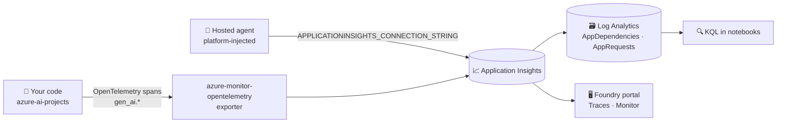

# 📈 How Foundry traces and monitors your AI app

> 💡 **TL;DR:** Foundry writes **OpenTelemetry** traces to the **Application Insights** connected to your project. You see them in the portal (Traces, conversations, agent Monitor tab) and can query them with **KQL**. Tracing is **off by default** and content recording can contain personal data.

| 👀 Where | 🔎 What you see | 🛠️ How |
|---|---|---|
| Portal → Traces | spans, durations, tokens, messages | connect Application Insights (Bicep does it) |
| Portal → agent → Monitor | runs, success rate, latency, tokens, eval scores | needs an agent (chapter 04) |
| Log Analytics | everything, queryable | `kql()` in [stark_helpers.py](../notebooks/stark_helpers.py) |
| Local console | spans while developing | OTLP/console exporter (optional) |

Hands-on: [notebooks/03_tracing_and_monitoring.ipynb](../notebooks/03_tracing_and_monitoring.ipynb).

---

## 🗺️ The big picture



---

## 1️⃣ Switch it on

In [notebook 03](../notebooks/03_tracing_and_monitoring.ipynb), before importing the SDK:

```python
os.environ["AZURE_EXPERIMENTAL_ENABLE_GENAI_TRACING"] = "true"
os.environ["AZURE_TRACING_GEN_AI_CONTENT_RECORDING_ENABLED"] = "true"   # prompts/responses: workshop only
conn = project().telemetry.get_application_insights_connection_string()
configure_azure_monitor(connection_string=conn)
```

The project hands out its own connection string, so no secret sits in `.env`.

## 2️⃣ What a span carries

Spans follow the OpenTelemetry **GenAI semantic conventions**: `gen_ai.operation.name`, `gen_ai.request.model`, `gen_ai.usage.input_tokens`, `gen_ai.usage.output_tokens`, `gen_ai.conversation.id`, `gen_ai.agent.name`. Add your own attributes with a span (`stark.hero`, `stark.chapter`) to slice by business context.

## 3️⃣ Query it

The notebook runs KQL on `AppDependencies`. Ingestion takes a few minutes, so `kql_wait()` retries. Table and attribute names can differ between SDK versions; if a query returns nothing, run `AppDependencies | take 5` and look at `Properties`.

## 4️⃣ Privacy and cost

- ⚠️ Content recording stores prompts and answers. Project members with *Log Analytics Reader* can read them.
- 💰 Application Insights ingestion is billed per GB.
- 🔒 Tracing is off until a Foundry owner enables it.

## 5️⃣ Not covered yet

Continuous evaluation on live traffic, alerts and the agent Monitor tab come with agents and evaluations (chapters 04 and 11).
