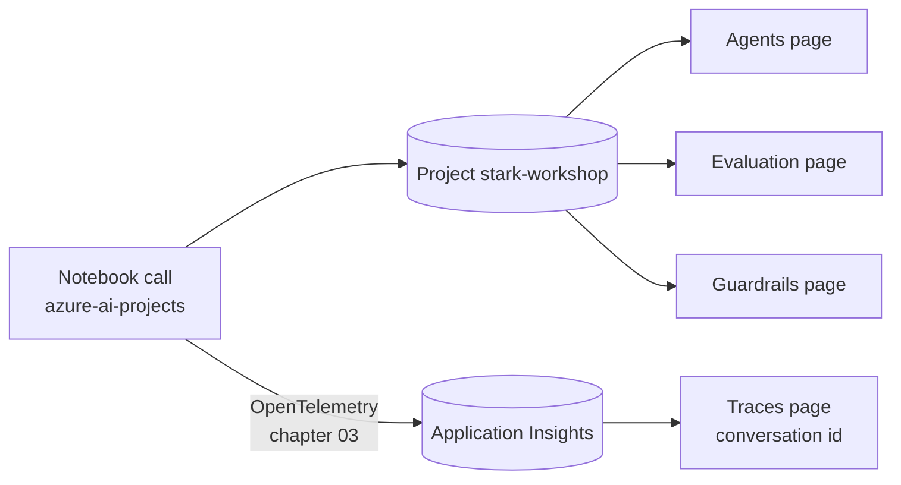

# 👀 What shows up in the Foundry portal?

> 💡 **TL;DR:** Most notebook calls leave something you can see at <https://ai.azure.com> (switch on **New Foundry**, pick the `stark-workshop` project). Agents, evaluations and traces get their own pages. Plain model calls and conversations (chapters 01–03) have no Foundry page: find their traces in **Application Insights**. An agent's calls also show in its **Traces** tab. The clean-up cells delete what a chapter creates, so its page empties again.

| Portal page | Filled by chapter | What you see |
|---|---|---|
| **Build → Models** | `azd up` | the model deployments |
| **Build → Agents** | 04, 05, 06, 08, 09, 13, 14, 16 | agents, their versions, the playground |
| **Application Insights** (Azure portal) → Transaction search | 03 | traces of direct model calls, custom spans |
| **Build → Agents →** an agent **→ Traces** | 04 on (tracing set up in 03) | one row per call, with the conversation id |
| **Evaluation** | 10, 11, 16 | evaluation runs, scores, row-level results |
| **Build → Guardrails** | 14 | the guardrail you assign to an agent |
| **Operate → Assets** | 16 | all agents in one inventory with their traces |

> ⚠️ The page names come from the Microsoft Learn docs (linked below) and the repo's notebooks. They were not clicked through against this project, and the Foundry portal moves fast. Items marked 🧪 are preview.

---

## 🗺️ The big picture

---

## 1 · Models and conversations (chapters 00–02)

- **Build → Models** lists the deployments from `azd up` (chat, judge, fast, embedding).
- A plain `responses.create` or `conversations.create` is **not an agent**, so nothing appears under **Agents**. A conversation lives in the project, but without an agent no Foundry page lists it. Chapter 03 finds its traces in Application Insights. With an agent (chapter 04 on), open the agent's **Traces** tab and select the **Conversation ID** ([how conversations work](conversations.md)).
- With `store=False` (chapter 02) nothing is kept, so there is nothing to find.

## 2 · Traces and Monitor (chapter 03)

- Telemetry needs **2–5 minutes** to show up. Agent calls are traced server-side; direct model calls only after the notebook calls `configure_azure_monitor` (chapter 03).
- Chapter 03 calls the model directly, so its traces show in **Application Insights** (Transaction search, or KQL), not in Foundry. The Foundry **Traces** view belongs to an agent and fills from chapter 04 on.
- A trace shows the spans, durations, token counts and, with content recording on, the messages. Details: [observability.md](observability.md).

## 3 · Agents (chapters 04–09)

- Every `agents.create_version` adds a **version** to the agent's page. Re-creating an agent with the same name adds version 2, it does not replace version 1.
- Calls to an agent are traced **server-side**, with no code in the notebook. [Notebook 04](../notebooks/04_jarvis_prompt_agent.ipynb) section 6 finds one conversation by id in KQL (`invoke_agent` span with a nested `chat` span). Section 7 shows where the same trace is in Foundry and Application Insights.
- The agent page has the **Playground** (chat with it), the version list, its tools and its **Traces** and **Monitor** tabs.
- Names to look for: `jarvis-nb04`, `jarvis-nb05-fs` (vector store `stark-handbook-nb05`), `jarvis-nb06-learn`, `stark-toolbox` (chapter 07), `friday-docs-nb13` (chapter 13), `invoice-workflow` and `morning-briefing` (hosted, chapter 15), `jarvis-orchestrator` and `friday-finance` (chapter 16).
- Chapter 06 also creates the project connection `stark-mcp` (the `azd` hook [connect_mcp.py](../scripts/connect_mcp.py) writes it). Chapter 16 creates `friday-a2a` itself. ❓ Connections and toolboxes sit under the project's tool and connection settings. The exact menu name was not checked.
- Chapter 07 skills and toolboxes are preview. ❓ Where the portal lists a skill was not checked.
- Hosted agents (chapter 09) show up under **Agents** like prompt agents. Their container logs stay in `azd ai agent monitor`, not in the portal.

## 4 · Evaluations (chapters 10, 11, 16)

- **Evaluation** lists every `evals.runs.create`: name, target agent and version, dataset, status, token use, and a score per evaluator.
- Select a run for the row-level results: the query, the response and the score explanation. Select two runs and **Compare** to see v1 against v2 (chapter 10, section 6).
- Eval names: `stark-agent-quality`, `stark-saved-responses`, `stark-conversations`, `stark-traces`, `capstone`.
- Datasets uploaded with `datasets.upload_file` (`stark-eval-queries`, `stark-conversations`, `stark-capstone`) are project data. ❓ They are listed under the project's **Data** area. The exact menu was not checked.

## 5 · Guardrails and red teaming (chapter 14) 🧪

- **Build → Guardrails** holds the policy. If the SDK call fails, create it there and assign it to the agent (see [guardrails.md](guardrails.md)).
- The red-team scan (named `stark-guarded`) runs from the SDK. Where its result appears in the portal was not checked.

## 6 · The whole system (chapter 16)

- **Operate → Assets** 🧪 lists agents in one inventory. Select an agent, then **Traces**, to see one row per call with a **Trace ID** and a **Conversation ID**.
- The capstone question traces through `jarvis-orchestrator` into `friday-finance`, so look at the two traces together.

---

## 🔗 Sources

- [Set up tracing in Microsoft Foundry](https://learn.microsoft.com/azure/foundry/observability/how-to/trace-agent-setup): Traces and conversations
- [View evaluation results](https://learn.microsoft.com/azure/foundry/how-to/evaluate-results): Evaluation page and Compare
- [Manage agents at scale (Control Plane)](https://learn.microsoft.com/azure/foundry/control-plane/how-to-manage-agents): Operate → Assets
- [Portal general availability overview](https://learn.microsoft.com/azure/foundry/concepts/general-availability): which pages are GA or preview
