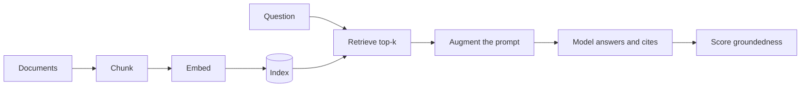

# 📚 12 · RAG: how does an agent answer from your own documents?

> 💡 **TL;DR:** A model knows nothing about your documents. **Retrieval-augmented generation (RAG)** finds the passages that fit a question and puts them into the prompt, so the model answers from them and can cite them. You can build the retrieval yourself, let Foundry's **file search** do it, or own the index in **Azure AI Search**. In every case, score the result with **groundedness**.

| Variant | Who chunks and embeds | Who retrieves | Citation | Deployed in this repo |
|---|---|---|---|---|
| By hand | your code, with `STARK_EMBEDDING_MODEL` | your code: cosine similarity, top-k | `[n]` markers you ask for | ✅ |
| File search | Foundry, in a vector store | Foundry: the model writes the query | `file_citation` | ✅ |
| Azure AI Search | your code | the search service: keyword, vector or hybrid | `url_citation` (agent tool) | optional, `STARK_ENABLE_SEARCH=true` |

Hands-on: [11 · RAG three ways](../notebooks/11_rag_three_ways.ipynb). Helpers: [stark_rag.py](../notebooks/stark_rag.py). The documents: [data/archive](../data/archive).

> ❓ **Not run on a live project yet.** The chapter and the Bicep module follow Microsoft Learn as of 2026-11. The Bicep compiles; nothing was deployed or called. ❓ marks what a live run still has to confirm.

---

## 🗺️ The big picture



The first row (chunk, embed, index) runs once per document. The rest runs for every question.

---

## 1 · Chunk

A chunk is the unit you retrieve and quote. It should hold one topic and make sense alone.

| Choice | Effect |
|---|---|
| cut at headings or sentences | a fact stays with what it is about |
| cut every N characters | a sentence can end up in two chunks, and neither says the whole thing |
| overlap between chunks | a fact near a cut appears in both |
| put the title into the chunk | "Housing bolts" alone could be about a suit; "Arc Reactor Maintenance Manual › Housing bolts" is not |

The chapter uses [`split_by_heading()`](../notebooks/stark_rag.py): one chunk per `## ` section, 25 chunks for five files. Case E cuts every 200 characters instead and splits "Housing bolts ar" from "e tightened to 42 Nm".

File search chunks for you: 800 tokens with 400 overlap by default. A `chunking_strategy` can change that when you add a file ❓ (in the REST reference, not tried here).

## 2 · Embed and index

Each chunk becomes a vector ([models.md](models.md), section on embeddings). The index stores chunk and vector together.

| Variant | Embedding model | Index |
|---|---|---|
| By hand | `STARK_EMBEDDING_MODEL` through [`embeddings_client()`](../notebooks/stark_helpers.py) | two Python lists |
| File search | a model Foundry manages, not your deployment | a vector store (`vector_stores.create`, `files.upload_and_poll`) |
| Azure AI Search | `STARK_EMBEDDING_MODEL`, the same vectors as by hand | an index you define: [`archive_index()`](../notebooks/stark_rag.py) |

Embed the question with the same model as the chunks. Vectors from different models are not comparable.

## 3 · Retrieve

Retrieval ranks the chunks against the question and keeps the best `k`.

| Query type | Finds | Misses |
|---|---|---|
| keyword (BM25) | exact words: names, part numbers, codes | paraphrases |
| vector | the same meaning in other words | rare exact terms that embeddings blur |
| hybrid | both, merged by rank (reciprocal rank fusion) | less than either alone |

By hand, the whole retrieval is three lines:

```python
question_vector = embeddings_client().embeddings.create(model=model("embedding"), input=[question]).data[0].embedding
scored = [(cosine_similarity(question_vector, vector), chunk) for chunk, vector in zip(chunks, chunk_vectors)]
hits = sorted(scored, key=lambda hit: hit[0], reverse=True)[:3]
```

> ⚠️ **Retrieval always returns something.** Ask for the Wi-Fi password and you still get the three closest chunks. Nothing in the retrieval says "no match"; the prompt and the evaluation have to handle it.

`k` is a trade-off. Too small and an answer that needs two chunks gets one (case D). Too large and the prompt fills with text that does not matter.

## 4 · Augment and answer

The retrieved chunks go into the prompt as numbered sources, with rules ([`grounded_prompt()`](../notebooks/stark_rag.py)):

```text
Answer the question using only the sources below. Cite each source you use as [1], [2], ... If the sources do not
contain the answer, say 'That is not in the archive.' and do not guess.

Sources:
[1] arc-reactor-maintenance.md › Housing bolts
...

Question: What torque do the arc reactor housing bolts need?
```

With a managed tool you write no such prompt. The agent's instructions carry the rules, and the tool adds what it retrieved.

| | File search | Azure AI Search tool |
|---|---|---|
| Tool | `FileSearchTool(vector_store_ids=[...])` | `AzureAISearchTool(azure_ai_search=AzureAISearchToolResource(indexes=[AISearchIndexResource(...)]))` |
| Points at | a vector store | a project connection and one index |
| See what was retrieved | `include=["file_search_call.results"]` on `responses.create` ❓ with an agent | ❓ the output item was not seen yet |
| Citation | `file_citation` with `filename` | `url_citation` with the index's URL field |
| Query | the model writes it | `query_type`: `simple`, `vector`, `semantic`, `vector_simple_hybrid`, `vector_semantic_hybrid` (default) |

The chapter sets `query_type=AzureAISearchQueryType.SIMPLE`. The default needs the semantic ranker, which the chapter's index does not configure.

## 5 · Score it

A RAG answer can fail in two places: retrieval brought the wrong context, or the model ignored the right one. Three built-in evaluators tell them apart ([datasets-evals.md](datasets-evals.md)).

| Evaluator | Reads | Fails when |
|---|---|---|
| `builtin.retrieval` | `query`, `context` | the context does not help with the question |
| `builtin.groundedness` | `context`, `response`, `query` | the answer says something the context does not support |
| `builtin.relevance` | `query`, `response` | the answer does not address the question |

Each is judged on a scale of 1 to 5 and passes from 3. The chapter stores one row per case (`query`, `context`, `response`), runs one evaluation per variant, and first scores an answer it knows is wrong (90 Nm against a context that says 42 Nm).

---

## 🔌 The optional Azure AI Search deployment

Off by default. Switch it on with:

```bash
azd env set STARK_ENABLE_SEARCH true
azd provision
```

| What | Where | Detail |
|---|---|---|
| Search service | [search.bicep](../infra/modules/search.bicep) | Basic tier, `disableLocalAuth: true` (Entra ID only, no keys) |
| Project connection | same file | `stark-search`, category `CognitiveSearch`, `authType: 'AAD'` |
| Roles on the service | same file | Search Index Data Contributor and Search Service Contributor for you, the Foundry account identity and the project identity |
| Settings in `.env` | [write_env.py](../scripts/write_env.py) | `STARK_ENABLE_SEARCH`, `STARK_SEARCH_ENDPOINT`, `STARK_SEARCH_CONNECTION` |
| Package | [requirements.txt](../requirements.txt) | `azure-search-documents` |

> ⚠️ **It costs while it exists.** The Basic tier is billed by the hour, used or not; see [pricing](https://azure.microsoft.com/pricing/details/search/). Setting `STARK_ENABLE_SEARCH` back to `false` does not delete the service. Use `azd down`, or delete the search service in the Azure portal.

> ❓ **Not deployed yet.** Unchecked: the shape of the connection resource, the role ids, and whether the agent tool accepts a service without keys. Microsoft Learn's walkthrough enables both keys and roles on the service. If the tool cannot reach the index, try that first ([troubleshooting.md](troubleshooting.md)).

This is a connected tool resource. It is not the **standard agent setup** from [concepts.md](concepts.md), where Foundry stores agent state in your own Azure AI Search: that stays not deployed.

---

## 🙈 Common mistakes

| Mistake | What happens | Do this |
|---|---|---|
| checking only the answer | you cannot tell a retrieval miss from a model mistake | look at the hits first, then the answer |
| no rule for "not in the sources" | the model answers from memory | say what to answer when the sources don't hold it, and test it |
| embedding the question with another model | the ranking is random | one embedding model for chunks and questions |
| re-embedding after every question | slow and costly | embed the chunks once, store the vectors |
| comparing scores between query types | BM25, cosine and fused ranks use different scales | compare ranks, not scores |
| trusting groundedness without context | an empty context makes the score meaningless | check that the rows carry the retrieved text |
| leaving the vector store's files behind | deleting a store keeps its uploaded files | [`delete_vector_store()`](../notebooks/stark_helpers.py) deletes both |

---

## 🔮 What if (not implemented)

- **Semantic ranker.** Azure AI Search can rerank results with a language model, and the agent tool's default `query_type` uses it. The chapter's index has no semantic configuration.
- **Integrated vectorization.** The search service can chunk and embed by itself, with an indexer and a vectorizer. Here your code does both.
- **Foundry IQ.** A managed knowledge base on top of Azure AI Search. Not used.
- **PDFs as the corpus.** `prebuilt-layout` from [foundry-tools.md](foundry-tools.md) turns a PDF into Markdown you could chunk the same way. The archive is Markdown already.
- **Access control per document.** Every reader of the archive sees every chunk. A real system filters by who asks.
