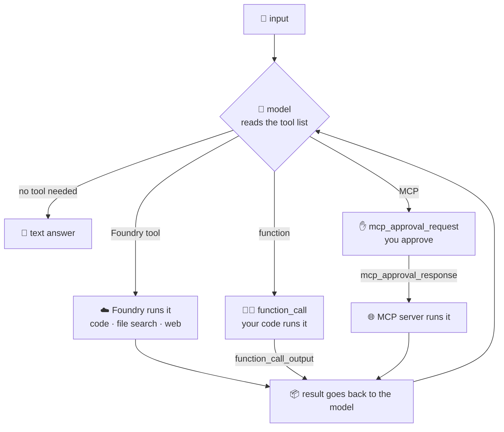
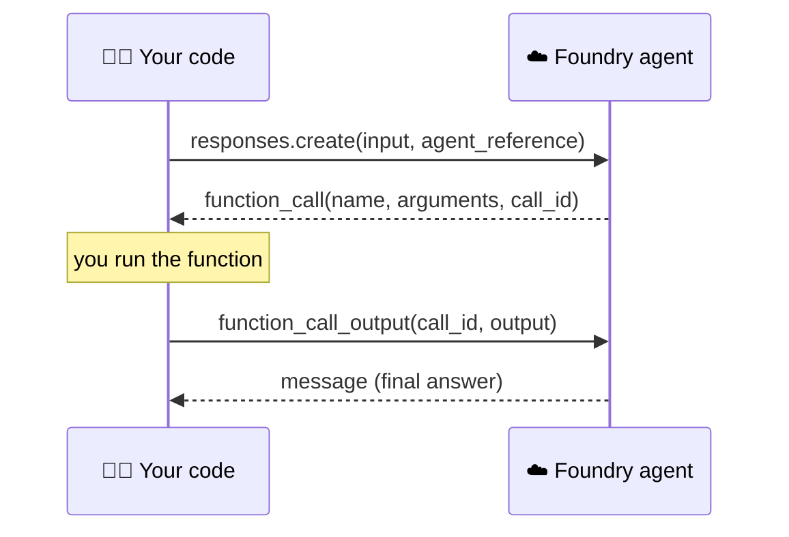
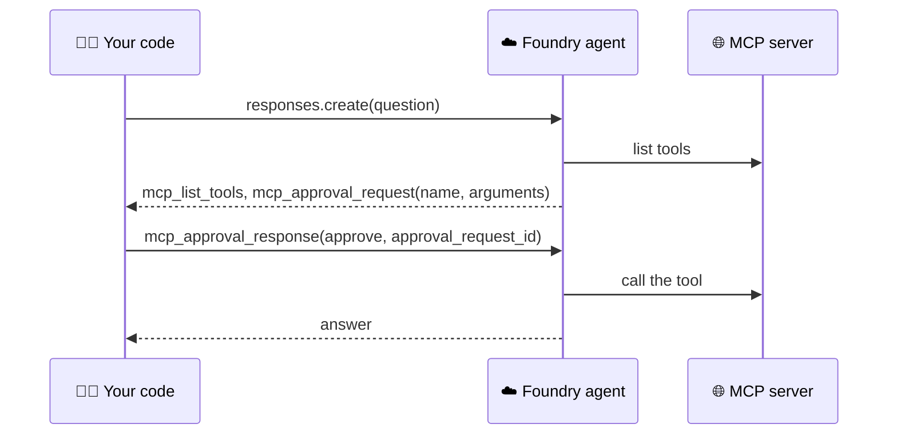

# 🛠️ 7 · How agents use tools

> 💡 **TL;DR:** A tool is a capability listed in the agent **version**. The model sees each tool's name, description and schema and decides **when** to call it. Who **runs** the call depends on the tool: Foundry (code interpreter, file search, web search), your code (function), or a remote server (MCP, A2A). Pick the tool by who should run it, and treat every tool result as untrusted input.

| 🛠️ Tool | 🧰 SDK class | 🏃 Who runs it | 🔎 Item in `response.output` | 📓 Chapter |
|---|---|---|---|---|
| Function | `FunctionTool` | **your code** | `function_call` | [05](../notebooks/05_tools_function_and_builtin.ipynb) |
| Code interpreter | `CodeInterpreterTool` | Foundry sandbox | `code_interpreter_call` | [05](../notebooks/05_tools_function_and_builtin.ipynb) |
| File search | `FileSearchTool` | Foundry (vector store) | `file_search_call` | [05](../notebooks/05_tools_function_and_builtin.ipynb) |
| Web search | `WebSearchPreviewTool` | Foundry | web search call | [05](../notebooks/05_tools_function_and_builtin.ipynb) |
| MCP | `MCPTool` | remote MCP server | `mcp_list_tools`, `mcp_approval_request` | [06](../notebooks/06_mcp_tools.ipynb) |
| A2A | `A2ATool` | remote agent | see [mcp-a2a-skills.md](mcp-a2a-skills.md) | [16](../notebooks/16_vision_a2a_capstone.ipynb) |

> ⚠️ The output items in this document were observed on a real project with throwaway agents. **Web search was not run here**, and A2A and skills are covered in [mcp-a2a-skills.md](mcp-a2a-skills.md).

---

## 🗺️ The big picture



The model can loop: call a tool, read the result, call another. Your code only gets involved for **functions** and **approvals**.

---

## 1️⃣ Declaring tools

Tools are part of the definition, so they are **versioned** with the instructions (see [agents.md](agents.md)):

```python
PromptAgentDefinition(model=..., instructions=..., tools=[fn_tool, CodeInterpreterTool()])
```

- The model only knows a tool by its **name**, **description** and **parameter schema**. A vague description makes the model pick the wrong tool, so write it for the model.
- The instructions say **when** to use tools ("Use tools for facts", "Answer only from the handbook"). Without that line the model may answer from memory.
- Helper [tool_calls()](../notebooks/stark_helpers.py) lists what a response used, for example `function_call:get_arc_reactor_output`.

---

## 2️⃣ Function tool: you run the code



What came back for "Output of the Mark 42?" on this project:

| 🧱 Item | 🔎 Fields that matter |
|---|---|
| `reasoning` | present for reasoning models, ignore it |
| `function_call` | `name`, `arguments` (a **JSON string**), `call_id`, `status` |
| `message` | the final text, after you send the output |

You answer with one item per call, tied to the `call_id`:

```python
{"type": "function_call_output", "call_id": call.call_id, "output": json.dumps(result)}
```

| ✅ Do | 🚫 Don't |
|---|---|
| `json.loads(arguments)`, then validate | trust the arguments: the model (or a prompt injection) chose them |
| loop until no `function_call` is left, and cap the rounds | assume exactly one call |
| `strict=True` and `additionalProperties: False` in the schema | accept extra fields silently |
| return `output` as a **string** (JSON is fine) | return a Python object |
| keep side effects behind your own checks (`transfer_funds` in [chapter 14](../notebooks/14_ultron_guardrails_redteam.ipynb)) | let the model move money |

Code: [chapter 05 section 1](../notebooks/05_tools_function_and_builtin.ipynb), and the invoice agent in [chapter 13](../notebooks/13_senses_document_intelligence.ipynb).

---

## 3️⃣ Code interpreter: Foundry runs Python

No code from you. The model writes Python, Foundry runs it in a sandbox, and the result flows back in the same response.

- Output item: `code_interpreter_call` with the `code` the model wrote and a `container_id`.
- Use it for exact arithmetic, data analysis and charts. Read the generated code before you trust a number: the notebook prints it.
- ⚠️ The model writes the code, so never put secrets in files you hand to the sandbox.

## 4️⃣ File search: ask your own documents

1. Create a **vector store** and upload files (`vector_stores.files.upload_and_poll`).
2. Give the agent `FileSearchTool(vector_store_ids=[...])`.

Observed: the response has a `file_search_call` item with the `queries` the model searched for, and the message carries a `file_citation` annotation with the file name (`workshop-handbook.md`). With the instruction "Answer only from the handbook", a question the file cannot answer gets "The handbook does not list a Wi-Fi password."

The vector store is a **project resource** that outlives the agent. [Chapter 05](../notebooks/05_tools_function_and_builtin.ipynb) deletes it in its clean-up cell.

## 5️⃣ Web search

`WebSearchPreviewTool()` lets the agent search the web for current facts.

> ⚠️ The query leaves the Azure compliance boundary (Bing). Read the data-handling terms before using it with customer data. It may not be available in every region, and the notebook catches that error. Not run here.

---

## 6️⃣ MCP: tools from a remote server

| ⚙️ Setting on `MCPTool` | 🎯 Purpose |
|---|---|
| `server_label` | name of the server inside the agent |
| `server_url` | remote endpoint, reachable from Foundry |
| `allowed_tools` | allow-list: the model never sees the others |
| `require_approval` | `always` (default), `never`, or per-tool lists |
| `project_connection_id` | project connection that holds the credentials |



Observed with the public Microsoft Learn server (`require_approval="always"`):

| 🧱 Item | 🔎 What it held |
|---|---|
| `mcp_list_tools` | the server's tools: `microsoft_docs_search`, `microsoft_code_sample_search`, `microsoft_docs_fetch` |
| `mcp_approval_request` | `server_label: learn`, `name: microsoft_docs_search`, `arguments: {"query": "..."}` |

Approve with `mcp_approval_response` and send it with `previous_response_id`. [ask_agent()](../notebooks/stark_helpers.py) runs that loop and **denies by default**:

```python
ask_agent(agent, "question", approve=lambda item: item.server_label == "learn")
```

| 🛡️ Practice | 💡 Why |
|---|---|
| `allowed_tools` | smaller attack surface, fewer wrong tool picks |
| approval for anything that writes | a human sees tool and arguments first |
| credentials in a **project connection** | the definition and traces carry no secrets |
| `require_approval="never"` only for read-only tools you trust | see [stark-ops.yaml](../agents/stark-ops.yaml): three read tools of our own server |

> 💡 **List before you restrict.** Ask the server for its tools first (`session.list_tools()` with the `mcp` package, as in [chapter 06](../notebooks/06_mcp_tools.ipynb)), or read the `mcp_list_tools` item of the first response. Then put only the names you need into `allowed_tools`.

Our own server: [src/stark-mcp](../src/stark-mcp/function_app.py), details in [mcp-a2a-skills.md](mcp-a2a-skills.md).

---

## 7️⃣ A2A and skills

- **A2A** makes another agent a tool: `A2ATool(a2a_version=V1_0, project_connection_id=...)`. The calling agent in [chapter 16](../notebooks/16_vision_a2a_capstone.ipynb) combines it with an `MCPTool`.
- **Skills** are not tools: they add procedures (a `SKILL.md`) and can be attached to a toolbox ([chapter 07](../notebooks/07_agent_skills.ipynb)) 🧪 preview.

Both are explained in [mcp-a2a-skills.md](mcp-a2a-skills.md).

---

## 8️⃣ Choosing and securing tools

| 🎯 You need | 🛠️ Use | ⚠️ Watch for |
|---|---|---|
| your own logic, database, internal API | function | validate arguments, you own the side effects |
| exact maths, tables, charts | code interpreter | read the generated code |
| answers from your documents | file search | the vector store lives on after the agent |
| current public facts | web search | data leaves the Azure boundary |
| tools shared by many agents | MCP | untrusted descriptions and results |
| another team's agent | A2A | identity and role assignment |

> 🚫 **Tool output is untrusted input.** Text from a file, a web page or an MCP server flows into the model's context, so it can carry instructions (indirect prompt injection). Give each agent the **fewest tools** it needs, approve risky calls, and test the attack on purpose in [chapter 14](../notebooks/14_ultron_guardrails_redteam.ipynb). Background: [guardrails.md](guardrails.md).

---

## 🪜 Walkthrough: add one tool to an agent

Pick the simplest tool, **code interpreter**, then see where a function differs. Code: [chapter 05](../notebooks/05_tools_function_and_builtin.ipynb).

**Step 1. Declare the tool in the version.**

```python
from azure.ai.projects.models import PromptAgentDefinition, CodeInterpreterTool
agent = project().agents.create_version(
    agent_name="tools-demo",
    definition=PromptAgentDefinition(model=model("chat"),
        instructions="Use the code interpreter for any calculation.", tools=[CodeInterpreterTool()]))
```

**Step 2. Ask something that needs it.** `oai.responses.create(input="What is 17 factorial?", extra_body=agent_ref(agent))`.

**Step 3. Prove the tool ran.** [`tool_calls(resp)`](../notebooks/stark_helpers.py) lists the items used. Look for `code_interpreter_call` and read its `code`.

**Step 4. For a function tool, add your half.** The response contains a `function_call`. You run it and send back `function_call_output` (section 2 shows the item).

**Step 5. Clean up** what the tool created (vector stores, agents).

---

## 🙈 Common mistakes

| 🚨 Mistake | 💥 What happens | ✅ Do this |
|---|---|---|
| vague tool description | the model picks the wrong tool or none | write the description for the model |
| no "use tools for facts" in the instructions | the model answers from memory | say **when** to use tools |
| `output` as a Python object in `function_call_output` | the call fails | return a **string** (`json.dumps(...)`) |
| trusting `arguments` | a prompt injection can choose them | `json.loads`, then validate |
| not capping the tool loop | endless rounds and cost | cap the rounds (`max_rounds` in [`ask_agent()`](../notebooks/stark_helpers.py)) |
| leaving the vector store behind | it outlives the agent and keeps data | delete it in the clean-up cell |
| `require_approval="never"` on a tool that writes | no human sees the call | keep approval for anything that changes state |
