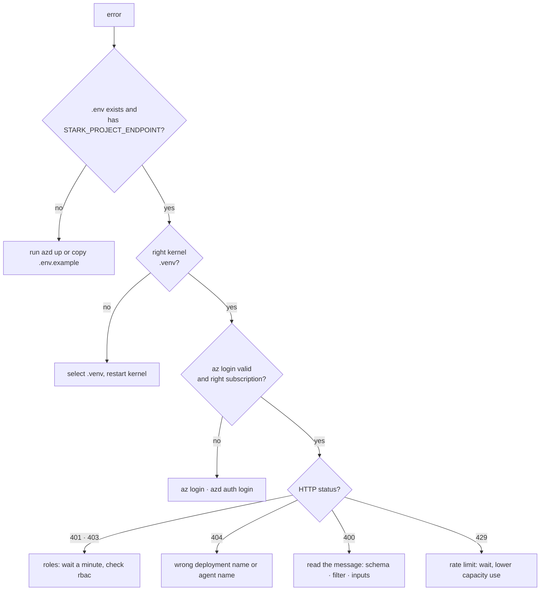

# 🩺 Troubleshooting: the errors you will most likely meet

> 💡 **TL;DR:** Most problems are one of five things: a **missing `.env`**, the **wrong Python kernel**, a **role that has not propagated yet**, a **model that does not exist in your region**, or **telemetry that has not arrived yet**. Find your symptom below. Each row says why it happens, then how to fix it.

| Area | Section |
|---|---|
| Setup and deploy | section 1 |
| Login and permissions | section 2 |
| Agents and tools | section 3 |
| Traces and KQL | section 4 |
| Evaluations, guardrails, documents | section 5 |
| Workflows | section 6 |

> ⚠️ Rows marked 🔎 are **likely causes** from how Foundry and Azure normally behave. The others were hit while building this repo. If you find a new one, open an issue.

---

## 🗺️ How to debug in order

---

## 1 · Setup and deploy

| Symptom | Why | Fix |
|---|---|---|
| `STARK_PROJECT_ENDPOINT is not set. Run azd up ...` | no `.env`, or an empty value. This is the friendly error from [`cfg()`](../notebooks/stark_helpers.py) | run `azd up` (it writes `.env`), or copy [.env.example](../.env.example) to `.env` and fill it |
| `ModuleNotFoundError` in a notebook | the notebook uses another Python than your `.venv` | pick the `.venv` kernel, run `pip install -r requirements.txt`, restart the kernel |
| `NOT FOUND in this region/subscription` from `check_models.py` | the model is not offered to your subscription in that region | choose another region or model and edit [stark.json](../infra/config/stark.json) |
| `VERSION MISMATCH` | the version in `stark.json` is not available any more | use a version the script lists |
| `azd up` fails on model deployment with a quota message 🔎 | not enough quota for the `capacity` in `stark.json` | lower `capacity`, free quota, or use another region |
| `azd up` fails on a role assignment 🔎 | your account may not create role assignments | ask for Owner, or User Access Administrator on the subscription |
| `azd` complains about extensions or `agent.yaml` | the Foundry extensions are missing or too old/new | `azd extension install microsoft.foundry`. [azure.yaml](../azure.yaml) pins the tested versions |
| deploy fails only on `azure.ai.agent` services | the extension is missing or has a different version than [azure.yaml](../azure.yaml) pins, or you lack *Foundry Project Manager* | infrastructure and `.env` are done, so every chapter except 09 and section 6 of 15 works. Run `python scripts/grant_hosted_role.py`, and compare with `azd ai agent init` ([hosted-agents.md](hosted-agents.md)) |
| `azd up` again says the name is taken | the old Foundry account is soft-deleted | `azd down --purge`, or purge the account in the portal |
| `.venv\Scripts\activate` is blocked on Windows 🔎 | PowerShell script policy | `Set-ExecutionPolicy -Scope CurrentUser RemoteSigned`, or use the VS Code kernel picker |

---

## 2 · Login and permissions

| Symptom | Why | Fix |
|---|---|---|
| `DefaultAzureCredential failed to retrieve a token` | no valid login for the credential chain | `az login` and `azd auth login`, restart the kernel |
| right after `azd up`: `401` or `403` (`PermissionDenied`) | role assignments take a minute or more to apply | wait, restart the kernel, retry |
| `403` that stays | your user lacks *Azure AI User* on the resource | check [rbac.bicep](../infra/modules/rbac.bicep); in the portal open the resource → Access control (IAM) |
| document calls fail with `403` 🔎 | *Cognitive Services User* is missing | same place. [foundry-tools.md](foundry-tools.md) |
| `az account show` shows another subscription | you logged in to a different tenant or subscription | `az account set --subscription <id>`; `azd env set AZURE_SUBSCRIPTION_ID <id>` |
| an API key is asked for | local auth is **disabled** on purpose ([foundry.bicep](../infra/modules/foundry.bicep)) | use `DefaultAzureCredential`, not a key |
| `404` on `responses.create` 🔎 | the `model` is not a **deployment name** | use the name from `deployments.list()` (chapter 00), not the model name |
| embeddings call returns `404` | the project route has no `/embeddings` | use [`embeddings_client()`](../notebooks/stark_helpers.py) |

---

## 3 · Agents and tools

| Symptom | Why | Fix |
|---|---|---|
| the run stops with an `mcp_approval_request` | MCP tools default to `require_approval="always"` | answer with `mcp_approval_response`. [`ask_agent()`](../notebooks/stark_helpers.py) does it and **denies by default**: pass `approve=lambda item: ...` ([tools.md](tools.md)) |
| a `function_call` and no answer | Foundry waits for **your** function result | run the function, send `function_call_output` with the same `call_id`, loop until none is left |
| `400 invalid_payload` mentioning inputs | the request breaks the agent's `structured_inputs` schema | `Required inputs [x] not provided`, `Unknown inputs [x]`, or a wrong type. See [agents.md](agents.md) |
| agent answers from memory, tool not used | instructions never say *when* to use the tool, or the tool description is vague | write the description for the model, add "use tools for facts" ([tools.md](tools.md)) |
| agent version 2 appears instead of a replacement | `create_version` with an existing name **adds** a version | expected. Delete old versions with [`delete_agent()`](../notebooks/stark_helpers.py) |
| agents from earlier runs clutter **Build → Agents** | a notebook was stopped before its clean-up cell | run the clean-up cell, or delete the agent in the portal |
| skills have no effect on a prompt agent | `skills=[...]` is accepted but needs the Copilot harness | see [mcp-skills.md](mcp-skills.md). The harness is a gated preview |
| `not enabled for this subscription` | a gated preview feature | cannot be fixed in code. Skip that section |
| MCP call returns an auth error | the project connection `stark-mcp` is missing | `azd deploy` runs [connect_mcp.py](../scripts/connect_mcp.py) in the *postdeploy* hook. Run it again after the function exists |
| A2A call uses the wrong protocol version | unrequested version defaults to preview **v0.3** | use the v1.0 card or the `A2A-Version: 1.0` header ([capstone.md](capstone.md)) |
| A2A call gets `403` | caller lacks *Foundry Agent Consumer* on the target | assign the role, wait a minute |
| web search tool errors | not available in every region | the notebook catches it. Expected |

---

## 4 · Traces and KQL

| Symptom | Why | Fix |
|---|---|---|
| no traces for direct model calls | your process sends traces only after `configure_azure_monitor` (agent calls are traced server-side) | run the setup cell in [notebook 03](../notebooks/03_tracing_and_monitoring.ipynb) **before** the SDK calls, and wait 2–5 minutes |
| traces are empty just after a call | ingestion takes **2–5 minutes** | wait. [`kql_wait()`](../notebooks/stark_helpers.py) retries for you |
| KQL returns no rows | table or attribute names differ between SDK versions | run `AppDependencies \| take 5` and read `Properties` ([observability.md](observability.md)) |
| chapter 03 calls are missing in the Foundry **Traces** tab | they are model calls, **no agent** | look in Application Insights → Transaction search. Foundry shows traces per agent from chapter 04 on ([portal-tour.md](portal-tour.md)) |
| KQL says access denied 🔎 | *Log Analytics Reader* missing or not yet applied | check [rbac.bicep](../infra/modules/rbac.bicep), wait a minute |
| prompts and answers show in traces | content recording is on | intended for the workshop only. Turn off `AZURE_TRACING_GEN_AI_CONTENT_RECORDING_ENABLED` for real data |

---

## 5 · Evaluations, guardrails, documents

| Symptom | Why | Fix |
|---|---|---|
| evaluation run seems stuck | runs are asynchronous and judge calls take time | [`wait_eval_run()`](../notebooks/stark_helpers.py) polls (30 minute default limit) |
| `assert_pass_rate` raises | the pass rate is below the threshold | open the item **reasons** ([`eval_scores()`](../notebooks/stark_helpers.py)). Fix the agent, run again ([datasets-evals.md](datasets-evals.md)) |
| trace evaluation fails | it is **preview** and needs a recent `azure-ai-projects` | `pip install -U azure-ai-projects` |
| `400 content_filter` | a guardrail blocked the request | expected in chapter 14. See [guardrails.md](guardrails.md) |
| guardrail creation via ARM fails | control names or API versions changed | create it in **Build → Guardrails** and assign it there |
| Content Understanding fails | it needs **your** model deployments | `azd env set STARK_ENABLE_CU true && azd provision` ([foundry-tools.md](foundry-tools.md)) |
| invoice fields have low confidence | the scan is poor or the layout is unusual | route to a human and check arithmetic in code ([foundry-tools.md](foundry-tools.md)) |

---

## 6 · Workflows

| Symptom | Why | Fix |
|---|---|---|
| `PowerFx is not available (dotnet runtime not installed)` | the declarative YAML needs .NET, **or** the .NET CPU architecture differs from Python's (e.g. x64 Python on Windows-on-ARM, `error 0xc1`) | install .NET; if it is installed, point `DOTNET_ROOT` to the matching install. [`fix_dotnet_for_powerfx()`](../notebooks/stark_helpers.py) does it, then **restart the kernel** ([workflows.md](workflows.md)) |
| handoff `build()` refuses a participant | `require_per_service_call_history_persistence=True` is missing | set it on **every** agent |
| a second handoff run continues the first | a workflow keeps its conversation between runs | build a fresh workflow per run |
| Agent Framework import or API errors | the packages move quickly | pin versions of `agent-framework*` once your run works |

---

## 🆘 Still stuck?

1. Copy the **full** error and the HTTP status.
2. Check `pip show azure-ai-projects` against [requirements.txt](../requirements.txt).
3. Compare with the Microsoft Learn page linked at the end of the matching doc.
4. Open an issue with the chapter number, the cell and the error.
