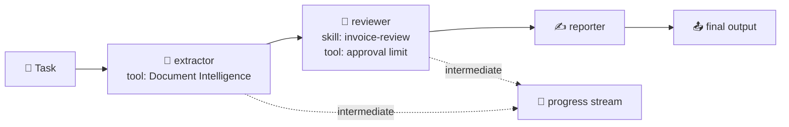

# 🔀 Workflows: from one agent to a plan

> 💡 **TL;DR:** A workflow splits a job into steps and defines who acts next. Foundry's recommended way is **Microsoft Agent Framework**: **sequential**, **concurrent**, **handoff**, **group chat** and **magentic** orchestrations, in code or **declarative YAML**. They run in your process; wrap one with `workflow.as_agent(...)` and host it (chapter 09) to run it in Foundry. The visual workflow designer in the portal is being retired (support ends after 2026-12-01); YAML workflows keep running as hosted agents.

| 🔀 Pattern | 🧩 Shape | 🧰 Builder | 🎯 Example in chapter 15 |
|---|---|---|---|
| Sequential | A → B → C | `SequentialBuilder` | invoice pipeline |
| Group chat | star with a speaker selector | `GroupChatBuilder` | review board |
| Handoff | agents route to each other, user in the loop | `HandoffBuilder` | workshop support (built only) |
| Declarative | the flow in YAML | `WorkflowFactory` | [invoice-pipeline.yaml](../workflows/invoice-pipeline.yaml) |

Hands-on: [notebooks/15_workflows.ipynb](../notebooks/15_workflows.ipynb).

---

## 🗺️ The big picture

---

## 1️⃣ Sequential

Each agent consumes the previous agent's conversation (or only its response with `chain_only_agent_responses=True`). `intermediate_output_from=[...]` surfaces earlier steps. The reviewer gets the **invoice-review skill** as instructions, and the decision comes from a limit **tool**, not from the model's guess.

## 2️⃣ Group chat

All agents see one shared conversation. A `selection_func` (or an `orchestrator_agent`) picks the next speaker; `termination_condition` stops it. Good for review boards; costs grow with every turn.

## 3️⃣ Handoff

Agents declare who they may hand over to (`add_handoff`). When an agent answers without handing off, control returns to the user, so a handoff run is interactive. Use autonomous mode only with turn limits.

## 4️⃣ Declarative YAML

`kind: Workflow`, a trigger, and `InvokeAzureAgent` actions that name agents. Python registers the agents (`factory.register_agent`), the YAML only holds the flow, so reviews and diffs are easy.

## 5️⃣ Running in Foundry

`workflow.as_agent(name=...)` makes a workflow look like an agent; `ResponsesHostServer` hosts it; `azd deploy` ships it. Then evaluation, tracing and A2A work as for any agent.

> ⚠️ **Unverified:** Agent Framework APIs move quickly (`agent-framework`, `agent-framework-foundry`, `agent-framework-declarative`); pin versions once your run works. The handoff run and the declarative YAML run were not executed here.
