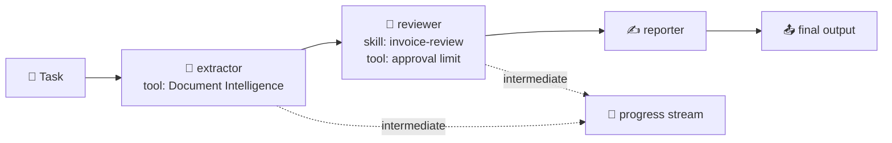
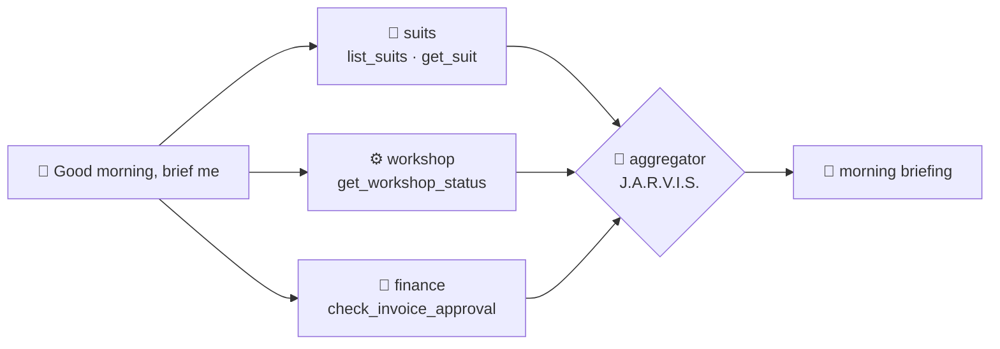

# 🔀 14 · Workflows: from one agent to a plan

> 💡 **TL;DR:** A workflow splits a job into steps and defines who acts next. Foundry's recommended way is **Microsoft Agent Framework**: **sequential**, **concurrent**, **handoff**, **group chat** and **magentic** orchestrations, in code or **declarative YAML**. They run in your process; host one natively with `ResponsesHostServer(workflow=...)` as a hosted agent (chapter 09) to run it in Foundry. The visual workflow designer in the portal is being retired (support ends after 2026-12-01); YAML workflows keep running as hosted agents.

| 🔀 Pattern | 🧩 Shape | 🧰 Builder | 🎯 Example in chapter 15 |
|---|---|---|---|
| Sequential | A → B → C | `SequentialBuilder`, or `WorkflowBuilder` with `add_edge` (the notebook shows both, the hosted agent uses the second) | invoice pipeline |
| Concurrent | same input to all at once, then merge | `ConcurrentBuilder` | morning briefing |
| Group chat | star with a speaker selector | `GroupChatBuilder` | review board |
| Handoff | agents route to each other, user in the loop | `HandoffBuilder` | workshop support (run with scripted turns) |
| Declarative | the flow in YAML | `WorkflowFactory` | [invoice-pipeline.yaml](../workflows/invoice-pipeline.yaml) |

Hands-on: [notebooks/15_workflows.ipynb](../notebooks/15_workflows.ipynb).

---

## 🗺️ The big picture



---

## 🧭 Who decides what runs next?

A workflow is a **graph**: boxes (agents or plain code) joined by **edges**. `add_edge(A, B)` means "when A finishes, B runs". The important question for each pattern is **who picks the path**:

| 🔀 Pattern | 🧭 Who picks what runs next | 🎯 So the path is |
|---|---|---|
| Sequential | **your code**: fixed edges, in the order you wrote them | the same every time |
| Concurrent | **your code**: fan out to all, then the aggregator | the same every time |
| Group chat | a **selector function** (or an orchestrator LLM) picks the next speaker | rule-based or model-based |
| Handoff | the **agents** decide to pass control, only along the hand-offs you allowed | decided at run time, within limits |

In the hosted invoice pipeline the order is written out in [main.py](../src/invoice-workflow/main.py):

```python
WorkflowBuilder(start_executor=extractor, output_from=[final_message])
    .add_edge(extractor, reviewer)        # always after the extractor
    .add_edge(reviewer, reporter)
    .add_edge(reporter, final_message)
```

Inside each box a model decides what to **say** and which **tools** to call. It never decides which box runs next, so every request takes the same path, which is cheap, predictable and easy to test. `SequentialBuilder(participants=[a, b, c])` builds the same chain from the list order, and `WorkflowBuilder` with `add_edge` writes it out edge by edge. The notebook shows both, and the hosted project uses the second (section 1 compares the two).

To make the path depend on the data, **your code** adds a condition to an edge, for example `add_edge(extractor, reviewer, condition=lambda r: ...)`. `add_edge` accepts a `condition` function, and the builder also has switch-case and fan-out edge groups. Conditional edges were **not run here**.

> 💡 Prefer fixed edges for pipelines with a known process. Reach for group chat or handoff only when the right next step genuinely cannot be known in advance, because every model-chosen step costs tokens and makes runs harder to repeat.

---

## 1️⃣ Sequential

There are **two ways to build the same chain**. Both give a fixed order, and in a test both produced the same answer:

| 🧰 Builder | 🧩 How the order is written | 📍 Used in |
|---|---|---|
| `SequentialBuilder(participants=[a, b, c])` | the **list order** is the run order (a shortcut) | notebook section 1, first runs |
| `WorkflowBuilder(...).add_edge(a, b).add_edge(b, c)` | every **edge written out** (the order is hard-wired); the general builder that also does conditions, fan-out and custom code steps, and lets you set what each step sees (`AgentExecutor(..., context_mode=...)`) | notebook section 1 ("wired by hand"), and the hosted [invoice-workflow](../src/invoice-workflow/main.py) |

Each agent consumes the previous agent's conversation (or only its response with `chain_only_agent_responses=True`). `intermediate_output_from=[...]` surfaces earlier steps. The reviewer gets the **invoice-review skill** as instructions, and the decision comes from a limit **tool**, not from the model's guess.

> ℹ️ A custom last step that returns plain text, needed for hosting (section 6), can be added to either: a `SequentialBuilder` chain whose last participant is such a step also hosted fine in a local test. The hosted project uses `WorkflowBuilder` to show the explicit wiring, not because `SequentialBuilder` cannot do it.

## 2️⃣ Concurrent

All participants get the **same input at the same time**, and an **aggregator** merges what they return. In [chapter 15](../notebooks/15_workflows.ipynb) three specialists (`suits`, `workshop`, `finance`) check the workshop in parallel, each through the `stark-mcp` tools, and J.A.R.V.I.S. writes the morning briefing.



| 🔧 Detail | 💡 Why |
|---|---|
| `ConcurrentBuilder(participants=[...]).with_aggregator(brief)` | the callback gets every specialist's `AgentExecutorResponse` once all are done; its return value is the output |
| `client.get_mcp_tool(..., project_connection_id="stark-mcp", allowed_tools=[...])` | a **hosted** MCP tool: Foundry calls the server with the connection's key, and each specialist sees only its own tools |
| the specialists never see each other's answers | only the aggregator merges them, so a bad report cannot steer another specialist |
| time is about the slowest specialist plus the merge | not the sum of all four (8 seconds locally in a test run) |

The `stark-mcp` data is static, so the briefing facts are the same every morning, apart from J.A.R.V.I.S.'s wording.

## 3️⃣ Group chat

All agents see one shared conversation. A `selection_func` (or an `orchestrator_agent`) picks the next speaker; `termination_condition` stops it. Good for review boards; costs grow with every turn.

## 4️⃣ Handoff

Agents declare who they may hand over to (`add_handoff`). When an agent answers without handing off, control returns to the user, so a handoff run is interactive: the workflow emits a `request_info` event (`HandoffAgentUserRequest`) and waits for `create_response(text)` or `terminate()`. [Chapter 15](../notebooks/15_workflows.ipynb) plays a list of user messages through it. Use autonomous mode only with turn limits.

| ⚙️ Setting | 🎯 Why |
|---|---|
| `require_per_service_call_history_persistence=True` on **every** agent | `build()` refuses participants without it |
| `enable_return_to_previous(False)` | the start agent routes every user message, not only the first |
| a fresh workflow per run | a workflow keeps its conversation between runs |

## 5️⃣ Declarative YAML

`kind: Workflow`, a trigger, and `InvokeAzureAgent` actions that name agents. Python registers the agents (`factory.register_agent`), the YAML only holds the flow, so reviews and diffs are easy.

> ⚠️ **Needs .NET.** Expressions such as `=System.ConversationId` are evaluated by PowerFx, which runs on .NET through `pythonnet`. The error `PowerFx is not available (dotnet runtime not installed)` also appears when `dotnet` **is** installed but its CPU architecture differs from Python's. Seen here: an **x64 Python on Windows-on-ARM** cannot load the **ARM64** .NET in `C:\Program Files\dotnet` (`error 0xc1`). Setting `DOTNET_ROOT` to the x64 install (`C:\Program Files\dotnet\x64`) fixes it. [`fix_dotnet_for_powerfx()`](../notebooks/stark_helpers.py) does that, and chapter 15 calls it before anything else. Restart the kernel after changing the environment.

## 6️⃣ Running in Foundry

Foundry's own workflow designer and in-portal workflow execution end on **2026-12-01**, and its YAML (a different dialect from Agent Framework's) is rejected as an Agent Framework workflow. The replacement is to host an Agent Framework workflow as a **hosted agent**. Two projects do that for chapter 15: [src/invoice-workflow](../src/invoice-workflow/main.py) (sequential) and [src/morning-briefing](../src/morning-briefing/main.py) (concurrent).

| 🔧 Detail | 💡 Why |
|---|---|
| `ResponsesHostServer(workflow=factory, parse_response=...)` | native workflow hosting. `workflow.as_agent()` through `agent=` is deprecated, because a `WorkflowAgent` keeps state between runs |
| the factory returns a fresh workflow per request | workflows keep their conversation, so one instance must not serve several users |
| `default_options={"store": False}` on the agents | the host keeps the history |
| the workflow's output is **plain text** (a final executor, or the aggregator's return value) | the host rejects raw streamed model updates as workflow output (`cannot checkpoint unfinished provider background output`) |
| `python scripts/grant_agent_role.py` after deploying `invoice-workflow` | the container runs as its own identity and needs *Cognitive Services User* for Document Intelligence. `morning-briefing` needs nothing extra: its MCP calls use the project connection |

Both deployed agents were called through their Responses endpoints (about 30–40 seconds per call; the first call after idle can answer `proxy_timeout`, so call again). They show up under **Agents** like `jarvis-hosted`. Whether the portal draws the workflow graph for it was **not checked**.

> ⚠️ **Unverified:** Agent Framework APIs move quickly (`agent-framework`, `agent-framework-foundry`, `agent-framework-declarative`); pin versions once your run works. The hosted `invoice-workflow` and `morning-briefing` were deployed and called on a real project. The handoff run was executed here with scripted turns (routes can vary because the model decides). The declarative YAML run was executed too, after fixing a .NET architecture mismatch (see section 5).

---

## 🪜 Walkthrough: from one agent to a pipeline

Code in [chapter 15](../notebooks/15_workflows.ipynb).

**Step 1. Start with the job on paper.** "Read invoice, review against a limit, write a report" is three roles, so three agents.

**Step 2. Give each agent one task.** The extractor gets the Document Intelligence tool, the reviewer gets the skill and the limit tool, the reporter gets only instructions.

**Step 3. Chain them.** `SequentialBuilder` passes each agent's output on (the notebook also wires the same chain by hand with `WorkflowBuilder`). Add `intermediate_output_from=[...]` to watch progress.

**Step 4. Run and read the stream.** Look at what each step produced before you trust the final text.

**Step 5. Pick another shape when needed.** Several opinions: group chat. Routing to specialists with a user in the loop: handoff. A flow in a reviewable file: declarative YAML.

**Step 6. Host it.** `ResponsesHostServer(workflow=build_workflow, parse_response=...)`, deployed with `azd deploy` ([src/invoice-workflow](../src/invoice-workflow)).

---

## 🙈 Common mistakes

| 🚨 Mistake | 💥 What happens | ✅ Do this |
|---|---|---|
| a workflow for a one-step job | extra cost and latency | use a single agent |
| letting the model decide an approval | a guess decides money | use a tool with a hard limit |
| group chat without a stop rule | cost grows with every turn | set `termination_condition` |
| reusing a handoff workflow | it keeps the old conversation | build a fresh one per run |
| autonomous handoff without a turn limit | it can loop | cap the turns |
| not pinning `agent-framework*` | an upgrade can break the notebook | pin once it works |
