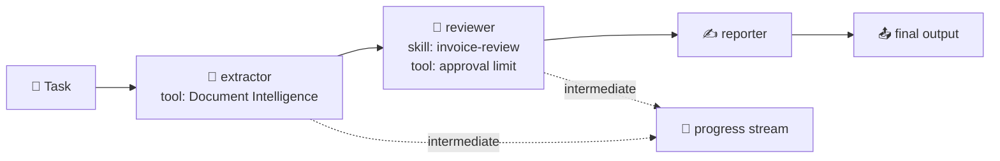

# 🔀 Workflows: from one agent to a plan

> 💡 **TL;DR:** A workflow splits a job into steps and defines who acts next. Foundry's recommended way is **Microsoft Agent Framework**: **sequential**, **concurrent**, **handoff**, **group chat** and **magentic** orchestrations, in code or **declarative YAML**. They run in your process; wrap one with `workflow.as_agent(...)` and host it (chapter 09) to run it in Foundry. The visual workflow designer in the portal is being retired (support ends after 2026-12-01); YAML workflows keep running as hosted agents.

| 🔀 Pattern | 🧩 Shape | 🧰 Builder | 🎯 Example in chapter 15 |
|---|---|---|---|
| Sequential | A → B → C | `SequentialBuilder` | invoice pipeline |
| Group chat | star with a speaker selector | `GroupChatBuilder` | review board |
| Handoff | agents route to each other, user in the loop | `HandoffBuilder` | workshop support (run with scripted turns) |
| Declarative | the flow in YAML | `WorkflowFactory` | [invoice-pipeline.yaml](../workflows/invoice-pipeline.yaml) |

Hands-on: [notebooks/15_workflows.ipynb](../notebooks/15_workflows.ipynb).

---

## 🗺️ The big picture

---

## 1️⃣ Sequential

Each agent consumes the previous agent's conversation (or only its response with `chain_only_agent_responses=True`). `intermediate_output_from=[...]` surfaces earlier steps. The reviewer gets the **invoice-review skill** as instructions, and the decision comes from a limit **tool**, not from the model's guess.

## 2️⃣ Group chat

All agents see one shared conversation. A `selection_func` (or an `orchestrator_agent`) picks the next speaker; `termination_condition` stops it. Good for review boards; costs grow with every turn.

## 3️⃣ Handoff

Agents declare who they may hand over to (`add_handoff`). When an agent answers without handing off, control returns to the user, so a handoff run is interactive: the workflow emits a `request_info` event (`HandoffAgentUserRequest`) and waits for `create_response(text)` or `terminate()`. [Chapter 15](../notebooks/15_workflows.ipynb) plays a list of user messages through it. Use autonomous mode only with turn limits.

| ⚙️ Setting | 🎯 Why |
|---|---|
| `require_per_service_call_history_persistence=True` on **every** agent | `build()` refuses participants without it |
| `enable_return_to_previous(False)` | the start agent routes every user message, not only the first |
| a fresh workflow per run | a workflow keeps its conversation between runs |

## 4️⃣ Declarative YAML

`kind: Workflow`, a trigger, and `InvokeAzureAgent` actions that name agents. Python registers the agents (`factory.register_agent`), the YAML only holds the flow, so reviews and diffs are easy.

> ⚠️ **Needs .NET.** Expressions such as `=System.ConversationId` are evaluated by PowerFx, which runs on .NET through `pythonnet`. The error `PowerFx is not available (dotnet runtime not installed)` also appears when `dotnet` **is** installed but its CPU architecture differs from Python's. Seen here: an **x64 Python on Windows-on-ARM** cannot load the **ARM64** .NET in `C:\Program Files\dotnet` (`error 0xc1`). Setting `DOTNET_ROOT` to the x64 install (`C:\Program Files\dotnet\x64`) fixes it. [`fix_dotnet_for_powerfx()`](../notebooks/stark_helpers.py) does that, and chapter 15 calls it before anything else. Restart the kernel after changing the environment.

## 5️⃣ Running in Foundry

`workflow.as_agent(name=...)` makes a workflow look like an agent; `ResponsesHostServer` hosts it; `azd deploy` ships it. Then evaluation, tracing and A2A work as for any agent.

> ⚠️ **Unverified:** Agent Framework APIs move quickly (`agent-framework`, `agent-framework-foundry`, `agent-framework-declarative`); pin versions once your run works. The handoff run was executed here with scripted turns (routes can vary because the model decides). The declarative YAML run was executed too, after fixing a .NET architecture mismatch (see section 4).

---

## 🪜 Walkthrough: from one agent to a pipeline

Code in [chapter 15](../notebooks/15_workflows.ipynb).

**Step 1. Start with the job on paper.** "Read invoice, review against a limit, write a report" is three roles, so three agents.

**Step 2. Give each agent one task.** The extractor gets the Document Intelligence tool, the reviewer gets the skill and the limit tool, the reporter gets only instructions.

**Step 3. Chain them.** `SequentialBuilder` passes each agent's output on. Add `intermediate_output_from=[...]` to watch progress.

**Step 4. Run and read the stream.** Look at what each step produced before you trust the final text.

**Step 5. Pick another shape when needed.** Several opinions: group chat. Routing to specialists with a user in the loop: handoff. A flow in a reviewable file: declarative YAML.

**Step 6. Host it.** `workflow.as_agent(...)` plus `ResponsesHostServer`, deployed with `azd deploy` ([src/invoice-workflow](../src/invoice-workflow)).

---

## 🙈 Common mistakes

| 🚨 Mistake | 💥 What happens | ✅ Do this |
|---|---|---|
| a workflow for a one-step job | extra cost and latency | use a single agent |
| letting the model decide an approval | a guess decides money | use a tool with a hard limit |
| group chat without a stop rule | cost grows with every turn | set `termination_condition` |
| reusing a handoff workflow | it keeps the old conversation | build a fresh one per run |
| autonomous handoff without a turn limit | it can loop | cap the turns |
| not pinning `agent-framework*` | an upgrade can break the notebook | pin once it works |
